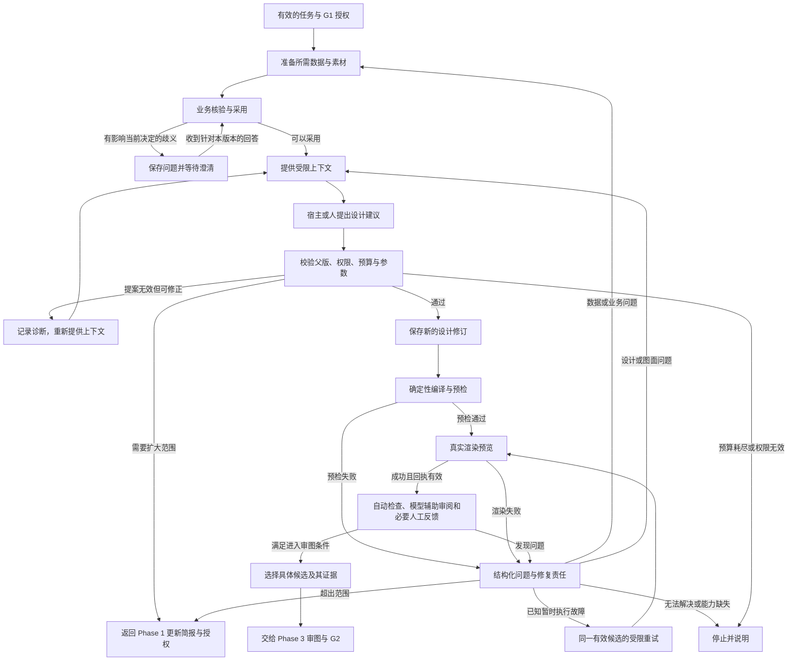

# Phase 2 设计与实现说明

> 通用运行框架 + 业务检查与执行组件 + 受约束提案 + 可追溯的设计修订

更新日期：2026-11-12（Asia/Shanghai）

状态：**目标技术设计与实现约束；不是已完成实现、已通过测试或已开放能力的声明。**

## 一、文档定位与使用阶段

本文细化 [总体流程](制图智能体总体流程.md) 中的 **Phase 2：数据处理、业务核验与设计迭代**，说明它如何作为通用框架运行，如何与当前代码衔接，以及怎样验证实现没有绕过权限、版本和证据约束。

**Phase 2 不等于实施阶段 A2。** 前者是一次制图任务的工作阶段；后者只是建设数据与素材处理能力的工程阶段。完整 Phase 2 需要 A1 的控制基础、A2 的数据处理、A3 的业务规则和 A4 的部分构图能力。

### 1.1 在实施计划中的位置

| 实施阶段 | 本文的作用 | 必须形成的结果 |
|---|---|---|
| A0 | 设计评审与合同确认的前置参考 | 确定对象身份、状态转移、提案边界、预算和恢复规则，不能等写完代码再补 |
| A1.1 | 明确运行前提 | 身份、作用域、nonce 和恢复已经过相应验证；出现相关类或字段不代表验收完成 |
| **A1.2** | **主要实现依据** | 提案、设计版本、候选/预览、状态、持久预算和合法修订 |
| **A1.3** | **主要集成依据** | 审阅记录、选定候选、G2 交接，以及与成品审查/Manifest 的区别 |
| A2 | 填充数据处理接口 | 文档/图片/GIS 处理、来源定位、纠正、采用及依赖失效 |
| A3 | 填充业务接口 | 专题规则、海报内容关系、调研行程/入口/路线/时间核验 |
| A4 | 扩展受信设计与渲染能力 | 在同一循环中增加相容布局、组件和输出，不另造工作流 |
| A5 | 验收检查依据 | 三类任务、跨步骤中断、旧证据误用、预算与安全反例 |

因此，最合适的做法是：**A0 纳入评审，A1.2 开始按本文建设最小框架，A1.3 完成审阅与冻结交接；不要等到 A2 才讨论这份设计。** 具体阶段名称与投入仍以 [调整方案与阶段实施计划](制图智能体调整方案与阶段实施计划.md) 为准，本文不增加阶段编号或重复计算人日。

如果 A1.2 已经在开发，应立即按本文的版本、状态、授权、预算和验收清单做一次针对性差距检查；不必机械重做整个 A0，但关键设计决定和缺失测试必须补齐。补充文档本身不代表完成任何实现阶段。

### 1.2 设计约束

- 运行仍使用 `skills/carto-agent/` 内的唯一 CLI、状态管理和受信组件，不新增第二条地图主流程。
- 继续遵守 [设计原则](design-principles.md)：人或模型明确专业选择，程序验证并执行；未知能力拒绝，程序不隐藏设计偏好。
- 本文的逻辑状态、接口名称、字段和目录都是**设计示意**，不是可以直接写入现有请求的字段或命令。协议落地时必须同步合法/非法样例与自动测试，未知字段默认拒绝。
- 本文不创建新的审批 gate，不把设计提案当作 G1 简报，不把设计审阅当作 G2 或 G3。
- 新增入口、类或 Schema 不等于完成本设计。当前代码进展与重点核对项见第十四节；本次未执行业务流程或源码测试。

---

## 二、Phase 2 是什么，不是什么

它是一套可复用的协同运行机制：管理输入、调用已准入能力、收集提案、执行检查、保存版本、安排修订和等待人工。

| 层次 | 通用部分 | 场景不同的部分 |
|---|---|---|
| 过程控制 | 授权、状态、预算、版本、暂停恢复、停止条件 | 不因场景不同而复制 |
| 数据处理 | 来源、快照、解析、提取、工具结果和采用机制 | 栅格、表格、文档、图片、行程等处理器 |
| 业务核验 | 问题、证据、严重度、责任方和采用记录格式 | 指标口径、图文关系、地点/入口、路线与时间 |
| 设计与执行 | 提案校验、计划构造、编译、预览、检查 | 表达方法、内容组件、布局和渲染能力 |

**不是一个万能模块**：通用协调器不需要知道某个指标的业务含义，也不应自己计算路线或绘制图表；它调用明确注册的组件，并根据受信规则处理结果。

**不是无限重试**：数据不明要澄清，权限不足要重新授权，能力不足或预算耗尽要停止，不能一直让模型“再试一次”。

**不是最终冻结与交付**：Phase 2 输出一组可供审图的候选和证据；Phase 3 才验证 G2 并创建锁，Phase 4/5 才生产和交付正式成果。

---

## 三、输入、输出与不可破坏的规则

### 3.1 输入

进入一次受管理操作时，协调器需要：

- 当前任务版本、MapIntent 和已批准 MapBrief 的精确引用；
- 已验证的运行授权、允许来源/操作/设计范围及剩余预算；
- 当前采用的数据、素材、语义说明及其证据；
- 模板或其他已准入设计能力的完整合同与版本；
- 当前设计修订、候选、预览、检查和人工决定；
- 本次事件、操作标识和调用者依据的状态版本。

有输入未准备好时，可以先进入准备或澄清；不能把空引用或预填 passed 当作验收结果。

### 3.2 输出

成功出口是**待 G2 的候选选择**，至少能准确回到：

1. 本次任务和授权版本；
2. 所选设计修订与完整 MapPlan；
3. ResolvedMap、RenderScene、预检和真实预览；
4. 数据采用、必要业务确认、检查与审阅依据；
5. 使用的数据、素材、规则、参数与环境版本；
6. 当前选择记录及尚需 Phase 3 完成的决定。

其他出口包括：需要事实澄清、需要新设计提案、需要重新授权、操作结果待恢复或已停止。它们都必须返回真实状态和下一步要求，不能统一报告为成功。

### 3.3 十条不变规则

1. **原始材料和每个已保存版本不改写。** 用户修改任务时创建新任务/简报版本；普通设计修订不能覆盖初始请求。
2. **模型提案不等于可信执行输入。** 模型不得指定任意代码、模块、文件写入或审批结果。
3. **G1 是执行范围授权。** 批准对象仍是 MapBrief，不能把 proposal 的摘要伪装成 map-brief 摘要。
4. **预期身份和范围来自受信上下文。** 不能从待验证票据自身反填 expected_subject/tenant/scope，形成自我验证。
5. **同一 nonce 只用于一次批准消费。** 后续操作核对受信运行授权；恢复不是重新消费同一票据。
6. **每个有效设计修订和执行尝试有明确身份。** 旧预览、旧问题报告和旧审阅不能批准新的候选。
7. **只有编译器生成最终执行描述。** 数据与资源引用、环境、参数和输出规格必须完整。
8. **技术检查不能证明所有业务事实。** 来源可追溯、识别置信度和业务确认是不同结论。
9. **每次受管理操作先核对权限和预算。** 不能通过新 CLI 进程、失败重试或重新提交提案重置预算。
10. **冻结后退出设计循环。** 修改影响执行的内容，需要新候选、新预览和相应批准，不能在旧锁中继续编辑。

---

## 四、组件职责与接口

下表是职责接口，不要求每项成为一个服务或独立智能体。

| 组件职责 | 主要输入 | 主要输出 | 明确不做什么 |
|---|---|---|---|
| 运行协调器 | 受信状态、事件、授权与预算 | 操作决定、下一步、状态与回执 | 不自行选择业务含义或绘制图面 |
| 数据处理组件 | 获准材料、处理要求、工具上下文 | 来源定位、提取/计算结果、素材与证据 | 不把资料中的命令当作执行指令 |
| 业务核验组件 | 处理结果、场景规则、来源 | 结构化问题、可采用范围、待确认事项 | 不擅自调整行程或改变指标口径 |
| 数据采用记录 | 精确事实/资源引用、有权确认依据 | 本次采用的版本及限制 | 不自动取得新的访问或外传权限 |
| 宿主提案驱动 | 有限上下文、允许能力、上一轮反馈 | 语义级设计提案、理由或澄清请求 | 不直接写可信 RenderScene、审批或状态文件 |
| 提案验证与计划构造 | 提案、基准版本、允许设计范围 | 合法设计修订、MapPlan 或拒绝原因 | 不通过忽略未知字段让不合法提案过关 |
| 编译与预览 | 已验证计划、数据和资源 | 完整候选、预检、渲染文件与回执 | 预检失败后不强行渲染，不临时重新设计 |
| 检查与审阅收集 | 特定候选/预览、规则与反馈 | 检查结果、专业意见、建议修复方向 | 模型不能豁免 blocker/error 或替人签发批准 |
| 版本与预算存储 | 操作标识、输入摘要、状态基准、结果 | 不可变产物、计量记录、可靠转移 | 不成为与 job-state 并行的第二个执行权威 |

**业务扩展方式**：专题、海报、调研通过受信注册组件接入。新处理器、表达、布局或检查器要先完成协议和准入，不能由用户请求给出任意 Python 导入路径。

**共享与差异**：文档和图片解析是共享数据处理；专题的单位/分类、海报的图文一致、调研的入口/路线/时间是业务核验差异；地图、图表、文字和图片绘制则使用相容的执行组件。

---

## 五、对象与版本设计

### 5.1 必须区分的身份

| 身份 | 表示什么 | 改变时的处理 |
|---|---|---|
| 任务版本 | 用户本次要求和必需成果 | 明确创建新版本，不覆盖原始输入 |
| 授权版本 | 哪份简报、范围和时间条件已被批准 | 变化时按相应 gate 取得新授权 |
| 数据/素材采用版本 | 本次使用什么事实、资源及解释 | 重验受影响内容和下游设计 |
| 提案 | 模型或人建议怎样修改 | 不等于已经接受的设计；拒绝提案也留审计记录 |
| 设计修订 | 经验证后形成的一版完整设计决定 | 每版不可变，关联父版、授权和数据 |
| 候选 | 某版设计编译后的完整执行对象 | 不从文件名猜测当前候选 |
| 预览尝试 | 对某候选的一次实际渲染和证据 | 相同候选的不同尝试也分别绑定 |
| 选择记录 | 本次选定哪个候选、预览和审阅组合 | 选择改变时重验，并使不再适用的待签/已签未用批准失效 |
| 操作标识 | 一次受管理动作的幂等身份 | 同标识不同输入拒绝，相同输入按已记录结果恢复 |

状态机 revision 是并发控制计数，不能兼作设计修订号。正式 render attempt 与预览尝试也要明确区分，不能以同名文件互相替代。

### 5.2 提案需要表达哪些内容

提案合同至少要能够回答：

- 它属于哪个任务、作用域和调用者？
- 它依据哪一版设计、哪份预览或问题报告？
- 它建议修改哪些允许参数，为什么修改？
- 是否改变了事实、来源、必保内容或批准范围？
- 它使用哪些已经准备且获准的资源？

父版的编号不能单独保证正确，应与内容摘要及当前状态核对。来自旧上下文的提案不能自动合并到新设计，也不能只因 run_id 相同就接受。

建议优先使用类型化的设计参数赋值，不开放对任意 JSON 路径的通用 patch。诸如 `_design_overrides` 的隐藏字段不能绕过正式合同、未知字段拒绝和编译验证。

### 5.3 正反例：语义说明，不是现行可执行请求

| 提案 | 应如何处理 |
|---|---|
| 两图的完整类别定义兼容，面板数和数据不变；G1 明确允许 independent/shared，建议改为 shared 图例 | 校验范围、模板支持、类别一致和容量；通过后形成新设计版本 |
| 修改同一图例模式，但 proposal 依据的父版已经不是当前版 | 拒绝陈旧提案，重新提供当前上下文，不能覆盖新设计 |
| 为压缩图例，删除必需类别或改变类别含义 | 返回业务/范围判断；不能当作普通布局修复 |
| 把业务 goal 改成另一用途，或更换源数据 | 返回 Phase 1 形成新简报与授权；不是直接 G1 批准提案摘要 |
| 添加未注册画布参数、隐藏覆盖字段、文件路径或代码 | 严格拒绝，不静默忽略 |
| 在预算不足时不断换 proposal_id 重交同一建议 | 受同一运行账本约束；标识变化不产生新预算 |

正式协议实现时，应把这些情况做成对应的合法/非法 Fixture 与自动测试。本文不把示意参数当作现有 Schema 合法样例。

### 5.4 存储组织与唯一执行权威

可采用下列组织思路，具体路径在 A0 与现有仓库约定对齐：

```text
运行目录
  原始任务与各版授权引用          不覆盖
  数据/素材及采用证据             不可变引用
  提案记录                       包含接受和拒绝的结果
  设计修订 r1 / r2 / ...          每版计划、候选、检查与预览引用
  审阅及选择记录                 精确指向版本
  操作日志、步骤回执、预算记录     支持幂等和中断恢复
  job-state                     当前执行位置和选定对象的权威引用
```

- 不把现有候选文件移动到别处后，再认为旧回执仍然有效；旧引用必须仍能核验其原对象。
- 新版从一开始写入自己的位置，或使用内容寻址存储；不要覆盖 `request/generate-request.yaml` 来切换设计。
- 预算账本可以单独存储，但必须与操作回执、状态转移形成一致的提交和恢复关系。
- 不增设一份独立控制步骤的 `phase2-state.json` 与 job-state 互相争夺权威。

---

## 六、运行状态与允许转移

### 6.1 逻辑状态

下列名称便于讨论，不直接要求向现有 status 枚举增加同名值。优先映射到唯一状态机的 step、现有状态和明确的等待原因，映射由 A0 确认。

| 逻辑位置 | 要做什么 | 正常下一步 | 不能做什么 |
|---|---|---|---|
| 检查授权与预算 | 解析受信范围、版本和剩余额度 | 数据准备或当前合法步骤 | 从票据自己读取 expected 身份作为真值 |
| 准备数据与素材 | 处理所需输入，保留证据 | 业务核验 | 无授权扩大来源或上传材料 |
| 核验与采用 | 检查语义、关系及采用依据 | 等待澄清或准备提案 | 用格式通过代替业务确认 |
| 等待提案 | 输出有限上下文，等待宿主或人提交 | 提案验证 | 持有文件写锁等待用户，或自行编造完成结果 |
| 验证提案 | 检查父版、范围、参数、能力和资源 | 保存设计修订或拒绝 | 陈旧提案自动合并，未知字段自动丢弃 |
| 编译与预检 | 生成候选并做静态/业务检查 | 预览或修订 | 候选不完整仍启动渲染器 |
| 渲染预览 | 输出实际图面、回执与环境证据 | 检查与审阅 | 临时换字体、改分类、换数据 |
| 检查与审阅 | 形成可执行的问题分类和建议 | 修订、澄清、重授权、停止或选择候选 | 只因文件可打开就认定任务完成 |
| 等待澄清 | 展示确切问题与相关证据 | 新采用版本或停止 | 用户沉默自动视为同意 |
| 需要重新授权 | 说明范围变化或授权失效原因 | 核对简报并取得新 G1；内容变化则创建新版简报 | 给旧票据反复消费，或伪装为恢复 |
| 待 G2 | 保存选定候选及其证据 | Phase 3 | 自动签 G2 或提前创建已批准锁 |
| 停止 / 结果未知 | 保留现状和诊断 | 明确恢复、范围修订或终止 | 清除历史、重置预算、假报成功 |

### 6.2 核心路径



图表示逻辑关系，不表示所有工具先跑完才核验；每次受管理动作都要检查当前权限与预算。重新授权完成后，从重新验证的安全检查点继续，不自动重置已发生的消耗。

### 6.3 提案、重试和恢复是三件事

- **设计修订**：改变了设计决定，需要新版本及新证据。
- **执行重试**：同一有效候选或锁、固定输入和要求的环境下再次执行，产生新尝试记录。
- **中断恢复**：重建同一操作已经发生的事实，验证已有产物和记录，不把另一个操作当作原操作继续。

例如：图例拥挤应修改设计；渲染进程临时失败可按规则重试；审批已消费而状态提交中断，需要精确恢复，不能再消费一次审批。

---

## 七、一轮迭代的实现步骤

### 7.1 构造最小必要上下文

上下文包含任务和约束摘要、允许能力、已采用数据/素材引用、当前设计、上一轮真实预览、问题报告和剩余预算。必要原文或图片区域按权限提供，不把完整行程、全部业务表格或密钥放入普通日志。

上下文要关联状态版本和输入摘要。上下文票据或引用只是防止陈旧提交的绑定，不是新的业务授权。

### 7.2 宿主提出方案，不直接执行

模型提出方法、内容、关系和允许参数，说明修改原因与预期效果。若发现事实不足，应请求澄清；若能力不足，应提出范围内替代建议或停止，不生成代码绕过后端。

在 IDE 宿主模式下，模型可以在程序退出后思考和提交。不能让程序长时间持有运行写锁等待人或模型。

### 7.3 验证提案并保存设计修订

至少完成：

1. 输入大小、字段、类型和未知字段检查；
2. run/project/调用者与受信上下文一致；
3. 提案依据的父版、报告和当前选择一致；
4. 每一项修改属于明确的可改设计范围；
5. 数据、素材和能力引用可访问、未漂移且获准；
6. 没有擅自改变来源、用途、必保内容、业务关系或输出底线；
7. 当前预算和授权有效。

提案被拒绝不产生“有效设计版本”，但应留下受控的提交/拒绝记录。验证通过后保存新设计及其父版和授权引用；编译随后失败也保留该版和失败证据，不回写父版。

### 7.4 编译与预检

程序从不可变任务版本、已验证提案和完整合同构建 MapPlan，再生成候选及 RenderScene。实际执行参数只由受信构造器生成。

预检先检查依赖、角色、引用、业务条件和物理可行性。失败时直接返回问题报告，不继续生成貌似正常的预览。

### 7.5 预览与评价

成功候选交给匹配的后端渲染；验证输出、回执、资源和环境绑定。每次预览尝试分别记录，不能用旧截图代替新版本。

评价分三层：

- 程序检查可形式化要求，例如缺字、越界、引用、类别和图例一致性。
- 模型结合实际预览提出可读性、层级和构图建议，不把单一分数当作专业真理。
- 需要专业或业务判断时交给有权人员；常规每一轮不必都新增人工审批，最终仍要进入 Phase 3 的设计审图与 G2。

记录审阅方法、对象、依据、结论与问题。系统记录“审阅了哪个文件”不等于能够证明某人真正仔细看过每个细节；不能把操作日志夸大为业务正确保证。

### 7.6 选择下一步

问题的路由依据来自受信检查规则和明确的用户决定，不直接执行模型生成的任意 next_action。

| 问题类型 | 路由 | 典型例子 |
|---|---|---|
| 数据/语义 | 准备、业务核验或澄清 | OCR 单位不清、类别含义冲突、入口不明确 |
| 设计/图面 | 新提案 | 图例组织差、标签或图片区域不合适 |
| 资源 | 获准资源准备；必要时重新授权 | 字体缺失、图片版本变化 |
| 授权 | Phase 1 | 新服务、新来源、修改用途或超出允许设计范围 |
| 暂时执行故障 | 受限重试或恢复 | 相同有效输入下的已知临时渲染错误 |
| 安全/证据/未准入 | 停止或人工处理 | 票据、引用或产物被篡改，要求未开放能力 |
| 预算/无进展 | 停止并提供诊断或候选取舍 | 自动反复来回改同一参数，资源额度耗尽 |

未知错误默认停止并给出受控诊断，不将它当作普通视觉问题继续自动修复。

---

## 八、权限、预算、幂等与暂停恢复

### 8.1 权限来源与 G1 的持续使用

A1.1 必须先确定身份、范围、nonce 和恢复的有效实现。Phase 2 只使用通过验证的授权记录，不能重新把请求声明当作鉴权。

- 可证明仍在原授权范围内的设计修改，使用仍有效的运行授权，不反复消费原回执。
- 无法证明覆盖，或实际批准对象发生变化时，回到新 MapBrief 与 G1。
- A1.2 首版可以保守地要求部分修改重新 G1，但批准对象必须是新简报，不能是伪装成简报的设计提案。
- 授权有效期、票据消费窗口和运行预算不是同一个概念；过期、撤销和续期规则由 A0 明确，不由模型推断。
- 若仅授权到期而批准对象未变，可按确定的政策对同一简报重新授权；仍须新票据和新 nonce，不能自动延长旧授权或重放已消费回执。

### 8.2 预算应覆盖真实受管理动作

应分别计量工具调用、受管理模型调用、提交/修订次数、上下文规模、成本单位和时间。

1. 工具或模型操作开始前预留额度，完成后按规则结算；失败不自动退还已发生的消耗。
2. 同一操作恢复不能重复扣费，也不能重复获得额度；不确定是否执行时保留“结果未知”的保守记录。
3. 不只在成功的 revise 结束后保存预算。失败、拒绝和进程退出也不能抹去已发生的消耗。
4. 不把模型自报的 estimated_cost_units 当作唯一依据；使用受信计量或事先定义的保守计量规则。
5. 计算耗时、等待人工的时间、授权期限和整体业务期限分别处理。进程内用单调时钟计时，跨重启保存累计耗时或明确的时间依据，不把旧进程/旧启动周期的 started_monotonic 直接当作通用持久时钟。
6. 在宿主自行调用模型的模式下，框架只能控制有登记的上下文请求、提案和工具动作，不能声称能限制宿主所有聊天和思考成本。需要严格模型预算时，必须让相应调用经过可计量的受管理接口。

预算不是新增授权；用户增加预算如果改变批准范围，应更新相应授权，而不是清零历史消耗。

### 8.3 幂等与操作记录

每个可产生费用、产物或状态变化的操作，应有与任务、输入摘要和预期状态绑定的 operation_id。

- 同一 ID、同一输入：验证并返回已记录结果，或恢复该操作。
- 同一 ID、不同输入：拒绝。
- 相同候选的再次渲染：若不是原操作恢复，就建立新的预览尝试，不能覆盖旧证据。
- 第三方未提供幂等或查询能力时，不能承诺外部“恰好一次执行”；超时后记录未知状态，按策略确认后重试，并保留费用与新结果的证据。

### 8.4 单写锁与状态提交

A1 最小实现可沿用现有运行级写锁，串行执行一次有时限的程序操作。调用返回或进入等待时释放锁，不在锁内等待模型回复或人工审批。

完成一次操作时，将不可变结果、步骤回执、预算变化、当前选择和下一步通过同一受信 journal/恢复机制发布。多份文件分别写成功，不等于整个转移已原子完成。

如果后续为长任务释放锁再等待异步工具结果，则必须补充 operation_id、执行占用记录和 CAS 核对；迟到结果不能覆盖较新的状态。不能只释放锁而没有替代的一致性保护。

### 8.5 暂停与恢复

等待模型、用户澄清或重新授权时，应保存精确问题、相关版本、允许回应方式和下一步。恢复时重验引用、身份、范围和状态；陈旧回答不能套用到已改变的材料上。

中断后只承认能从持久证据证明的结果。孤立的图片、候选文件或“上次应该成功了”的推测，不能推进状态。框架权限检查也不等于操作系统或网络沙箱，隔离部署能力须另行实现和验证。

---

## 九、单步驱动的实现骨架

推荐每次处理一个有界事件，而不是在一个常驻 while 循环里包办用户、模型、工具和审批。以下为**伪代码**，不表示已有同名 API：

```python
def handle_phase2_event(run_id, expected_state_revision, event):
    with existing_run_write_lock(run_id):
        state = load_authoritative_state(run_id)
        validate_typed_event_and_caller(event, state)

        # 先识别原操作的重发。已提交操作的状态版本可能已经前进，
        # 不能先按旧 expected_revision 拒绝一个合法的幂等查询。
        prior = lookup_operation(event.operation_id)
        if prior is not None:
            # 核对原输入、调用者和现有访问权；不回滚当前状态，
            # 不重复产生副作用，也不把历史结果冒充当前选定候选。
            return verify_and_recover_same_operation(prior, state, event)

        require_current_state(state, expected_state_revision)
        require_event_allowed_at_this_step(state, event)
        dependencies = load_verified_references(state, event)
        authorization = require_valid_run_authorization(state, event)
        reserve_budget_and_record_intent(state, event, dependencies)

        # 不在这里等待用户或调用无法计量的宿主模型。
        # 需要提案/澄清时，产出受限上下文或问题引用并返回等待状态。
        try:
            outcome = execute_one_bounded_operation(event, dependencies, authorization)
        except KnownOperationError as error:
            outcome = failure_outcome_without_sensitive_payload(error)
        checked_outcome = validate_outcome_and_classify_issues(outcome, state)
        output_refs = write_immutable_outputs(checked_outcome)

        return commit_through_existing_journal(
            operation=event.operation_id,
            output_refs=output_refs,
            budget_settlement=checked_outcome.usage,
            next_state=choose_allowed_transition(checked_outcome, state),
        )
```

实际实现还必须覆盖异常、取消、部分写入、超时和恢复，不可把伪代码当作完整事务保证。报错输出应脱敏，不能将业务行、完整行程或密钥写入普通日志。

### 宿主如何配合

1. 查询状态，取得下一步要求和有限上下文引用；
2. 需要模型时，登记受管理调用并提出方案；
3. 通过唯一 CLI 的受限接口提交，不直接改文件；
4. 程序处理后返回状态、产物引用、问题和允许的下一步；
5. 需要人时暂停并等待针对该版本的回答；
6. 条件满足后交给 Phase 3，不自动签发 G2。

未来独立服务可以使用同样的提案和事件接口接入模型，不另建一套地图执行逻辑。一个主智能体即可组织这些职责，不需要每一步一个智能体。

---

## 十、依赖失效与可复用结果

### 10.1 哪些可以复用

数据处理缓存必须绑定源内容、处理方法、参数、软件版本、身份/作用域和相关使用条件。默认优先在同一运行内复用；跨运行不能只看摘要相同就直接使用，更不能复用另一运行的批准。

| 改变什么 | 需要重新处理什么 | 通常不必重做什么 |
|---|---|---|
| 仅允许范围内的图例组织或布局 | 新设计、候选、预览、相关检查和审阅 | 内容未变且授权仍有效的数据统计 |
| 配色或显示映射 | 表达合同、图例、候选、预览和比较检查 | 无关的原始资料解析 |
| 指标单位、类别解释或 OCR 数字 | 采用记录及依赖的地图、图表、文案和候选 | 没有依赖关系的其他材料处理 |
| 地点或入口 | 相关地理/路线/时间核验及地图内容 | 不受影响的独立素材处理 |
| 字体、图片或输出规格 | 相应布局、字形、图像、输出与整体预览 | 无关业务事实；但须核对授权与资源条件 |
| 来源、用途、服务或允许范围 | 新授权及受影响处理 | 不能直接认定任何旧结果仍可用，须按依赖重新核验 |

缓存命中不能替代能力准入、权限、时效或采用检查。不能用“执行摘要相同”忽略影响输出或披露的其他输入。

### 10.2 阻止无意义循环

同一输入、同一约束和同一参数组合反复失败时，不应自动无限重试。记录候选特征和问题变化，识别无进展或来回切换，停止自动循环并展示取舍。

用户明确要求比较或返回某个旧方案可以处理，但应形成新的选择记录，重验相关证据并取得所需批准；不能让旧的已消费或已失效 G2 随选择“复活”。

---

## 十一、与 Phase 3 和 Phase 4 的交接

### 11.1 交给 G2 的是具体组合，不是“最新目录”

选定结果应绑定候选、预览尝试、必需检查/审阅、任务/授权、数据采用和本次选择版本。G2 摘要如何包含这些信息需在 A0 明确，并与 freeze、重放和最终检查同时调整。

改变选择或相关依据后，旧 G2 是否仍有效必须由程序按精确批准对象判断；首版可保守地重新签发。不得根据目录排序或 run_id 猜选定版本。

### 11.2 设计审阅与成品审查分开

- Phase 2 的评价用于迭代；Phase 3 审阅待冻结的完整设计并处理 G2。
- Phase 4 检查锁驱动产生的实际文件，按约定完成人工、时效或媒介审查，再形成正确的交付批准对象。
- 如果 CLI 中出现 `review`，必须明确它属于设计审阅还是成品审查。成品 review 入口的存在，不代表 Phase 2 的设计审阅已实现。
- 本文只规定交接，不在 Phase 2 创建 DeliveryManifest 或消费 G3，不将提案批准、设计审阅和成品审查混成一个动作。

---

## 十二、最小可运行例子与三类扩展

### 12.1 A1.2 的最小例子

前提：现有 1×2 分类栅格任务，两图完整类别定义兼容，模板明确支持 independent/shared，G1 允许在不改数据和面板数的条件下选择两种图例模式。

1. r1 采用 independent，编译和预览通过。
2. 审阅建议减少重复图例，宿主根据 r1 及其报告提交 shared 提案。
3. 程序验证父版、范围、类别一致性、容量和预算；保存 r2，不覆盖 r1 或原始请求。
4. 编译 r2、预检、生成新预览和检查记录。
5. 选定 r2，形成新的选择记录；r1 的预览不能批准 r2。
6. 进入 Phase 3，由有权身份审阅并处理 G2，冻结时不再次修改设计。

若类别定义冲突，则转业务核验；若图例模式不在授权范围内，则回新简报/G1；若只是渲染进程出现可重试故障，则不再问模型改设计。

A1 验收还应覆盖连续两次合法修订、陈旧提案和明确重新选择旧方案的情况。测试不能用修改请求指纹或移动旧候选文件来伪造版本管理。

### 12.2 后续能力填充

| 阶段 | 增加什么 | 保持不变的框架责任 |
|---|---|---|
| A2 | 文档/表格/图片解析、OCR、来源定位、数据与表达分离 | 授权、版本、预算、提案与问题路由 |
| A3 专题 | 明确的指标、类别、比较与受支持表达 | 语义决定与算法执行分开 |
| A3 海报 | 图表/文字/图片组合、内容关联与整版检查 | 每轮候选和证据准确对应，不仅检查单个组件 |
| A3 调研 | 行程、入口、路线、时间与采用 | 固定顺序和用途约束不被设计或容灾改变 |
| A4 | 受控构图、相容组件与输出扩展 | 新能力先准入，不能运行时自由写代码或跳过验证 |

框架先在最小任务上运行，不等待全部 OCR、海报、调研和自由布局完成。复杂业务填入处理与检查接口，而不是再复制一个 Phase 2 主循环。

---

## 十三、验收与自动测试清单

以下是待落地的测试要求，不是本次测试结果。

| 测试组 | 必须证明的情况 |
|---|---|
| 正常修订 | 初始候选、连续修订、新预览、选择及 G2 交接均保留历史 |
| 原始输入保护 | 原请求与旧版简报/计划字节不被设计修订改写，旧回执引用仍可解析 |
| 提案并发 | 旧父版、错误摘要、跨运行提案、两个并发修改和同 ID 不同内容被拒绝 |
| 严格协议 | 未知顶层/嵌套字段、隐藏覆盖、非法参数和可执行内容拒绝，不静默丢弃 |
| 授权对象 | G1 只批准准确简报；预期身份来自可信上下文，不来自票据自身；范围变化重新授权 |
| nonce 与恢复 | 重放拒绝；精确原事务可恢复；消费后中断不重复消费、不跳到新对象 |
| 预检 | 预检失败不启动渲染，问题能返回正确责任层 |
| 真实预览 | 截图、回执、场景和资源不匹配时拒绝；仅有图片文件不算成功 |
| 审阅与选择 | r1 的意见或预览不能批准 r2；切换候选和审阅依据后旧选择不被误用 |
| 业务分流 | OCR 单位歧义、类别冲突、错入口、路线模式不符不会被普通布局修复掩盖 |
| 预算 | 多进程/重启仍累计；无效和失败调用不抹消费用；不能换 ID 重置额度 |
| 时间计量 | 等待人工与计算耗时按规则分开，重启和不可信时钟变化不会产生负消耗或无限预算 |
| 幂等 | 同操作同输入不重复执行；外部结果未知有明确处置，不能假称恰好一次 |
| 中断恢复 | 在意图、预算、产物、回执和状态提交之间逐点中断，恢复后不跳步或混用版本 |
| 缓存与失效 | 纯图面变化不重做无关数据；数据、字体或素材变化使正确的下游证据失效 |
| 有界结束 | 预算耗尽、重复失败、无改进和未知错误会停止；不自动降低要求 |
| 隐私 | 受控材料和提取正文不进入普通日志，未授权服务不得获得输入 |
| Phase 边界 | Phase 2 不自动签 G2/生成已批准锁，不生成交付清单或提前交付 |

正式验收还需一份用户授权材料、一条完整的真实审批链和对应成品。合成 Fixture、模拟模型/服务和合成票据只能用于明确隔离的开发测试。

---

## 十四、当前代码衔接与复核重点

2026-11-12 本次静态读取时，代码已出现 `revise`、成品 `review`、`BudgetStore`、`design-revision-proposal`、`budget-state` 和 `NonceStore` 等内容；这比早期调整方案的基线已有推进。**本次未运行测试，不能据此宣布 A1.1/A1.2/A1.3 已通过。**

| 现有位置（相对 scripts/carto_core） | 可利用的基础 | 必须对照本文核实 |
|---|---|---|
| `workflow/map_generation.py` | 编排、compile/preview、新增 revise/review 等入口 | 是否保持原任务不变；是否从新版本引用加载；所有读取者是否一致；成品 review 不混作设计审阅 |
| `workflow/state_machine.py` | 单写锁、步骤回执、状态 revision 和 journal | 设计 revision 与状态计数分开；新转移、中断和并发是否具有真实恢复证明 |
| `workflow/budget_store.py`、`models.py` | 预算对象和持久存储 | 全部受管理模型/工具调用是否接入，失败是否结算；持久时间语义不能只依赖原 started_monotonic |
| `workflow/agent_runtime.py` | 类型化提交、内容限制、预算接口 | 接入的是受限设计提案而非模型制作的可信执行对象；校验类存在不等于宿主调用已被计量 |
| `workflow/map_planning.py`、`compiler/map_candidate.py` | 计划构造、合同检查、候选编译 | 输入来自明确采用的设计版本，不读取隐藏覆盖或自行选择新参数 |
| `workflow/map_preview.py`、`compiler/map_lock.py` | 回执、预览证据、G2 摘要与锁 | 候选/预览/选择/审阅身份准确绑定，旧版本不能代替新版本 |
| 数据准备器及 `adapters/tool_gateway.py` | 已有统计、准备、受信调用接口 | 结果与授权、采用版本相符，模型/请求自报上下文不能冒充鉴权 |
| `security/approval.py`、`nonce_store.py`、`workflow/approvals.py` | 新增的完整声明与 nonce 相关代码 | 以实际安全反例和恢复测试验收；不能从票据自身取得待校验的 expected 身份 |

本次读到的修订路径包含候选归档以及写回请求/简报的处理，应重点对照第五节的不可变版本规则；提案的父版、嵌套参数、G1 批准对象和预算结算也必须逐项验证。这里列的是静态复核重点，不是已经执行过的漏洞复现或最终验收结论；代码继续推进后应重新核对。

### 实现组织建议

保留 `MapGenerationWorkflow` 为唯一外层入口，内部按职责提取提案验证、版本记录、问题路由和预算协作，不把所有逻辑继续堆进一个大方法。复用现有存储与状态权威，不在仓库根或另一个业务路由复制运行实现。

源代码、Schema、策略、Fixture 和测试须同批演进；旧锁和旧协议不自动升级，不新增旧格式并行兼容。具体文件拆分在 A0 确认接口后安排，本文不以目录草图替代代码设计评审。

---

## 十五、开发顺序与责任

| 顺序 | 对应计划 | 工作重点 | 主要工程责任 |
|---|---|---|---|
| 1 | A0 | 决定对象身份、不可变边界、状态转移、授权持续、预算和问题分类 | 技术负责人牵头，全员评审接口 |
| 2 | A1.1 | 验收身份、scope、对象、nonce 和恢复基础 | 内核/安全负责人；独立反例验证 |
| 3 | A1.2 | 单步事件、受限提案、设计修订、持久预算、真实候选/预览 | 内核与制图编译负责人，宿主集成配合 |
| 4 | A1.3 | 审阅、选定候选和 G2；与成品审查、清单时机和恢复衔接 | 内核、集成与质量负责人 |
| 5 | A2 | 文档/图片/GIS 处理及采用、失效接口 | 数据工程负责人 |
| 6 | A3/A4 | 各业务规则、内容和布局能力填充 | 数据、制图、模板/集成负责人共同验收 |
| 7 | A5 | 三类真实任务、预算/安全/中断和最终交付检查 | 全员，业务责任人提供真实确认 |

**最小实施范围**：先证明“一份已授权数据 → 一版候选 → 真实预览 → 合法提案 → 新版候选 → 审阅 → G2 交接”成立。不要先建设万能设计引擎，也不要等全部业务实现后才补版本、安全和预算。

---

## 十六、相关文档

| 文档 | 关系 |
|---|---|
| [总体流程](制图智能体总体流程.md) | Phase 2 的输入、输出和全流程位置 |
| [调整方案与阶段实施计划](制图智能体调整方案与阶段实施计划.md) | A0 评审、A1.2/A1.3 主实施及 A2–A5 的排期依据 |
| [标准专题图](标准专题图制图流程说明.md) / [海报地图](海报地图流程说明.md) / [领导调研](领导调研用图制图流程说明.md) | 相同框架中的专用处理、设计和验收规则 |
| [设计原则](design-principles.md) | 创意选择、形式验证与机械推导的职责约束 |
| [生成工作流](../skills/carto-agent/workflows/generate-map.md) / [路由](../skills/carto-agent/workflows/routing.md) | 当前真实运行入口；不以本文虚构新命令 |
| [生成编排](../skills/carto-agent/scripts/carto_core/workflow/map_generation.py) / [状态管理](../skills/carto-agent/scripts/carto_core/workflow/state_machine.py) | 现有控制、版本与恢复实现的衔接位置 |
| [提案基础](../skills/carto-agent/scripts/carto_core/workflow/agent_runtime.py) / [预算存储](../skills/carto-agent/scripts/carto_core/workflow/budget_store.py) | 需要接入并验证的工程基础，不是完成证明 |

**总结**：Phase 2 的通用性来自相同的权限、版本、接口和反馈规则；它的业务能力来自受信的处理、检查、编译与渲染组件。设计迭代不是反复覆盖一张图，而是在明确范围内不断产生可比较、可追溯、可拒绝的新版本。
