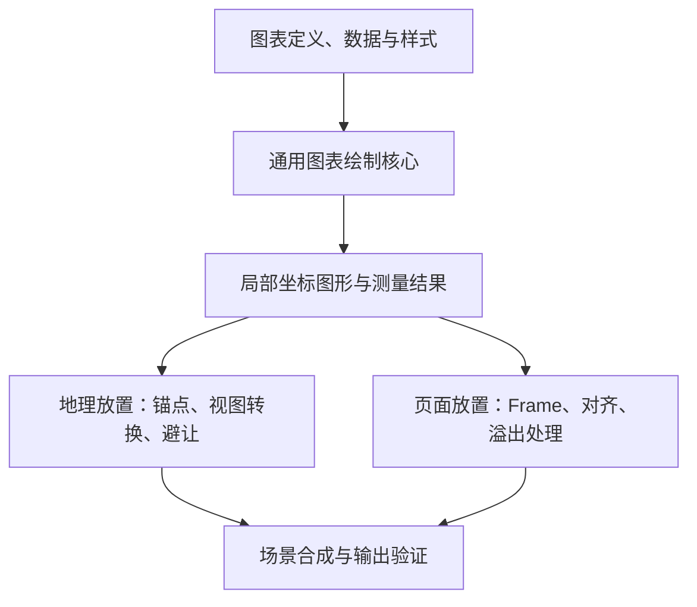

# 地图表达目录、内置方法与符号库设计结论

更新日期：2026-10-22

适用项目：Carto Master / Carto Agent

文档性质：阶段性设计建议与实现核对，供后续开发决策使用。

## 1. 文档定位与结论

本文汇总地图表达目录、内置表达方法、通用图表、符号库和四类模板之间的关系，说明如何复用能力、保留模型的表达设计空间，以及如何验证模型生成的方案和候选实现。

本文不讨论专利。下文的职责划分和执行链路是建议设计，当前实现状态集中列在第 10 节。文中的候选方法名称、数据组织和调用步骤均用于解释设计，不是新增运行时协议，也不能直接作为当前 CLI 的输入。运行时仍以 `skills/carto-agent/` 下的 Schema、策略和代码为准，不读取本文作为机器协议。

本阶段建议采用：

> **表达规则约束数据与视觉之间的含义；Scenario／任务规定目标和业务要求；模型选择、组合或生成具体方案；Style 提供兼容的视觉配置；受信代码完成计算和绘制，验证结果用于修订与确认。**

具体结论如下：

1. **需要明确的表达规则，但不必立即建设完整的独立表达资源系统。** 表达规则必须能够被查找、校验和执行；这些要求可以先由内置方法及其结构化能力说明满足。
2. **表达目录与受信能力配合使用。** 目录提供可复用规则、适用条件和常用预设；方法实现计算与绘图。目标设计允许在已支持能力内形成未预先命名的组合，不把目录当作所有合法方案的穷举清单。
3. **当前项目适合保留轻量目录。** 已有的表达标识、版本、摘要和锁定检查具有实际作用，不建议为了简化而直接删除；现阶段也没有必要立即增加独立发布、安装和复杂依赖解析。
4. **表达方法应与业务主题分离。** “按地区展示分类数值”可以复用于行业产值、游客量等主题；地区、年份、单位和 Top K 规则由场景及本次任务提供。
5. **主图区内的小图表与页面旁的辅助图表可以共用绘图核心。** 两者分别使用地理放置和页面放置，数据范围、比例尺度及标签策略可以不同。
6. **符号库提供资源，专题表达方法决定如何使用资源。** 图标本身不负责判断字段含义，也不自动完成分类、比例缩放或图例生成。
7. **地图表达和符号资源均不是第五类模板。** MapScenario、MapStyle、MapLayout、MapBrand 的职责保持清晰；是否进一步独立管理表达资源，取决于实际复用和维护需求。
8. **规则约束与表达设计分开。** 任务要求和有条件的映射规则提供判断依据，模型在其范围内提出方案；成熟预设是可复用起点，不自动成为所有任务的强制形式。
9. **不预先穷举完整绘图函数。** 优先复用成熟方法和可组合的基础能力，缺少能力时允许模型辅助开发候选实现；“受信”描述验证和执行条件，不以代码作者是人还是模型区分。
10. **输入输出结构不足以证明正确。** 还要明确语义、特殊情况、执行范围、验证依据和复现条件。每次制图动态执行模型代码是另需建设的扩展，当前未开放。

## 2. 统一术语

### 2.1 统一为地图表达目录 / Map Expression Catalog

“地图表达目录”“Map Encoding Catalog”和“Map Expression Catalog”在此前文档中指向同一个逻辑位置。此次统一术语，不据此建设两套目录。

原始设计、模板说明和相关 TRD 统一使用以下术语：

| 名称 | 统一含义 |
|---|---|
| 地图表达目录 / Map Expression Catalog | 可引用的表达定义与常用预设集合，提供发现与适用性判断依据 |
| 地图表达 / Map Expression | 数据与地理对象如何通过视觉映射及图形组织被表达；可使用预设或明确的组合方案 |
| 视觉编码 / Encoding | 一种表达内部的数据到视觉变量的映射，例如数值到面积、类别到颜色 |
| 内置表达方法 | 在受信代码中实现表达算法的函数或模块 |
| 通用图表绘制核心 | 根据数据、尺度、样式及支持的图表预设或图形组合生成局部坐标图形的代码 |
| 符号库 / Symbol Catalog | 点符号、线样式、面填充、注记等资源及其使用约束的集合 |
| 符号实例 | 某个要素在本次地图中实际使用的符号引用、位置和绘制参数 |

保留现有机器名称 `map-expression-catalog.yaml`、`expression_id`，无需因英文术语统一而迁移运行时字段。

原始设计曾使用 Map Encoding Catalog，后续 MapStyle 文档使用 Map Expression Catalog。现已将[模板体系设计](../carto-template-dsg.md)、四类模板说明、总体架构及两份 TRD 的相关描述对齐为 Map Expression Catalog。此次只统一设计描述，运行时字段、Schema、策略和实现不随之变更。

### 2.2 一个容易混淆的区别

“用蓝色填充多边形”只是绘制行为；“将某个区域指标按分位数分级，用有序色带表示，并生成真实断点图例和无数据说明”才是一项完整的地图表达。

同样，“画出一个避难所图标”属于符号绘制；“根据设施类别选择图标，根据容量确定符号大小，并说明尺寸对应的数值”属于专题表达。

因此，地图表达可以调用符号资源或图表核心，但不能被某个图标文件或某个绘图函数完全替代。

### 2.3 表达规则、设计活动与可复用定义

| 概念 | 回答的问题 | 例子 |
|---|---|---|
| 表达规则 | 某种映射在什么条件下成立，必须保持什么含义 | 声明长度与数值成比例时，从零基线按明确比例计算 |
| 表达设计 | 本次如何选择映射、图形和组织方式 | 为各城市选择横向条形或线段加圆点 |
| 本次表达方案 | 设计最终采用了哪些具体决定 | 颜色表示行业，长度表示产值，各城市共享数值尺度 |
| 可复用表达定义 | 哪些映射机制、适用条件和规则值得复用 | 地理锚定分类图表的公共要求及成熟条形图预设 |

规则描述成立条件，设计给出具体选择，验证检查选择及实际结果是否满足条件。表达设计包含数据映射和地理关联，不只是配色或排版。模型选择一种映射后，要应用该映射对应的规则；不能为自己的方案临时改写业务要求或降低规则。

本次方案先进入既有计划、候选与验证流程。有复用价值并经相应范围验证后，再考虑沉淀为定义；不要求每次探索都新增模板、目录项或独立“表达族”管理系统。

## 3. 各部分的职责与合适位置

### 3.1 业务、表达、样式和放置

下表为目标职责划分，与现有四类模板设计衔接。

| 部分 | 应负责的内容 | 示例 |
|---|---|---|
| MapScenario | 制图目的、数据角色、值语义、必需内容、表达选择和业务约束 | 各市展示本年度产值最高的三个行业，城市之间必须可比较 |
| 本次任务与 MapPlan | 实际数据绑定、地区、年份、参数值和本次执行决定 | 浙江省、指定年度、城市代码字段、产值字段、实际取值范围 |
| 模型的规划与图面设计 | MapPlanner 决定表达语义，MapComposer 在冻结前细化获准的图形与布局组合 | 提出共享尺度条形方案，预览后修订位置；语义变化返回规划 |
| 数据准备 | 在允许的操作范围内筛选、汇总、排序、关联，提供数据快照和处理依据 | 先按城市与行业汇总，再按城市取 Top 3 |
| 表达规则与可复用定义 | 输入要求、有条件的映射约束、常用预设及检查依据 | 声明长度比例时检验实际比例；共享尺度条件由比较目标和所选编码共同确定 |
| 内置表达方法 | 执行编码计算，调用图表或符号能力 | 计算柱高、类别颜色映射或比例符号尺寸 |
| MapStyle | 在业务和表达约束内提供颜色、字体、线条、符号选择及视觉默认值 | 行业配色、柱宽、边框、标签格式 |
| MapLayout | 页面与 Frame 的空间组织、容量和溢出处理 | 主图在左侧，省级汇总图在右侧辅助区域 |
| MapBrand | 机构标识、字体资源、品牌色及使用限制 | 报告 Logo、机构字体和身份色 |
| 空间规划与地图编译 | 视图、投影、地理锚点解析、地理位置到输出位置的转换 | 把城市代表点转换为主图中的图表锚点 |
| 图表核心、符号加载器与 Renderer | 测量和绘制图形，实例化资源，合成输出 | 绘制三根柱、加载图标、输出 SVG 或地图图层 |
| 质量验证与执行快照 | 检查实际映射、放置和资源一致性，固定本次选择 | 断点、尺度、数据摘要、方法与符号版本可追溯 |

表达规则按适用条件限制 Style。例如，颜色被用于识别类别时保持类别映射一致；适用标准禁止符号改色时保留原色；声明按面积比例编码时检验面积。不能把这些有条件的要求泛化为所有图形都必须采用相同形式，也不能由一次视觉美化改变已确定的含义。

Layout 提供容器和排版约束，不能替代数据汇总或分类算法。辅助图表的内容由 Scenario/项目提供，Layout 只决定它可以放在哪里、可使用多大空间。

### 3.2 当前字段归属与目标设计的衔接

当前 v1 的 `portrayal` 仍持有 `symbol`、`classification`、`scaling`、`z_order` 和无数据策略。不能因为本文建议由 Style 提供视觉细节，就在另一处新增一套同时生效的配置。

后续演进应明确每项规则的唯一权威来源、允许覆盖的范围和冲突处理方式。表达规则与定义提供适用条件和可复用方案，Scenario/任务规定目标及业务要求，模型选择或组合本次方案，Style 提供兼容配置，编译与验证后固定最终决定。

这种“参数约束与参数取值分开”不是重复设计。真正需要避免的是：目录、Schema 和代码各自维护一份相同规则，却没有生成关系或一致性检查。

字段现状及迁移边界见 [MapScenario 的表达契约说明](map-scenario.md)。

### 3.3 硬要求、默认建议与设计自由

沿用既有六种规则语义，不新增一套等级。模板应区分必须满足的业务或标准要求、带条件生效的表达规则，以及允许调整的默认值或参考建议。

例如，“通过图形比较各市绝对产值”是本次任务要求；选择长度编码后，需要协调跨城市数值尺度；“优先用柱状图”可以是允许调整的建议。若任务或适用标准明确固定图形，则按其绑定范围执行，不能因为模型有创造能力就忽略它。

允许选择不等于执行时保留歧义。候选编译须解析实际映射、尺度、地理关联、参数和依赖，在预览执行前消除未决决定。设计迭代遵循现有 MapPlanner／MapComposer 分工；改变数量含义、分母或比较策略时返回规划，改变兼容的间距、布局等由图面实现修订。

## 4. 表达目录是否有必要独立建设

### 4.1 三种组织方式

| 方式 | 如何组织 | 适合的情况 | 主要代价 |
|---|---|---|---|
| 纯内置方法 | 场景直接选择代码方法；规则通过代码接口及其说明提供 | 方法很少，集中维护，变化不频繁 | 发现和比较能力容易依赖代码知识，重复校验可能分散 |
| 轻量目录 + 内置方法 | 项目内维护结构化表达定义，由受信代码执行 | 已有多个表达，需要引用、校验和锁定，尚无独立分发需求 | 需要保证目录声明与代码能力一致 |
| 独立表达资源体系 + 执行后端 | 表达定义有独立发布、版本、依赖和发现机制，引用获准执行能力 | 多团队、多提供方、独立版本演进或跨项目复用已形成需求 | 增加发布、兼容性、依赖解析及资源治理成本 |

**本项目当前建议采用第二种。** 逻辑上独立的表达定义，不等于必须独立打包、独立部署或建立一个服务。

纯内置方式作为小规模实现是合理的；完整独立目录也不是错误。判断标准是其管理收益是否已经超过引入的维护成本，而不是项目是否使用了智能体。

### 4.2 目录与方法的执行关系

无论目录如何组织，最终都必须存在可执行能力。以下是使用成熟预设的路径；组合能力贯通后，可将预设引用替换为经过校验的显式组合，叶子操作仍须已实现且获准：

```text
表达标识与参数
    → 检查输入、参数和当前能力
    → 选择已注册的受信方法
    → 执行数据到图形的计算
    → 绘制、放置、合成与验证
```

目录项可以描述“数值映射为符号面积”，但不能仅通过增加一个名称就获得面积缩放能力。表达需要的算法、数据处理、资源加载和渲染后端必须实际可用。

建议让方法标识到代码实现的绑定保持简单，不额外建立一套独立维护的业务规则表。需要对目录参数、方法支持范围和验证要求进行一致性检查。

目录不得嵌入任意 Python、Shell、SQL 或浏览器脚本。声明式组合只能调用平台已经注册且允许的操作。这与[现有实施计划对表达目录的约束](../u-p2-implementation-plan.md)一致。

### 4.3 智能体怎样使用目录

区分两种入口，并为未固定表达的任务保留组合空间：

- **已有 Scenario，且表达已固定：** 解析并核对精确引用，检查数据和执行能力，无需每次重新搜索表达目录。
- **任务尚未选定表达：** 根据数据语义、几何、业务目标和输出条件优先尝试成熟预设；不适合时，可在已支持的组合能力内生成新方案。对实际采用的映射应用相应规则，经编译、预览与验证后固定本次决定。

候选可以由智能体提出，但不能只凭名称相似就判定适用。所引用规则、方法实现、Renderer 能力、允许的数据处理操作和检查要求必须同时满足。组合方案不必先注册一个完整图表名称，但其结构必须有正式协议承载，所用能力必须可解析和验证；当前 v1 尚未具备这种通用组合链路。

尚未实现的设想保留在设计文档中。当前表达 Schema 只接受 `active`、`deprecated` 两种状态，不能直接写入 `planned`，也不应把待研究能力标为可执行。

### 4.4 何时升级为完整独立目录

出现以下实际需求时，再评估独立发布和管理：

- 多个场景或项目重复维护同一表达规则，集中管理能明显减少重复；
- 表达定义需要独立于平台版本发布，且必须并行支持不同版本；
- 多个提供方或渲染后端需要共享定义，并明确各自的兼容范围；
- 任务经常需要从较多候选中发现和比较表达，内置清单已难以支持选择；
- 表达的依赖、测试、预览和适用条件已成为独立维护对象。

其中，简单复用首先可以通过轻量目录解决；只有确实需要独立生命周期时，才引入相应的发布与依赖机制。

### 4.5 公共语义与具体图形选择

“在地理位置展示分类数值图”可以作为公共概念，不必在上层名称中固定柱状图。公共部分说明地理对象、类别、数值、单位、关联与放置；具体方案再明确使用的视觉映射及适用条件。

柱状图、饼图等可作为成熟预设，但不能只列一个可任意切换的 `chart_type`。长度比例、扇区分母、总量是否另行编码、跨对象比较方式等，仍需在方案中确定。折线类方案还应明确类别是否具有适合连接的顺序关系。图形类型切换若改变了这些含义，应返回表达设计与验证，不能作为 Style 的纯外观切换。

少量受约束变体适合起步，后续以实际可组合的能力扩展；不要求预先穷举所有合法组合，也不因抽象层次提高就立即建立新的资源种类或通用绘图语言。

### 4.6 预设、基础能力与模型编写实现

| 路径 | 平台准备什么 | 模型负责什么 |
|---|---|---|
| 成熟方法 | 常用图表、表达与检查器 | 选择方法、绑定数据、配置获准参数 |
| 基础能力组合 | 数值尺度、基本图形、分组测量、地理或页面放置，以及组合校验 | 生成未预先命名的具体方案，检查后执行 |
| 缺少能力时开发新实现 | 开发接口、依赖范围、验证与维护流程 | 辅助编写候选代码，补齐实现与证据 |

优先复用前两种，确实缺少能力时再开发。基础能力也不必全部自研，可以通过适配器复用获准的绘图和 GIS 引擎；常用组合应封装，避免每次都从线段和圆点重建图表。不为每个地区、业务主题或图形组合编写专用完整函数。

“受信”描述代码的验证与执行条件，不描述作者身份。人或模型编写的实现都需要与其用途相称的语义验证和执行限制。模型辅助开发并纳入正式能力，与现有内核禁止直接执行任意模型代码的边界不冲突。

若未来需要每次制图动态编写代码，应另行建设候选实现的隔离执行、允许依赖与资源范围、预算、独立验证和复现机制，再决定开放范围。独立工作进程本身不等于安全沙箱，输出结构合法也不证明计算正确。当前模板或目录不能夹带脚本启用这条路径，正式冻结后的 Renderer 不能重新生成或修改实现。

未来一次性实现可仅声明适用于本次已验证条件；准备作为公共能力复用时，再扩大适用范围与测试。不是每段代码都要永久进入表达目录，但已采用的实现及其依赖必须按相应执行协议固定。详见第 9 节的接口与验证要求。

## 5. 通用图表如何同时用于地图和辅助区域

### 5.1 复用的是绘图核心

建议把图表能力拆成两部分：

1. **图表绘制核心：** 接收受支持的图表预设或显式图形组合、数据、可用尺寸、样式与尺度参数，生成局部坐标中的图形，并返回图形边界、标签边界和必要的测量信息。
2. **放置逻辑：** 根据使用场景，将图形放入页面 Frame，或锚定到地图要素，处理位置、边界和碰撞。



同一套柱状图代码可以调用多次：为每个城市生成一个局部图表，也可以为页面侧栏生成一张省级汇总图。两种用途不要求使用相同的数据范围、尺寸、轴线或标签密度。

不建议先生成一张完整报表图，再把它直接缩成地图符号。地图小图需要专门控制最小柱宽、标签省略和图例复用，避免缩小后失去可读性。

### 5.2 两种放置方式的区别

| 项目 | 地图中的图表 | 页面辅助图表 |
|---|---|---|
| 定位依据 | 地理坐标或要素标识，经具体地图视图解析 | 页面或 Frame 坐标 |
| 数据绑定 | 通常每个要素对应一组数据 | 可以是全省汇总、时间序列或选定区域统计 |
| 尺度要求 | 跨要素比较时必须协调数值尺度 | 根据该图表目的确定；与主图比较时也需明确对应关系 |
| 放置约束 | 避让地理注记、符号、其他图表，必要时增加引线 | 对齐、留白、容器容量和页面不重叠 |
| 是否需要地理表达定义 | 需要说明地理锚定及地图比较规则 | 可以直接使用图表能力，无需经过地图表达目录 |

如果模板中已经有独立图表定义，应复用其通用图表部分。地图表达只补充地理锚定、尺度协调和空间检查，不复制一套柱状图、饼图、折线图算法。

柱状图、饼图、折线图可以共享调用接口、字体测量、图例和导出工具，但仍保留各自的计算规则。例如，饼图需验证部分与整体关系，折线图需验证横轴顺序；不能用同一套参数语义强行覆盖所有图表。

当前阶段不需要为此新增一类图表模板，或立即建立独立的图表样式资源系统。

### 5.3 图标与数据图表的边界

符号库里的“饼图图标”可能只是一幅固定图形。它可以表示“统计信息”这个类别，却不能自动表达 20%、30%、50% 的真实占比。

只有当受信代码根据数据计算扇区角度、柱高或折线位置时，它才成为数据驱动图表。结果可以作为复合图形参与符号放置，但其数据计算仍属于图表核心或表达方法。

## 6. 直接使用符号库制作专题图

### 6.1 资源、映射与实例各自负责什么

| 层次 | 负责内容 | 示例 |
|---|---|---|
| 符号资源 | 图形、锚点、固有比例、可调参数、使用限制 | 学校图标；可改颜色的圆；某种面填充图案 |
| 专题表达方法 | 根据类别或数值选符号、算大小、颜色和方向 | 学校使用校舍图标；容量映射为圆面积 |
| 符号实例 | 某个要素的资源引用、位置和本次参数 | 某学校点位使用指定版本图标，宽 4 mm |
| 资源加载与绘制 | 解析并校验资源，按实例参数绘制 | 加载一次图标，为不同设施绘制多个实例 |

一个符号可以服务于多种表达；一种表达也可以使用多个兼容符号。符号的标准含义和可变参数必须得到尊重，不能把不允许改色或变形的资源当作任意形状使用。

### 6.2 内置方法的完整执行链路

以“按设施类别展示点位”为例，建议链路为：

```text
Scenario 声明设施类别表达，任务绑定类别字段与点位数据
    → 校验类别、位置和类别到符号的映射表
    → 从符号库解析所需资源及版本
    → 内置类别符号方法为每个要素选择符号与固定尺寸
    → 生成包含要素、锚点、资源引用和参数的符号实例
    → 转换位置、避让并绘制
    → 从同一映射结果生成图例
    → 固定资源引用与数据依据，验证输出
```

直接调用符号库并不意味着省略专题表达方法。方法可能很简单，例如一次类别查表，但仍需负责未知类别、缺失值、默认符号和图例一致性。

如果换成数量表达，主要改变的是数据到参数的规则：

| 表达 | 内置方法做什么 | 符号库提供什么 |
|---|---|---|
| 类别点表达 | 类别映射为图形或颜色，通常使用固定尺寸 | 分类图标或可改色标记 |
| 比例符号表达 | 连续数值映射为符号面积 | 适合面积比较的符号及其参数约束 |
| 分级符号表达 | 先分级，再映射到有限个尺寸 | 可按指定尺寸绘制的符号 |
| 类别线表达 | 类别映射为颜色或线型 | 线样式资源 |
| 类别面表达 | 类别映射为颜色或图案 | 面填充资源 |

上述类别点、分级符号和线面扩展均为设计示例，不表示当前项目已注册这些方法。

### 6.3 比例符号的数值语义

对于同形圆符号，若参考值为 100、参考直径为 4 mm，则严格按面积表达时：

```text
直径(value) = 4 mm × sqrt(value / 100)
value = 100 → 直径 4 mm
value = 400 → 直径 8 mm，面积为原来的 4 倍
```

不能把直径也放大 4 倍，否则面积会变为原来的 16 倍。

这个公式以非负数值、正参考值和相同圆形为前提。零值、缺失值、最小可见尺寸和截断都必须有明确规则；如果设置正的最小尺寸或截断范围，就不能声称所有数值仍严格满足面积比例。

不同形状的复杂图标不能仅按外接框宽高就认定具有可比较的面积。数量比较宜优先采用同一简单形状；如果使用其他符号，需要定义并验证其面积度量。

图例应从实际映射结果生成，包括分级阈值、尺寸单位、无数据处理及截断说明，不能只放置一个示意图标代替数量图例。

## 7. 实例：浙江各市 Top 3 行业产值地图

### 7.1 任务解释和数据责任

任务为：在浙江省各地级市的位置附近，展示该市产值最高的三个行业，并支持城市之间的绝对产值比较。任务可以不固定图形；第 7.3 节以柱状图作为本次选定方案，第 7.6 节说明模型如何改变组合。

此前讨论中的“直方图”在这个例子中统一称为“柱状图”，因为每根柱对应一个行业类别。若要表达连续数值的区间频数，则需另外定义直方图的分箱和统计规则。

本例可以分解为：

| 层次 | 本例内容 |
|---|---|
| 业务主题 | 行业产值 |
| 数据语义 | 城市、行业、产值、统计年度、单位 |
| 数据准备 | 按城市和行业整理数据，再按城市取前三名 |
| 通用图表 | 本次先选择分类柱状图，可在规则和执行能力内提出其他方案 |
| 地图表达 | 在城市位置锚定图表，并保证跨城市数值可比较 |
| 视觉样式 | 行业颜色、柱宽、标签和引线样式 |
| 版式 | 主图区、标题、行业图例及可选汇总图 |

上层可称为“地理分类数值图”；`diagram/anchored-bars` 仅是柱状图预设的候选名称，当前目录中没有这个条目，也不要求为每个合法组合另起名称。定义不应绑定“浙江”“行业产值”或“Top 3”；这些属于具体场景与任务的配置。

### 7.2 合成数据示例

以下数字仅用于说明算法，**不是实际统计数据**。假定同一年度、同一统计口径，单位为亿元；为便于演示，只列两个城市、四个行业。

| 城市 | 电子设备 | 通用设备 | 化学原料及制品 | 纺织 |
|---|---:|---:|---:|---:|
| 杭州 | 120 | 90 | 50 | 70 |
| 宁波 | 80 | 150 | 110 | 60 |

在这组示例数据范围内：

- 杭州 Top 3：电子设备 120、通用设备 90、纺织 70。
- 宁波 Top 3：通用设备 150、化学原料及制品 110、电子设备 80。

实际任务必须核对完整城市覆盖和行业覆盖。若只提供部分行业，只能称为“所提供行业中的 Top 3”，不能无说明地称为全行业前三名。

### 7.3 内置方法方式

1. **检查输入语义。** 确认年份、行业分类、单位、可加总性、城市覆盖、缺失值和关联键。
2. **准备城市与行业统计。** 若来源为明细记录，先在正确粒度汇总；若已经是城市行业总值，不重复汇总或混入合计行。
3. **计算各市 Top 3。** 按值降序排列，值相同时按稳定的行业代码排序。本例采用固定三个名额；若业务要求并列全部保留，需另设规则。有效行业不足三个时展示实际数量并说明，不补造数据。
4. **关联地图要素。** 按城市代码关联行政区几何；准备稳定的标签点、面内代表点或经确认的锚点，不默认几何质心总是合适。
5. **组织通用输入。** 为每个城市提供要素标识和“类别—数值”序列。表达方法无需知道这些类别属于工业还是旅游主题。
6. **确定统一数值尺度。** 本例显示值最大为 150，最大柱高设为 60 px；零值为基线，则 120 对应 48 px，90 对应 36 px。实际浙江全省地图应依据全部待展示城市协调尺度。
7. **确定颜色和顺序。** 柱按各市排名排列，颜色按行业固定。电子设备在不同城市中即使排名不同，也应使用同一种颜色。
8. **调用柱状图核心。** 为各城市生成局部图形和测量边界，使用统一尺度，不给每个城市单独归一化。
9. **完成地理放置。** 按主图实际视图和相机，将锚点转换为输出位置。发生碰撞时，可整体移动图表并加引线；不能只缩小某个城市的图表而破坏数值比较。
10. **合成与验证。** 生成行业图例、数值尺度说明、单位和来源信息，记录本次选择，检查实际图形、数据对应和放置结果，再按现有工作流完成锁定及输出验证。

“锚定到城市”不自动意味着图表必须完全位于该市边界内。若业务要求严格置于面内，需要增加明确的几何包含约束，并允许在无法满足时报告容量不足。

### 7.4 使用独立表达目录时

数据处理、柱高计算和放置算法可以保持不变，增加的是显式的表达定义解析与选择过程：

```text
已有 Scenario：解析已固定的表达引用
或自由设计任务：选择预设，或在组合能力开放后生成显式组合
    → 核对引用规则与能力的版本、摘要、输入语义和适用条件
    → 检查数据处理、图表核心、地理放置与 Renderer 能力
    → 解析获准依赖，形成具体执行计划
    → 执行相同的数据准备和内置绘图方法
    → 放置、合成、锁定与验证
```

因此，两种方案不需要各实现一套柱状图代码。目录方式的收益主要在于规则复用、发现、适用性检查和版本管理；其成本主要在于定义及依赖的维护。

### 7.5 换主题或增加辅助图表

若改为各市 Top 3 景区游客量，可在语义检查通过后复用同一表达：城市仍是空间关联对象，景区成为类别，游客量成为数值，任务负责改变单位、排序对象和标签。

但复用有边界。例如，正负混合的利润值需要支持负值基线；增长率不能照搬产值的加总逻辑；不同单位的指标不能直接共用一个数量尺度。主题名称变化未必需要新代码，数据语义或表达机制变化则可能需要。

若在主图旁增加“全省行业产值汇总图”，可再次调用柱状图核心，通过 Layout 的辅助 Frame 放置。该图应从符合口径的完整数据汇总，不能直接加总各市已经截取的 Top 3 来充当全省总值。

### 7.6 从任务、设计到执行验证

沿用第 7.2 节的合成数据，假定所需绘图与组合能力已贯通，职责链如下：

| 环节 | 本次决定或工作 |
|---|---|
| Scenario／任务 | 浙江各市、同一年度与口径、行业产值、城市内 Top 3、跨城市绝对量比较 |
| 模型表达设计 | 选择横向条形，长度表示产值，颜色和文字表示行业；各城市共享尺度 |
| 表达规则 | 检查声明的长度比例、共享尺度、类别映射与城市关联；这些条件由所选映射和任务共同确定 |
| Style | 提供类别调色板、字体、条形厚度与间距；规划绑定类别角色，由受信方法生成本次行业颜色映射 |
| 受信代码 | 汇总、排序、取前三，按共享尺度计算长度，绘图并完成地理放置 |
| 验证与修订 | 从实际图形核对映射和位置，生成预览，按决定所有权修改并重新编译 |

假定 150 亿元对应 60 px，则杭州电子设备 120 亿元对应 48 px，宁波通用设备 150 亿元对应 60 px。若各城市独立归一化，两者都会达到 60 px；即使都成功输出合法 SVG，也不满足本次比较要求。

模型也可以提出“线段＋末端圆点＋标签”的方案：保留共享尺度，用圆点距零基线的距离表示产值，每个行业占一行。该方案可由已有线段、圆点、文字和排列能力组合，不必先注册一份专用模板。改变图形或映射时先由规划明确语义；MapComposer 在获准范围内细化间距、位置与引线，不能自行改变分母或比较策略。

若仅为解决遮挡，可以移动图表并保持城市引线，或统一调整比较组的尺度并重算、复验；不能单独缩放某个城市的数量图形。验证不能只接受生成实现自报成功，应根据源数据与已确定规则独立核对实际图形。新颖方案的可读性还需结合预览及必要的专业判断，符合结构和数值规则不等于设计已经优秀。

### 7.7 同一分类数据不等于相同表达目的

| 目标 | 可考虑的方案与必须明确的含义 |
|---|---|
| 比较各市 Top 3 行业绝对产值 | 条形或其他兼容数量编码，明确跨城市比较尺度 |
| 看前三行业内部构成 | 饼图分母为该市前三行业之和，标题与说明明确范围 |
| 看前三行业占所提供全部行业的构成 | 饼图使用全部所提供行业总量，保留“其他行业”部分 |

以杭州合成数据为例，前三行业之和为 280，所提供四个行业合计 330，“其他”为 50。使用 280 或 330 作为分母表达的是不同问题。若要声称全市全部行业构成，还必须证明输入覆盖完整行业，不能把四行业合成样例当成完整统计。

普通等大饼图不能自动满足本例通过图形比较绝对量的要求。若另加总量编码或配套视图，应形成新的明确方案并验证。Scenario 可以改变任务目标；Style 不能把绝对量表达静默切换为占比表达。

## 8. 点、线、面地图分类怎样进入项目

此前列举的类别点、比例或分级点、点密度、等值线、热力图、流向、拓扑示意、面积变形等内容，可以作为表达知识和方法候选，但不宜原样变成一组同层级、全部可执行的模板类型。

建议区分以下信息：

| 信息类型 | 合适位置 | 原因 |
|---|---|---|
| 点、线、面等几何分类 | 文档导航或目录检索维度 | 便于查找，但不足以判断表达适用性；输入与输出几何还可能不同 |
| 类别、有序等级、数量、方向、时间等语义 | 表达定义及 Scenario 的数据角色 | 决定允许使用的视觉变量和输入条件 |
| 分类、比例缩放、类别映射 | 内置表达方法及其参数约束 | 需要可执行的确定性规则 |
| 点密度、核密度、等值线等数据推导 | 获准的数据处理或表达计算能力，表达定义声明依赖 | 不能仅靠颜色和符号配置获得计算结果 |
| 流向、拓扑示意、变形制图 | 对应方法与空间约束 | 除线型或填充外，还涉及方向关系、连接关系或几何变化 |
| 影像、三维曲面和透视显示 | 数据源、渲染能力及相应表达约束 | 涉及输入资源和输出能力，不只是符号选择 |

例如，“等密线地图”若意指 line cartogram，需先明确它修改的是线路长度、空间位置还是统计线段；“热力面状图”也需区分区域统计设色与连续密度场。名称尚有歧义时，先写明计算含义，不急于注册执行标识。

对当前不支持的方法，先保留设计说明。增加目录条目之前，需落实其实际输入、算法、验证和渲染能力。

## 9. 需要保证的语义与验证要求

这些是后续实现的验收要求，不表示当前已有全部检查器。

| 检查对象 | 应证明什么 |
|---|---|
| 主题与数据 | 数据单位、时点、统计口径和可加总性与任务一致 |
| 地理关联 | 业务标识与要素匹配，遗漏或重复具有明确处理方式 |
| 适用性 | 已满足该表达需要的语义、几何、数值范围和平台能力 |
| 数值编码 | 柱高、面积、分级断点等与实际数值映射一致 |
| 类别编码 | 同一类别使用稳定映射，未知类别和缺失类别有明确规则 |
| 图例 | 图例来自实际执行的映射，展示必要单位、阈值和例外说明 |
| 图表放置 | 锚定关系正确；任务要求图形跨对象数量比较时保持兼容尺度，碰撞处理符合任务约束 |
| 符号资源 | 实际资源与引用版本一致，参数合法，遵守标准或品牌限制 |
| 可复现性 | 输入快照、方法版本、参数、资源和必要的布局决定可追溯 |
| 不支持情况 | 缺失能力时明确报告，不悄悄改用不同语义的表达 |

对生成结果至少区分“结构合法”“语义正确”“实际绘制正确”。Schema 通过、资源引用存在或函数返回成功，都不能单独证明专题图已经正确表达数据。

### 9.1 绘图接口不仅约定输入输出结构

接口可以简洁，例如接收分类数值、共享尺度、兼容样式和可用空间，返回局部图形及测量结果；但还要由接口、计划、规则和执行环境共同明确以下契约，不必将它们都塞进函数参数：

| 契约内容 | 必须明确的事项 |
|---|---|
| 结构 | 数据角色、单位与输出图形结构；未知字段及不支持输入如何处理 |
| 语义 | 数值如何映射、是否使用传入尺度、类别颜色、分母及地理关联 |
| 特殊情况 | 缺失、零值、负值、空数据、并列、溢出与类别过多时的行为 |
| 执行范围 | 可调用能力、依赖、可访问数据和资源，以及时间与资源预算 |
| 验证依据 | 从源数据、已采用规则与实际图形核对结果；实现自报成功不能替代检查 |
| 复现条件 | 固定实际代码或能力版本、依赖、输入摘要、参数及必要的布局决定 |

第 7.6 节的两种尺度实现具有相同输入输出类型，却只有一种符合本次要求。Schema 合法、生成代码通过自身测试或图片外观合理，都不是充分证明。

若引入候选代码执行，须先有相应隔离、协议与验证能力，再进行试运行、独立检查、预览修订和实现冻结。一次通过的证据只覆盖已验证条件，不能据此宣称任意数据均适用；纳入公共能力前扩大边界样例与验证范围。当前文档未新增代码执行协议。

## 10. 当前仓库状态与设计差距

以下为截至本文更新日期的代码核对结果，不能用目标设计替代当前能力声明。

### 10.1 已有机制和实际边界

| 项目 | 当前事实 | 设计影响与依据 |
|---|---|---|
| 表达目录 | 仅有 `choropleth/sequential` 和 `proportional-symbol/count` 两项 | 已有轻量目录基础；见[目录文件](../../skills/carto-agent/policies/map-expression-catalog.yaml) |
| 表达 Schema | 几何限定 point/polygon，视觉变量限定 fill-color/symbol-area，算法标识也限定为两类 | 新增图表、线表达或其他算法需要协议演进；见[表达 Schema](../../skills/carto-agent/schemas/map-expression.schema.json) |
| 表达引用 | portrayal 按限定表达 ID 和版本引用，符号字段已有 `catalog_ref` 与参数 | 有引用结构不等于完整符号资源链路已经实现；见[portrayal Schema](../../skills/carto-agent/schemas/portrayal.schema.json) |
| 作者流程 | 读取和校验表达条目，生成 ID、版本和摘要，并要求目录恰好包含既定两项 | 不能仅增加第三条 YAML 就扩展能力；见[模板作者流程](../../skills/carto-agent/scripts/carto_core/workflow/template_author.py) |
| 依赖校验 | portrayal 引用须与锁资源一致，锁定集合还必须等于当前整个目录集合 | 这是有限基线，不是通用的按需引用子集解析；见[模板验证](../../skills/carto-agent/scripts/carto_core/workflow/template_validation.py) |
| 地图计划与候选 | 围绕 `risk-area`、`shelter-point` 固定角色，规划仅接受 quantile 分类和声明的 area-proportional 缩放 | 尚不是由目录驱动的通用方法分发；见[地图规划](../../skills/carto-agent/scripts/carto_core/workflow/map_planning.py)与[候选编译](../../skills/carto-agent/scripts/carto_core/compiler/map_candidate.py) |
| 数据准备 | 策略列出 read/filter/join/reproject/aggregate/classify，data agent 关闭 | Top K 等新操作需落实到受控能力，不能假定已经开放；见[数据准备策略](../../skills/carto-agent/policies/data-preparation-policy.yaml) |
| 符号检查 | 渲染适配器校验引用资源存在且类型为 icon/sprite/symbol，检查相关要素源 | 已有部分输入校验；见[Web 地图渲染适配器](../../skills/carto-agent/scripts/carto_core/adapters/webmap_renderer.py) |
| 符号实际绘制 | SVG 合成器中 `symbol` 绘制固定红圆，`complex-symbol` 绘制固定红色菱形；引用仅写入属性 | 通用符号资源的实际加载与实例化尚未接通；见[SVG 合成器](../../skills/carto-agent/scripts/carto_core/adapters/svg_compositor.py) |
| 地理放置 | SVG 合成器要求 geographic/feature 覆盖物已有 `screen_position` | 存在坐标类型不能证明自动锚点解析和避让已完整实现；仍需上游提供解析结果 |
| 通用图表与 Frame | 当前覆盖物没有通用 chart 类型；Layout Frame 没有专门的图表接口 | 文档里的 `chart_panel` 仍属设计；见[渲染场景 Schema](../../skills/carto-agent/schemas/render-scene.schema.json)和[Layout Schema](../../skills/carto-agent/schemas/layout.schema.json) |

目录列出的参数范围也可能宽于具体链路。例如目录允许多种分类方法，但当前地图规划只接受 quantile。平台向用户声明能力时，应以已贯通且验证过的执行范围为准。

### 10.2 优先修正：面积比例声明与半径计算不一致

目录中的 `proportional-symbol/count` 声明使用 `symbol-area` 和 `area-proportional-scaling`，地图规划也要求 `area-proportional`。

但当前候选编译中的 MapLibre `circle-radius` 采用下面的表达式：

```python
["interpolate", ["linear"], ["get", "count_value"],
 0, 5, max(max_count, 1), 16]
```

它把数值线性映射到半径，并带有正的起始半径，不能证明符号面积与数值成正比。当前图例还只是容量点的单个示意项，没有给出可核对的数量尺寸序列。

这意味着“按面积比例表达容量”目前是目录和计划中的语义要求，不能作为该演示链路已经准确实现的能力结论。

后续应明确采用严格面积比例还是带最小尺寸/截断的规则，修正实际计算和图例，并增加数值映射验证。本文仅记录问题，不修改运行代码。

### 10.3 本轮新增设计与现有能力的边界

第 2.3、4.5、4.6、7.6 和 9.1 节补充的是目标设计。当前两项表达与固定候选链路尚不构成通用图形组合执行器，也没有每次制图动态运行模型新代码的能力。不能通过添加表达名称、`chart_type`、组合字段或脚本绕过现有 Schema 与能力检查。

后续落地应先贯通常用方法与最小组合能力。模型辅助开发正式实现时，按仓库规则同步协议、策略、合法和非法样例以及测试；运行时动态代码执行是否需要开放，单独按实际需求评估。现有未实现部分与第 10.2 节的面积比例差异仍然保留，不因文档更新而视为修复。

## 11. 后续落地顺序与目录位置

### 11.1 建议实施顺序

| 阶段 | 工作 | 完成判据 |
|---|---|---|
| 第一阶段：对齐现有语义 | 修正比例符号计算及图例，核对目录、计划和代码支持范围 | 已有表达的实际图形与声明一致，不支持的参数被明确拒绝 |
| 第二阶段：贯通符号资源 | 完成资源解析、合法参数检查、实际绘制与实例复用，先验证一个类别符号案例 | 同一方法能使用兼容的不同资源，同一资源可供多个要素使用 |
| 第三阶段：验证图表复用 | 完成最小柱状图核心、页面放置和地理放置，贯通浙江合成案例 | 同一绘图核心同时支持城市图表与独立辅助图，且数据、尺度和图例正确 |
| 第四阶段：按需扩展轻量目录 | 使新增方法的定义、代码绑定、依赖和检查保持一致，演进当前固定两项的限制 | Scenario 可准确引用所需方法，版本和摘要仍可验证 |
| 第五阶段：验证最小组合 | 在已贯通图表基础上组合线段、圆点与标签，明确方案承载、能力依赖和校验方式 | 不新增完整预设也能形成可检查候选，保持数量与地理语义并可复现 |
| 后续评估：独立资源管理 | 根据第 4.4 节的实际需求引入发布、安装和兼容性管理 | 管理收益明确，具备独立维护和验证条件 |

这些阶段表达优先级，不要求新增方法先绕过能力管理运行。每次增加可执行能力，都应同时完成该能力必需的 Schema、策略、引用和验证调整。基础能力需要正式支持，合法组合不必各自成为永久目录项。模型辅助开发可用于各阶段，运行时动态代码执行不是这些阶段的前置条件。

不需要一次实现所有地图类型，也不需要先建设一个完整表达平台，才能验证图表和符号复用是否成立。

### 11.2 在本项目中的位置

| 内容 | 合适位置 | 说明 |
|---|---|---|
| 本次结论与后续概念设计 | `doc/template/` | 人类阅读的设计说明，不作为运行协议 |
| 场景、样式、版式、品牌的职责说明 | 现有 `map-scenario.md`、`map-style.md`、`map-layout.md`、`map-brand.md` | 已同步职责边界；后续能力落地仍须同步协议、实现和验证，详细公共规则以本文为设计参考 |
| 当前表达定义 | `skills/carto-agent/policies/map-expression-catalog.yaml` | 保留既有入口；能力成熟后按版本演进 |
| 实例及参数的结构约束 | `skills/carto-agent/schemas/` | 只在正式引入能力时修改 Schema，不把文档示例当作合法协议 |
| 表达计算、图表核心、资源解析、放置与编译 | `skills/carto-agent/scripts/carto_core/` | 按职责拆分模块；工作流负责组织，算法保持可复用 |
| 符号资源 | 既有模板资源包与资源引用机制，加载代码仍位于运行根目录 | 具体包内结构随资源协议确定，不在仓库根另建执行体系 |
| 方法和资源的自动检查、合成案例 | `skills/carto-agent/scripts/tests/` 及现有 Fixture 位置 | 新协议同时提供合法样例、非法样例和自动测试 |

MapLayout 的 Frame 与内容角色关系见 [MapLayout 完整说明](map-layout.md)，品牌资源约束见 [MapBrand 完整说明](map-brand.md)。

实施前按仓库要求阅读 `skills/carto-agent/SKILL.md`。运行能力只在 `skills/carto-agent/` 下扩展，不在历史占位目录或仓库根目录建设第二套实现。

### 11.3 下一轮设计应确定的最小事项

1. 选择一个符号案例和一个柱状图案例，明确输入语义、参数及不支持情况。
2. 确定图表核心的最小接口及语义契约，以及地理放置、页面放置各自负责的部分；明确哪些使用预设、哪些允许组合。
3. 确定符号资源的引用、锚点、可调参数和实际绘制方式。
4. 明确数值尺度、缺失值、异常值、图例和碰撞处理的唯一规则来源。
5. 列出为贯通这些案例所必需的协议变化与验收证据，再决定是否需要进一步独立管理目录。
6. 用共享尺度与独立归一化的反例验证语义检查，区分默认建议、任务硬要求和具体映射条件。
7. 为组合方案明确计划承载和复现方式；只有实际存在需求时，另行评估动态代码执行的隔离及验收成本。

## 12. 文档统一记录

### 12.1 术语与职责统一（2026-10-21）

本轮检查原始设计、四类模板说明、总体架构及两份 TRD，统一了以下影响理解和后续实现的表述。它们是设计层面的修订，不表示新增运行能力。

| 原有不一致或容易误解之处 | 统一后的描述 | 对应文档 |
|---|---|---|
| Map Encoding Catalog、Map Expression Catalog 混用，部分章节又称“编码模板” | 统一为地图表达目录 / Map Expression Catalog；视觉编码是表达内部的数据映射，表达与符号不新增为第五类模板 | [原始设计](../carto-template-dsg.md)、[总体架构](../carto-agent-architecture.md) |
| 原始目录树预设独立表达包、多套注册入口，容易把目录项理解为可执行实现 | 使用现有轻量目录与受信内置方法；独立发布按实际需求演进，目录声明不等于运行能力 | [原始设计](../carto-template-dsg.md)、[模板创建 TRD](../carto-create-template-TRD.md) |
| Style 既被说成外观配置，又承担算法、符号资源与表达语义的全部定义 | 表达定义约束语义，Style 配置允许的外观和参数；算法由受信代码实现，符号资源按明确所有权引用 | [MapStyle](map-style.md) |
| 场景绑定、表达发现与 Style Profile 的选择关系不清 | Scenario/任务提供业务语义与字段绑定；固定表达执行解析与校验，未固定时发现候选；Profile 不得突破表达和业务约束 | [MapScenario](map-scenario.md)、[地图生成 TRD](../carto-generate-map-TRD.md) |
| 地图小图表、页面辅助图表、静态图表图标容易被归为同一类资源 | 图表核心可复用，地理与页面放置分责；静态图标属于资源，独立辅助图表无需强制登记地图表达 | [MapStyle](map-style.md)、[MapLayout](map-layout.md)、[MapBrand](map-brand.md) |
| 原始问答把 Brand 解释为所有颜色和背景的最高所有者 | Brand 只拥有身份资源及允许消费的角色；专题颜色受表达、场景和标准约束，冲突不能简单覆盖 | [原始设计](../carto-template-dsg.md)、[MapBrand](map-brand.md) |
| Style 的“冲突优先级”与六种规则标签、完整段所有权混用 | 分别处理分段所有权、必须共同满足的硬约束及可调默认值，不用通用覆盖阶梯解除硬约束 | [MapStyle](map-style.md)、[原始设计](../carto-template-dsg.md) |
| 原始设计仍有旧锁文件名、并行 YAML 清单和必选原型描述 | 锁统一引用 MapSpecLock 正式 Schema；版式由机器契约拥有，原型和说明不构成另一套执行规则 | [原始设计](../carto-template-dsg.md) |
| 目标设计、Schema 枚举和演示结果有时被混写成已实现能力 | 当前仍为两项表达的有限基线；通用图表、符号资源实际绘制及面积比例修正分别记录为待落实能力 | 四类模板的当前状态章节及本文第 10 节 |
| 模板说明引用已不存在的补充设计文件，部分实施计划链接过期 | 改为现有原始设计、统一结论和全局实施计划的链接 | 四类模板说明、总体架构和模板创建 TRD |

后续实现优先验证第 10.2 节的面积比例问题，再以一个真实加载符号的案例和一个图表复用案例推进。当前文档中的目标接口、扩展标识和示意流程仍需经过正式协议设计，不能直接传给现有 CLI。

### 12.2 表达设计与受信实现补充（2026-10-22）

本次补充讨论结论：

- 区分表达规则、设计活动、本次方案和可复用定义；常用预设不穷举模型的设计空间。
- “地理分类数值图”保留公共语义，实际编码、尺度和分母在候选执行前明确；图形切换不是任意样式切换。
- 采用成熟方法、基础能力组合、按需开发新实现三条路径；代码作者与执行信任分开，输入输出结构不是正确性的充分条件。
- 以同一浙江合成案例补充设计、执行、验证和饼图分母说明，不新增业务主题专用模板或绘图函数。
- 同步模板总设计、总体架构、Scenario、Style 及创建和生成 TRD；沿用 MapPlanner／MapComposer／Renderer 分工，未更改运行代码、Schema 或策略。
