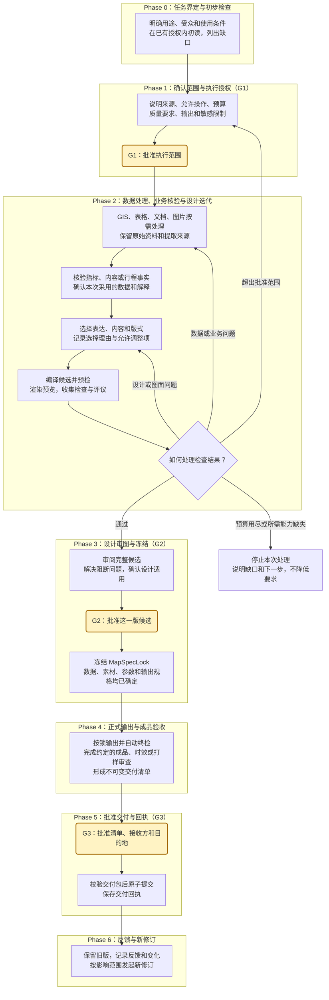
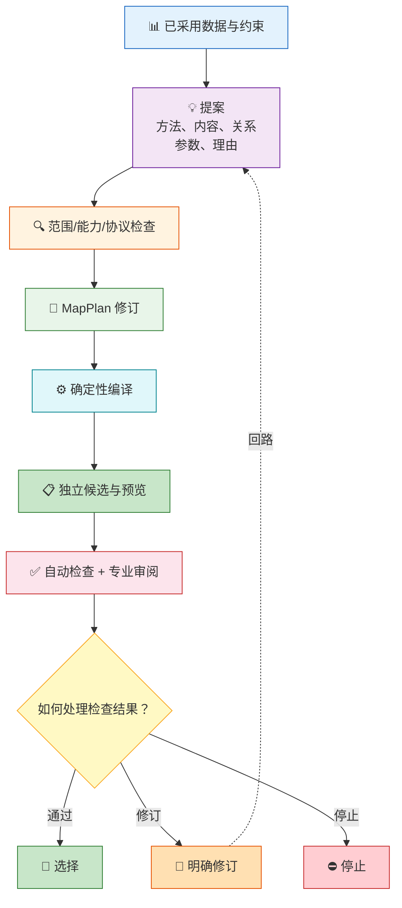
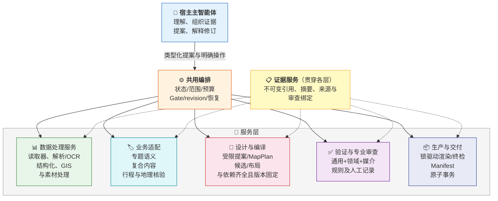

# 制图智能体总体流程

> 三类业务任务，一套可信主流程；数据处理统一，业务核验和设计策略可组合

更新日期：2026-11-12（Asia/Shanghai）

状态：**目标流程设计与当前实现对照。目标流程不等于已实现能力，不作为运行时机器协议。**

## 文档定位

本文综合标准专题图、海报地图和领导调研用图的讨论，定义一套完整的制图智能体目标流程，作为后续协议、实现、测试和能力准入的对齐依据。

- [标准专题图制图流程说明](标准专题图制图流程说明.md)：专题表达、数据语义、有限网格现状与设计迭代。
- [海报地图流程说明](海报地图流程说明.md)：文档/图片解析提取、复合内容、自由构图、跨组件一致性与输出验收。
- [领导调研用图制图流程说明](领导调研用图制图流程说明.md)：行程、地点、入口、路线、时间、敏感披露与出行用途边界。

本文为三类任务提供统一骨架，不让它们分别维护任务、解析、审批、锁与交付系统。本文也不覆盖 [设计原则](design-principles.md) 或直接修改现有运行协议；与现行原则、Schema、策略不一致的目标必须先完成评审和同步演进。

**核心结论**：先弄清任务和材料，确认可以做什么；把数据和业务事实查清楚，再设计、看图、修改。设计获批后固定方案，按方案出图，检查实际成品，最后批准交付。模板和新能力的研发另行进行，不强加给每次制图。

---

## 阅读顺序与统一用语

本文件说明四份文档共用的规则；三份任务说明只补充各自的数据、设计和验收要求。读者可先看下表和主流程图，再看关心的任务说明；开发者继续阅读产物、状态和实施阶段。

| 阶段 | 用白话说 | 完成后得到什么 |
|---|---|---|
| Phase 0：任务界定与初步检查 | 先弄清要做什么、材料够不够 | 任务理解、来源清单和待解决问题 |
| Phase 1：确认范围与执行授权（G1） | 确认能读什么、能做什么、做到什么程度 | 获准简报和执行范围 |
| Phase 2：数据处理、业务核验与设计迭代 | 把资料查清楚，把地图设计好；不合适就按责任修改 | 已采用数据、设计方案、候选与预览 |
| Phase 3：设计审图与冻结（G2） | 审阅这一版整体设计，批准后固定下来 | MapSpecLock |
| Phase 4：正式输出与成品验收 | 按固定方案出文件，检查实际成品 | 通过检查的文件与不可变交付清单 |
| Phase 5：批准交付与回执（G3） | 批准把这些文件交给指定的人，再完成交付 | 交付回执 |
| Phase 6：反馈与新修订 | 需要修改时出新版本，不覆盖旧版 | 新修订及其与旧版的关系 |

| 用语 | 本文的含义 |
|---|---|
| 数据画像 | 对材料和数据做初步检查：有哪些内容、规模多大、缺什么；不是凭需求猜出的事实 |
| 语义 / 业务核验 | 检查数据或符号表示什么，例如单位、类别含义、入口身份、时间口径 |
| 数据采用 | 确认本次使用哪份数据、素材及其解释；来源可查不等于内容一定真实 |
| 合同 / 协议 | 程序能够检查的数据格式、规则和约束；本文不是在新增法律合同 |
| 候选与预览 | 候选是完整的待审设计；预览是用候选实际渲染的图，不是文字描述 |
| 证据与依赖齐全（原文也称“闭合”） | 用到的数据、素材、规则、参数和工具结果都有固定来源及版本，没有待补项 |
| 摘要绑定 | 用内容摘要识别确切版本；文件或内容变了，旧证据不能冒充新版本的证据 |
| 冻结 / MapSpecLock | 将批准的设计和输入固定下来；冻结后不能在原锁里继续改图 |
| 设计修订版 / 执行尝试 | 前者改变方案；后者在同一锁下重试执行。状态机的 revision 计数不等于设计修订能力 |
| 交付清单 / DeliveryManifest | 写清交付哪些确切文件、给谁、到哪里，以及许可、限制和检查依据 |

**四种判断不要混淆**：数据采用确认“本次用什么”；设计审图确认“这样表达是否合适”；G1/G2/G3 分别授权执行、冻结和交付；成品审查检查“实际导出的文件是否符合约定”。它们可以在同一界面组织，但不能互相代替。

**当前能力口径**：本项目目前只准入用户提供的已分类栅格、有限网格、A4 横版 PDF+PNG；完整海报和领导调研链尚未准入，`production_enabled: false`。“正式输出”是流程中 render 步骤的名称，不等于已经取得生产用途许可。当前执行细节见[标准专题图说明](标准专题图制图流程说明.md)第八节和 Skill。

## 一、范围与建模原则

### 1.1 三个业务域是用户任务族，不是三套技术栈

| 用户任务族 | 主要业务问题 | 主要专用责任 |
|---|---|---|
| 标准专题图 | 怎样正确表达某个主题的空间分布、比较或变化？ | 指标、类别、单位、分母、时点、空间尺度、表达方法与图例 |
| 海报地图 | 怎样用地图和图文共同解释主题、服务阅读任务？ | 素材解析、内容编辑、关系组织、构图、跨组件语义与媒介验收 |
| 领导调研用图 | 怎样把已采用行程和地理事实转成适用的说明或出行参考？ | 行程实体、地点/入口、路线模式、时间条件、敏感披露与业务采用 |

“业务域”是本文面向用户的组织用语，不新增 `business_domain` 层级。机器协议继续使用既有 `business_scene`、`theme_tags` 等概念，并在正式评审后表达所需能力组合。

专题与调研主要描述业务用途，海报主要描述制品形式。调研可以做成海报，专题也可以使用文档和图片；不能强行要求三类互斥，也不能直接注册一个新名称就认定能力已开放。

### 1.2 按相互独立的维度选择能力

```text
业务用途与事实要求
    × 输入及数据处理能力
    × 表达与内容组件
    × 布局与制品形式
    × 输出媒介与使用方式
    × 权限、质量和风险约束
```

该组合须显式兼容并通过准入，不是任意自由拼接。请求合法、目录能识别、组件存在、模板存在和业务准入是不同条件。

### 1.3 三个生命周期独立协作

1. **项目制图**：针对这次任务采用事实、选择表达、设计、审图并交付。
2. **模板资产研发**：抽象可复用的角色、约束与配置，通过 T1/TP 验证发布，供项目复用。
3. **能力研发与准入**：实现读取器、算法、渲染器和检查器，完成协议、测试及业务验收后启用。

新建模板不是每次制图的必经步骤；开发新算法也不是运行时设计自由。临时拼代码、改策略或消费未发布草稿均不能代替能力准入。

### 1.4 明确不属于本主流程的能力

实时导航、动态定位、持续交通调度及其会话不是静态地图交付流水线。可以通过独立准入的接口交换授权对象，但不能用一张有路线折线的地图冒充导航，也不为每次位置更新重复静态 G2/G3。

---

## 二、目标主流程总览



**读图说明**：这是目标流程，不是当前 CLI 状态图。每次处理或修订前都要检查权限和剩余预算；有些核验应边处理边做，不能等全部工具运行结束才发现关键事实错误。数据问题回到数据处理，设计问题回到设计；超范围先修改简报并重新授权，预算用尽则停止。审图通过后才申请 G2，G3 通过后才实际交付。

该图是职责关系，不是把所有节点做成独立 CLI，也不要求所有任务执行所有处理器。原生 GIS 输入不应被迫经过 OCR；简单单图不应被迫生成多套海报构图。

---

## 三、各阶段的进入条件、动作与交接

### Phase 0：任务界定与初步检查

**动作**：明确用途、受众、阅读或业务任务、必需内容、输出与使用条件；盘点输入、来源、敏感性和可用能力；在已有授权内进行必要本地解析和画像。

这里的初读可以识别文档包含哪些表格、图片或行程，但不能默认上传第三方、读取额外目录或执行嵌入内容。相对日期、模糊地点和不明口径保留来源与歧义，不能从模板反填用户意图。

**交接**：任务理解、材料/来源索引、初步画像、待解决问题与执行范围草案，优先复用 `MapIntent`、请求及现有 artifact 引用机制。

**完成条件**：能够说明下一步要申请和执行什么；权限不足、意图不明或能力不支持时，明确返回对应问题，不假定默认场景。

### Phase 1：确认范围与执行授权（G1）

**共用边界**：G1 批准执行范围，不保证尚未核验的事实正确。G1 前只能在已有授权内做必要初读和检查；正式处理及外部调用必须具有覆盖该动作的有效授权。技术检查可以由程序完成，涉及含义、取舍或歧义的决定由有权人员确认；不要求每个数据项都重新人工签字。

**简报应区分**：

- 不可变的用途、事实边界、必需内容、输出底线和禁止事项；
- 获准来源、目录/服务、允许外传字段、操作、成本与时间预算；
- 已绑定的模板/能力/资源和允许设计事项；
- 尚需业务核验的事实及其阻断条件。

**G1 的责任**：批准特定地图简报及其执行范围，不提前替未知事实背书，也不要求模型猜出所有最终视觉参数。

**完成条件**：G1 对象、身份、动作、作用域、策略、环境、时效和 nonce 验证通过。当前 G1 与完整请求的既有绑定继续生效；新的设计开放范围必须先通过协议演进，不能从此段文字直接取得。

### Phase 2：数据处理、业务核验与设计迭代

本阶段有两项相互配合的工作：先核验材料并确认本次采用的数据，再选择内容、表达和版式。设计发现问题时可以返回数据处理；数据处理内部也可使用受控模型，但不能因此绕过数据授权。

早期构图草图可以使用明确标识的估计或占位；提交 G2 的候选必须使用实际采用的数据和素材，不得依赖未解决的关键事实或待补参数。只有影响必需成果的缺口才阻断相应步骤：已约定为可选且最终未采用的材料，不必全部补齐；也不能临时把必需内容改成可选来掩盖失败。改变数据含义时回业务核验，纯图面修订不无故重算所有数据。

**交接**：已验收数据与资源、采用决定和业务检查；`MapPlan` 及修订理由；由编译器生成的候选、场景、预览、检查与评议证据。

**完成条件**：选定候选能够完成用户任务，必需检查通过，阻断问题解决，警告按政策处置，设计取舍和依赖可追溯。

### Phase 3：设计审图与冻结（G2）

审阅对象为完整制品：主图、多图、图表、数字、文字、图片、图例及其关系，而不是只批准某张地图截图。

G2 绑定精确候选、执行描述、预览与所需业务采用/专业审查依据。所有依赖与输出规格固定，创建 `MapSpecLock`；冻结时不重新推理、求路、分类或优化布局。

**完成条件**：锁、候选、环境、资源、预览和批准对象一致。每个执行实例沿用同一锁类型；一个任务若确需多个独立执行实例，可各自有锁，不新增按业务域并行的锁体系。

### Phase 4：正式输出与成品验收

**目标顺序**：按锁输出 → 自动终检 → 完成简报要求的成品审查（以及适用的时效复核、印刷打样）→ 形成包含所需审查依据的不可变交付清单 → 在 Phase 5 申请 G3。不是所有任务都需要打样或额外专家会签，是否需要应在简报中明确；必需审查不能在事后省略。

正式输出必须与锁定内容和规格一致。发现内容或设计问题就返回相应责任层形成新修订；仅执行故障才按同锁重试规则处理。当前文件可被 render 导出，不代表已经获得生产用途许可。

**当前实现**：`check` 自动检查通过后即冻结 `DeliveryManifest`，人工可以在其后、G3 前审阅对应的实际成品。把审查记录强制纳入清单，是后续协议和状态机改造；不能给已冻结清单补字段后沿用旧摘要或旧 G3。

### Phase 5：批准交付与回执（G3）

G3 批准完整 Manifest 绑定的成品、接收方、目的地、许可与限制。全部必需输出通过，服务重验后执行隔离 staging、完整性检查、原子提交与不可变回执。

当前交付白名单仍为 `map.pdf`、`map.png`、`README.md`、`delivery-manifest.yaml`、`checksums.sha256`；扩展格式和多版本成果须先演进合同。原始材料、内部锁、密钥与内部回执不因“可追溯”而默认随包交付。

### Phase 6：反馈与新修订

收集阅读和业务使用问题、数据/行程变化、资源或使用条件变化。以显式修订替代覆盖旧产物；记录替代关系及所需重新批准，不保证已分发副本能被自动撤回。

可复用经验可提交模板提炼；不能把某次业务数据、敏感行程和偶然布局直接打包成模板。

---

## 四、统一数据处理：不仅是 GIS，也包含文档和图片

### 4.1 统一入口，按输入能力分派

| 输入 | 数据处理动作 | 必须保留的证据与限制 |
|---|---|---|
| 栅格 / 矢量 | 格式与空间检查、统计、角色绑定、获准变换 | 原始快照、CRS、范围、方法、结果与工具证据 |
| 表格 | 列与类型识别、主键/关联检查、单位、缺失和统计核验 | 源文件/单元定位、口径、处理链；不猜列义或补造值 |
| 文档 | 段落、表格、图注、嵌入图片和关系提取 | 文件摘要、页/段/单元/对象定位、解析版本与顺序 |
| 扫描件 / 截图 | 必要 OCR、表格或图像辅助识别，提出事实候选 | 区域位置、识别不确定性、纠正与采用记录；识别成功不等于事实正确 |
| 照片 / 图标 / 图片 | 提取资源、像素与可得元数据，核验用途与派生处理 | 原图与派生引用、来源和性质；不从文件名推断地点或许可 |
| 行程材料 | 提取地点、停留、活动、路段和时间候选 | 原文依据、稳定实体、歧义与确认版本 |
| 参考图件 / 版式 | 提取获准参考的结构和视觉特征 | 参考性质与使用范围；图中的数值和地名不是本次事实 |
| 工具 / 服务结果 | 请求、响应、输入输出摘要、适用条件与结果导入 | 受信调用、身份与作用域、时间和来源；不可由派生文件反冒充原始证据 |

同一种解析能力应被不同任务复用。海报中的报告解析与调研中的行程文档解析共享安全、提取和来源机制，领域语义不同；不能各建一套不相容的材料处理系统。

### 4.2 处理流水线与职责边界


- 解析器提取结构；模型可辅助理解和归一，但不能决定原文未给出的事实。
- 程序负责计算、形式验证与引用一致；有权人员确认不能自动确定的业务含义和采用决定。
- 设计者决定选什么、如何解释和组织，不把构图偏好伪装成数据处理结果。
- 从图像估读图表数值、从图片恢复地理坐标、执行图像地理配准等，属于额外能力与验证责任；不是普通 OCR 的自动延伸。
- 原始材料、提取结果、人工纠正、采用版本与设计派生资源分别留痕；不覆盖原文，不用低置信识别偷偷补小数点、单位或年份。
- 宏、脚本、提示词、外部链接和嵌入对象属于不可信输入，不转化为宿主命令或未批准下载。

### 4.3 就绪状态不能压成一个 ready

目标上应可区分：可访问、结构/统计已验证、语义已确认、资源可用、表达已就绪、正式执行条件已满足。它们是职责维度，不是本次新增字段。

当前分类报告把类别名称、颜色等一起纳入 `ready`，现有必填规则必须继续遵守。后续应分离数据事实、业务语义与表达定义，让换配色不必重新统计，同时保证新表达形成新候选、预览和所需审批。

### 4.4 数据采用：确认本次用什么，不另造审批体系

专题图采用指标口径，海报采用提取数字与素材，调研采用地点/入口/路线，都需要明确对象与来源。可自动确认的形式事实由工具验证，依赖业务判断的采用由有权身份确认并留痕。

采用记录、专业审阅和 G1/G2/G3 各自负责不同问题。不能以用户回答一个澄清问题取得额外权限，也不能以 G1 许可执行推定尚未核实的数据正确。

---

## 五、三类任务的专用规则及组合方式

### 5.1 标准专题图

重点核验：主题与指标、类别语义、单位/分母、空间与时间口径、缺失解释、方法适用性、跨图比较、图例一致性和阅读尺度。

数据量、行政单元数、类别数、分级级数分别处理。连续值分类、类别着色和比例符号不能因名称相近互换；算法计算不替代业务方法选择。相同颜色是否代表相同数值或类别，需要计划明确。

### 5.2 海报地图

重点核验：文档/图片提取结果、内容必要性、地图与图表/数字/文字/照片的来源关系、语义一致、阅读层级、布局容量、允许叠置、素材质量与输出适用性。

内容需求卡、分组、候选构图和实际素材试排发生在项目设计循环中，不强制先发布模板。组件单独通过不能证明整版通过；装饰素材不能伪装为观测或事实图片。

### 5.3 领导调研与出行用图

重点核验：材料忠实度、地点/入口身份、停留与活动关系、顺序、路线连续性与模式、估算来源、时间窗口、数据时效、敏感披露和使用用途。

固定顺序求路与行程优化分开；路线引擎替换不能暗中改变目标；实际道路参考不能在失败时只加“示意”字样就宣布完成。示意图、出行参考和导航接入分别声明与验收。

### 5.4 组合不等于混用责任

例如“以海报展示一次调研安排”应采用出行业务核验与海报构图能力，不需要再造一个混合业务域。能在同一候选中闭合的内容统一验收；确需独立批准或执行的子任务显式拆分，并关联精确产物。

批次成功要求全部必需子成果满足验收与交付条件；一个子任务的 G2/G3 不批准另一个。不能把缺失成果降为可选来掩盖失败。复合任务与批次交付能力当前尚需协议和实现建设。

---

## 六、设计职责：语义选择在前，确定性执行在后

### 6.1 四层边界继续成立

| 层 | 责任 | 边界 |
|---|---|---|
| 创意与专业选择 | 人/LLM 提出表达、内容、布局、颜色、分类及取舍 | 不编造事实，不越权，不以审美修改业务语义 |
| 形式验证 | 程序核验结构、引用、能力、安全与可形式化约束 | 失败必须阻断；通过不证明专业合理性 |
| 机械推导 | 依据显式参数计算断点、坐标、尺寸、字体度量等 | 不加入隐藏设计偏好，不静默修正 |
| 灰色地带 | 分清语义目标与算法执行，例如避让、裁切或图例组织 | 目标、可调整项和不可变项必须明确，不能借算法代替授权选择 |

LLM 输出受限语义提案；编译器拥有从已验证计划到执行描述的唯一构造责任。不给模型任意脚本、GIS 表达式或外部模块加载权限。

### 6.2 目标设计循环



不要求多候选一定优于单候选，也不以工具调用次数衡量智能。预算控制覆盖模型调用、工具成本、上下文、时间和修订次数；超限提供诊断，不降低底线。

### 6.3 自由布局与求解器的接入条件

自由布局不等于无约束。容器、内容类型、父子关系、数据/资源引用、层级、裁切和遮挡保护须类型化；真实地理坐标不属于排版变量。

受控叠置与设计优化可能超出现行不重叠或纯机械推导范围，须先同步评审设计原则和合同。明确目标、权重、固定项、算法版本及结果证据，不能通过引入求解器静默扩大程序的设计权。

---

## 七、证据与产物：复用现有概念，补齐缺失责任

下表是目标职责映射，不是新增协议清单或可提交 JSON。

| 文档或数据产物 | 负责记录什么 | 后续需要明确 |
|---|---|---|
| MapIntent / 请求 | 用户用途、任务、来源输入与实例身份 | 意图缺口、任务范围与设计开放项的清晰边界 |
| MapBrief | 特定运行的执行范围和不可变要求 | G1 授权如何覆盖受控后续提案，不能默许任意请求变化 |
| 原始快照、解析与工具报告 | 材料、提取、计算和服务结果的依据 | 文档页/段/单元/区域来源，输入输出身份、版本和时间 |
| PreparedDataBundle 及资源引用 | 已核验的数据角色、事实与素材交接 | 不同数据类型、采用状态、资产和时效的类型化扩展 |
| MapPlan 与提案记录 | 已选择语义、内容关系、参数和修订理由 | 不可变设计修订版（revision） 与所属授权版本 |
| ResolvedMap / RenderScene | 完整候选和可执行描述 | 多组件依赖、候选身份、输出规格与整版关系 |
| 预览、检查与专业审查记录 | 审阅了什么、发现什么、由谁采用或接受 | 精确摘要绑定、身份与适用范围、警告处置和失效规则 |
| MapSpecLock | 冻结选定候选与依赖 | 不增加另一套按业务域区分的锁，不包含尚未确定的执行参数 |
| RenderAttempt / FormalRenderEvidence | 同锁执行及真实输出证据 | 明确可重试错误，禁止失败后换设计冒充同 attempt |
| DeliveryManifest / 事务 / 回执 | 批准与交付的精确对象 | 完整成品、受众、目的地、限制、审查与一致性恢复 |

摘要和 HMAC 证明内容绑定及持钥签发，不自动证明业务事实、硬件隔离或地理精度。不得用程序自产“成功”文本替代实际工具与输出证据。

原始材料或大型点线数据不必复制进模型上下文、每个产物或交付包；使用受控文件引用，只传必要的摘要。复用始终受身份、作用域、来源内容和版本约束，不等于跨运行复用审批。

---

## 八、审批与审图：精确对象、独立责任

| Gate | 验证/消费位置 | action / object_type | 责任 |
|---|---|---|---|
| T1 | template author | `approve-template-brief` / `template-brief` | 模板用途、内容角色、范围与验证计划 |
| TP | template publish | `approve-template-publish` / `template-package` | 精确模板包和完整验证证据 |
| G1 | 获准生成处理开始前；当前 compile 验证 | `approve-map-brief` / `map-brief` | 特定任务执行范围，不替未知事实背书 |
| G2 | freeze | `approve-freeze` / `resolved-map` | 特定整体候选、预览与所需采用/审查证据 |
| G3 | deliver | `approve-delivery` / `delivery-manifest` | 精确成品与接收、目的地、许可和限制 |

1. 门禁编号保持不变，增加材料类型或内容模块不等于增加一套审批。
2. 身份、动作、摘要、作用域、环境、策略、时效和 nonce 均按协议验证；不能跨 gate、对象或运行使用票据。
3. G2 不能只绑定裸图片或裸候选而遗漏正式预览上下文；G3 绑定完整 Manifest。
4. 数据采用、业务确认、设计评议和成品审查必须指向实际对象，不能仅有一个可填写的 pass 标志。它们不能自授数据访问权，也不替代正式 gate。
5. 普通澄清不要求每次签 gate，但影响批准对象或范围的改变必须重获相应批准；不能用一次性回执反复消费来实现循环。
6. blocker/error 不能由模型或审图者随意降级；warning 只能按既定政策记录接受人、对象和理由，不能泛化为豁免权限。
7. 如专业审查要进入 G2 或 G3 对象，先定义报告形成、冻结与签发顺序；不能先签再补，也不能修改已冻结对象。

---

## 九、版本、修订与恢复的总体规则

### 9.1 四种身份分开

- **任务与授权版本**：用途、来源、允许操作和不可变要求；改变实际批准对象则重新 G1。
- **设计修订版（revision）**：在有效范围内的提案、计划、候选和预览变更；每版不可变，必须引用所属授权和父修订。
- **执行尝试（attempt）**：同锁、同输入和所需环境下的执行重试，不承载设计变化。
- **交付事务**：特定 Manifest 和幂等键对应的提交、查询与恢复，不复用其他成果的 G3。

现有 job-state revision 是状态并发控制，不等于上述设计修订版（revision）。不得删除或绕过输入指纹校验（如 `JOB_INPUT_DRIFT`），也不得通过修改既有请求或覆盖产物实现“支持迭代”。

### 9.2 影响范围与失效

| 变化 | 失效与处理 |
|---|---|
| OCR、表格解析或语义纠正 | 新提取/采用版本，重验全部依赖的数字、图例、图表、文案和候选 |
| 同一范围内纯图面修订 | 新计划/候选/预览；不变且作用域有效的数据证据可继续引用；是否影响 G1 由实际批准对象判断 |
| 新数据、素材、入口、行程或外部服务 | 检查来源与权限，重做受影响业务核验；超出或改变批准对象则重新授权 |
| 分类、单位、路线模式或图表编码变化 | 返回专业规划与语义采用，重新检查比较和解释关系 |
| 冻结后任何执行内容变化 | 新候选、新 G2、新锁、输出、终检和 G3；不修改旧锁 |
| 已知条件过时 | 按明确时效策略停止或重验；不得静默刷新数据后沿用旧证据 |
| 可恢复执行故障 | 同锁受限新 attempt，保持证据链；不重新设计 |
| 成品、目的地或接收方变化 | 新交付批准对象与 G3，必要时重新上游审批 |
| 提交结果未知 | 查询幂等事务并核验已提交成果，不盲目覆盖或重放 G3 |

### 9.3 修复必须有可执行出口

针对设计不适用、数据不明确、未授权/未准入、环境缺失、计算失败、渲染故障、证据漂移和交付结果未知，明确责任、是否可重试、需重获什么证据及下一步。

当前 `failed/check` 的普通 retry 被拒绝，公开 CLI 尚不提供完整设计修订回边。目标应补齐显式修订和受限重渲染转移，不能只提示“请修复”却没有合法出口；未实现时保存原运行并开启新运行，而不是编辑状态。

---

## 十、安全、时效和质量体系

### 10.1 统一安全边界

外部路径先允许根验证，数据、服务和工具按身份及作用域授权。敏感材料进入模型、OCR、地理编码或其他第三方之前，明确外传对象和最小必要字段。

文档、图片、字段说明、外部页面和模型输出都要作为不可信输入处理，其中的提示词、脚本或命令不能自动执行。凭据不得写入文档、模板、日志或模型上下文。原始数据、完整行程、敏感坐标及业务表格不进入普通日志。

交付检查覆盖图面、文字、图片、元数据和文件集合；移除原始输入附件不意味着输出不泄密。用途、受众或披露策略变化须影响正确的批准对象，不能借“内部使用”绕过禁止规则。

### 10.2 时间敏感性作为能力属性

专题图需要时点和口径一致，海报需要素材与事实对应，出行参考需要路线结果和计划条件适用。采用来源明确的复核策略，分别记录证据获取时间、计划时间、审批时效和成果适用条件。

通用冻结机制只固定一次采用，不保证现实条件始终不变；数据源未暴露版本或时效信息时如实记录限制，不伪造保证。

### 10.3 多层质量，不用一个“成功”替代全部

| 层次 | 检查问题 |
|---|---|
| 输入与提取 | 材料可读、提取完整、来源定位有效，识别错误是否已处理？ |
| 业务核验与数据采用 | 指标/内容/行程事实是否适用，待解决问题和业务确认是否正确？ |
| 设计与比较 | 方法、内容关系、表达、阅读条件和比较假设是否成立？ |
| 几何与视觉形式 | 字形、溢出、绑定、允许叠置、真实锚点和组件关系是否合规？ |
| 输出与媒介 | 实际文件是否满足锁定的尺寸、字体、颜色、像素与印刷/展示要求？ |
| 时效与隐私 | 当前用途所需条件是否仍成立，可见信息是否被允许？ |
| 交付与追溯 | 批准、Manifest、成果、接收方和事务是否一致？ |

形式硬检查与专业审阅互补。密度、留白和视觉重量等诊断可辅助判断，但不能自动作为普遍审美门槛。组件通过不代替整版验收，合成 Fixture 不代替真实任务验收，代码测试通过不代替生产准入。

---

## 十一、组件分工与实现组织目标



这是职责划分，不要求微服务化或每层一个智能体。基线保持单主智能体和共享确定性内核；有界提案组件需实际接入主链才能称为设计循环，存在类或单元测试不代表接入完成。

| 现有位置 | 后续调整职责 |
|---|---|
| `scripts/carto_core/workflow/` | 编排、数据准备、设计修订、审查与恢复；不按业务域复制主状态机 |
| `scripts/carto_core/scenarios/` | 保留领域准入、数据/语义/检查等组件；不把全部特例写进通用编译器 |
| `scripts/carto_core/compiler/` | 合同解析、类型化内容关系、候选构造、布局及执行绑定 |
| `scripts/carto_core/adapters/` 与现有工具入口 | 受信处理/渲染能力，不接受请求指定任意模块或执行代码 |
| `schemas/`、`policies/`、注册表 | 严格协议、审批、能力与检查范围，未知字段和能力继续拒绝 |
| `scripts/tests/` | 合法/非法实例、单元、集成、恢复、安全与真实任务验收的分层验证 |

以上路径均相对于唯一实现根 `skills/carto-agent/`。不新增仓库根 src/schemas/tests，不修改历史占位目录或 `skills/ppt-master/`，不建立宿主专用地图实现。

---

## 十二、现状与目标的明确差距

| 方面 | 当前状态 | 目标 |
|---|---|---|
| 主流程 | 固定 intake→brief→compile→preview→freeze→render→check→deliver | 保留可信后半链，补显式准备、提案、采用与修订责任 |
| 场景 | 执行仅准入 general-thematic 的受限分类栅格 | 三类任务按能力与合同组合，逐项准入 |
| 数据准备 | 分类报告含显示定义；G1 后重验并组装 bundle | 统一多源解析和证据，分清事实/语义/表达及采用状态 |
| 设计 | Planner 主要从合同和请求构建；有界提交基础组件未完整接主链 | 宿主提交受限提案，程序验证后构建计划并迭代 |
| 状态与修订 | 整体请求指纹固定，retry 不是设计修订 | 不可变任务/授权与显式设计修订版（revision） 分离，保留漂移检查 |
| 审图 | 人可在 G2/G3 前看图，缺完整机器绑定闭环 | 数据采用与专业审查记录关联到准确的批准版本 |
| 模板 | 已有独立 T1/TP；生成要求显式已发布模板 | 复用优先；项目内设计路径经协议和准入后进入同等验证 |
| 输出 | 当前 A4 栅格 PDF+PNG、固定白名单 | 按实际能力验证复合内容、多目标与专用用途，不直接开放 |
| 生产 | `production_enabled: false`，未完成三类真实任务验收 | 各能力独立验收与授权，不以文档或代码存在推定生产可用 |

其他工作区的领导调研或海报实现仅可作为参考，不能复制旧 `scene_hint`、旧审批命令、旧锁或兼容包装器进入本项目。当前版本、字段与能力策略以实际运行协议为准。

---

## 十三、分阶段调整与验收目标

A0–A5 是四份文档统一的实施阶段，不是 Phase 0–6 的制图步骤，也不是 T1/TP/G1/G2/G3 审批编号。三份任务说明只细化这些阶段，不再各设一套优先级编号。每阶段都须同步协议、实现、合法/非法样例、自动测试和工作流说明；列出阶段不表示代码已经完成。

| 阶段 | 重点与前置条件 | 应交付的结果 | 完成条件 |
|---|---|---|---|
| A0：基线与责任确认 | 三类任务和共用流程对齐；保留当前可运行边界 | 字段/产物/状态/Gate 差距清单、范围与版本决策、基线验收项 | 不再把目标写成已实现，不删门禁；确认后续协议边界 |
| A1：最小修订与审图闭环 | A0 完成；先在已准入栅格链验证 | 显式设计修订版（revision）、候选历史、审查绑定、预算、失败出口与恢复 | 预览后修改有合法路径；旧证据不批准新候选；同锁重试不冒充设计变更 |
| A2：统一数据与素材处理 | A0 的数据/权限责任明确，利用 A1 的变更证据 | 文档/图片/表格解析、来源定位、提取纠正、数据/语义/表达分离 | 提取错误和陈旧来源会阻断；素材变化使正确的依赖失效；不越权外传 |
| A3：业务能力接入 | A1/A2 可用；每类能力单独验证 | 专题规则、海报复合内容、调研实体/入口/路线/时间与采用 | 三类任务各完成最小合法链与反例；不按名称自动开放能力 |
| A4：构图与媒介扩展 | A3 中所需的基础内容与质量合同已验收；必要原则调整获确认 | 自由布局/受控叠置、整版合成、项目内设计、专用输出 | 实际内容下依赖齐全且版本固定、整版正确；不以组件截图或示意线代替目标成果 |
| A5：真实任务与运行验收 | 上游能力具备、用户提供合法输入和真实授权 | 三类任务证据包、故障与安全验收、时效/媒介/交付检查 | 真实审批与成果验收成立，生产准入独立决定，不自动改生产标志 |

A3 先用已支持的有限布局和输出，验证各业务最小链路；A4 再扩自由构图、复杂组合和媒介能力，避免两阶段互相等待。每项能力都要经过真实任务验收；A5 汇总跨任务、运行恢复和生产准入检查，不意味着前面可以免做验收。各业务可按需求逐项接入，不必等所有海报和出行功能齐备才启用一个小能力。

### 必须覆盖的跨阶段反例

- 文档中的指令触发未授权操作；OCR 错误数字被当作已确认事实。
- 原文件变化后仍引用旧页/单元位置；图片被替换却沿用旧素材和审查摘要。
- 配色变化无故重算数据，或数据变化后仅更新地图而不更新数字/文案。
- 预览后修改请求触发无合法修订出口；旧 G2 批准新候选。
- 同名不同入口、行程重排、时间冲突被隐藏、道路路线失败被示意线冒充。
- 终检失败被 retry 绕过；Manifest 冻结后补写审查内容；旧 G3 批准新接收方。
- 全部组件通过而整版错误；输出没有原文件但图面泄露敏感内容。
- 有效票据被误当作数据仍新鲜；更新实时路线却继续使用旧锁。
- 提交结果未知时重复覆盖；必需子成果缺失却标批次成功。

### 度量不以命令或智能体数量为目标

分别观察语义错误与遗漏、提取纠正率、非必要澄清、首轮设计审阅通过率、修订返工量、权限阻断、预览/成品不一致、恢复正确性、总成本与业务等待时间。不能只报告“渲染成功率”来代表任务完成。

---

## 十四、后续文档与协议的对齐关系

| 文档 | 责任 |
|---|---|
| 本文 | 三类任务共同的目标流程、交接、安全、修订、组件与实施顺序 |
| [标准专题图说明](标准专题图制图流程说明.md) | 专题任务方法及当前执行链；不单独维护另一套 Gate |
| [海报地图说明](海报地图流程说明.md) | 复合内容与图文素材处理、构图、整版与媒介要求 |
| [领导调研说明](领导调研用图制图流程说明.md) | 行程采用、地理/路线/时间与用途限制；导航边界 |
| [设计原则](design-principles.md) | 当前职责归属约束；扩展需正式同步评审 |
| [总体架构](carto-agent-architecture.md) | 组件与依赖；实施阶段根据已确认目标同步更新 |
| [生成 TRD](carto-generate-map-TRD.md) / [模板 TRD](carto-create-template-TRD.md) | 将目标落实为明确的对象、状态、版本、接口与发布协议 |
| [审批门禁手册](carto-gate-approval-manual.md) | 实施后同步真实批准对象、操作与恢复规则，不提前发布虚构命令 |
| [Skill](../skills/carto-agent/SKILL.md) / [路由](../skills/carto-agent/workflows/routing.md) | 当前唯一执行入口与准入边界，运行时不读取本目标稿 |

**最终完成定义**：用户任务有据可核，业务事实已采用，完整制品设计适用，实际输出与批准对象一致，敏感和时效要求得到满足，合法授权的精确成果已交付且可恢复、可追溯。三类任务共享这一完成定义，但各自保留必要的专业核验。
