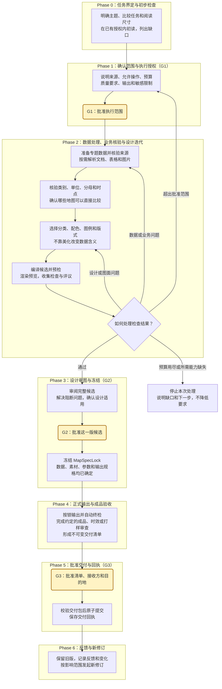
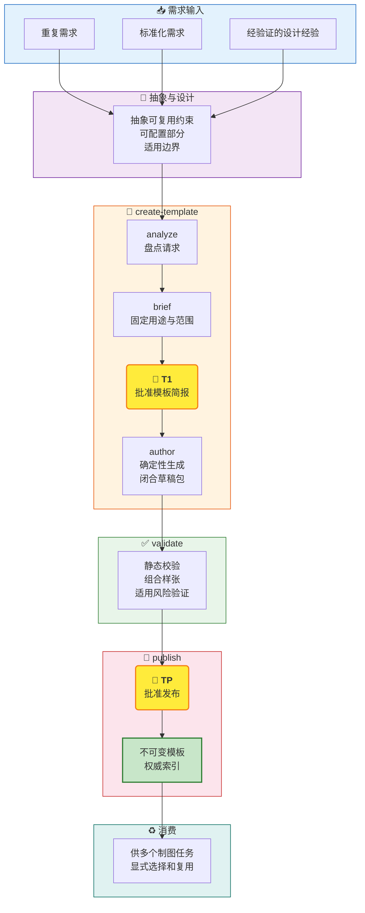

# 标准专题图制图流程说明

> 任务驱动、有控制的迭代、可靠交付

更新日期：2026-11-12（Asia/Shanghai）

状态：**目标流程设计与当前实现对照。目标流程不等于已实现能力，不作为运行时机器协议。**

**与其他说明的关系**：[总体流程](制图智能体总体流程.md)统一阶段名称、术语、审批、修订和实施计划；本文重点说明专题数据、表达方法和比较关系。后续共同规则变更应先同步总体文档，再检查三份任务说明；当前执行始终以 Skill、协议和能力策略为准。

---

## 关于这份文档

这份文档说明专题图如何在统一主流程中完成数据核验、设计、出图和交付，并对照当前 CLI 的实际能力。项目制图、模板资产研发、能力研发与准入是三个独立协作的生命周期；地图设计和生产交付则是同一次项目制图的前后阶段。

**一句话总结**：先确认用途、查清数据，再选择合适的表达、看图修改；设计获批后按固定方案出图并交付。每张地图都要有可检查的设计方案，但不必每次先创建并发布一个公共模板。

### 怎么读这份文档

- **目标设计**：描述理想的职责、阶段、交接和质量要求。不等同于已经有对应的命令、Schema、自动修订或策略授权。
- **当前实现**：以 `skills/carto-agent/` 里的工作流、Schema、策略、注册表和代码为准。本文不是机器运行协议，不会新增业务路由或审批旁路。
- **待实现**：必须先经过设计确认、协议与实现同步修改、合法/非法样例和自动测试，再走能力准入流程才能启用。不能直接拿本文当执行依据。

### 当前能力边界

- 唯一准入的业务场景是 `general_thematic_mapping`，能力档案 `general-thematic-mapping@3.0.0`，实现 bundle `general-thematic`，允许几何 `raster`，模板 `map-scenario/general-thematic-map@3.0.0`。
- 正式入口只处理用户提供的已分类栅格、有限参数化网格、A4 横版 300dpi、PDF+PNG 输出。`production_enabled: false`。
- 分级统计还没开放；比例符号等矢量候选代码虽然存在，但不等同于这些表达已经拿到正式准入。
- 本文修订不改变 T1/TP/G1/G2/G3，不放宽数据权限、字段约束、能力策略或默认拒绝行为。

---

## 一、设计判断：三个生命周期，不是一条必经长链

### 1.1 三个生命周期各管什么

| 生命周期 | 核心问题 | 完成标准 |
|---|---|---|
| 项目制图 | 这次用什么数据、怎样表达、如何出图并交付？ | 数据与设计适用，实际输出通过验收，精确成果经授权交付 |
| 模板资产研发 | 哪些内容角色、约束和配置值得重复使用？ | 适用范围明确，通过验证和 T1/TP，发布可复用版本 |
| 能力研发与准入 | 系统是否能可信地读取、计算、绘制和检查？ | 协议、实现、测试和业务验收齐备后才启用 |

地图设计与生产交付仍需分清职责，但它们属于项目制图内部阶段，不是另一组与总体文档不同的“第三个生命周期”。

### 1.2 原流程的问题和调整

原流程的主要问题不是步骤太多，而是三个生命周期被串行绑死了、设计判断不够显眼、反馈和修订路径不够清楚。

| 原流程的写法 | 本文的调整 |
|---|---|
| 每次制图先跑 create-template | 已有模板直接复用；模板研发是独立生命周期，按需进行 |
| 数据画像一次性收口统计、语义和配色 | 目标上区分数据事实、业务语义和制图表达，避免过早冻结视觉选择 |
| Phase 2 画在 G1 前面，但又标注"G1 后准备" | 正式数据准备放到 G1 之后；G1 前只做已有授权内的有限探索 |
| 设计被塞在 compile 一个步骤里 | 显式拆开语义核验、表达设计、图面提案和确定性编译 |
| preview 主要证明渲染能跑通 | 同时也形成设计评议的依据；问题回到对应责任层，有边界地迭代 |
| 人工审图放在 deliver 之后 | 设计审图进 G2 前，必要的成品审查进 G3 前；交付后属于使用反馈 |
| 六种网格样张就算代表模板质量 | 保留组合覆盖，补充数据边界、视觉风险和比较语义的验收设计 |
| 出错就"重试"或"全部重跑" | 区分执行故障、设计修订和授权变更，按依赖判断哪些证据真正失效 |

### 1.3 保留不变的底座

独立审批、路径与作用域校验、不可变快照与摘要、受信工具、确定性编译、锁驱动渲染、独立检查、版本化证据、受限恢复、原子交付——这些全部保留。

> 注意：形式验证通过 ≠ 设计合理，签名回执 ≠ 业务解释正确。

---

## 二、总览：制图主流程 + 独立模板生命周期

### 2.1 制图任务主流程（目标设计）

下面的 Phase 是职责阶段，不是新增的 CLI 子命令：

**读图说明**：这是目标流程，不是当前 CLI 状态图。每次处理或修订前都要检查权限和剩余预算；有些核验应边处理边做，不能等全部工具运行结束才发现关键事实错误。数据问题回到数据处理，设计问题回到设计；超范围先修改简报并重新授权，预算用尽则停止。审图通过后才申请 G2，G3 通过后才实际交付。

成熟重复任务可以一轮通过，不要求每次都做多方案搜索。只有出现重要的表达歧义或检查失败才增加候选。**当前自动迭代、候选比较和局部失效重算还没完整实现**，图中的回边不能理解为可以回退状态文件或复用旧审批。

### 2.2 模板资产生命周期（独立于每次制图）

**三种使用路径**：

| 路径 | 说明 | 当前状态 |
|---|---|---|
| 复用已有模板 | 有兼容已发布模板时，不重复 author/validate/publish，也不重复申请该模板的 T1/TP；每次地图运行仍需自己的 G1/G2/G3 | 可执行 |
| 新建或升级模板 | 以独立运行完成 T1/TP，再把精确发布引用交给地图任务。不能直接消费暂存包或继承模板审批 | 按已准入能力执行 |
| 项目内设计 / 无模板 | 组合受信能力形成项目设计，不强制公共发布，但必须接受同等闭合检查、专业验收与锁定 | 待实现 |

> 新算法或新代码不是普通设计参数变化，必须独立开发、测试和能力准入，不能在制图运行中动态生成并执行代码来绕过能力边界。

---

## 三、制图任务各阶段详解

### Phase 0：任务界定与初步检查

**要解决的问题**：用户真正需要什么地图？已有材料够不够？哪些事实必须先搞清楚？

1. 明确用途、受众和阅读任务——定位、分布识别、大小比较、时间变化或关系判断，不能只填一个主题标签。
2. 明确输出媒介、阅读尺寸、地图清单、必需内容和验收目标。
3. 盘点已授权的来源，检查必要元数据、类别统计、时点、单位、CRS、范围、缺失与异常。
4. 列出阻断性缺口——类别含义不明确、指标分母缺失、来源许可问题、时点不可比、空间范围不足或能力缺失。不要靠模型编造答案。
5. 输出任务理解、证据摘要、待澄清事项和执行范围草案。

**当前对应**：`carto intent resolve` 和 `data inspect-raster / analyze-classification / clarify-classification`。这些是辅助入口，不是新业务路由。分类准备可能冻结本地快照，不是说完全没有副作用。

**权限边界**：G1 前允许的是已有授权内的探索，不是任意数据读取。仍需校验允许根、身份、租户/项目、工具能力和数据范围。意图解析成功、统计完成或用户回答了问题，都不等于签发了 G1。

### Phase 1：确认范围与执行授权（G1）

**共用边界**：G1 批准执行范围，不保证尚未核验的事实正确。G1 前只能在已有授权内做必要初读和检查；正式处理及外部调用必须具有覆盖该动作的有效授权。技术检查可以由程序完成，涉及含义、取舍或歧义的决定由有权人员确认；不要求每个数据项都重新人工签字。

**要解决的问题**：为了这个任务，系统到底被允许做什么？

地图简报应明确目的、数据来源、允许操作、范围与资源限制、输出目标、敏感限制、必需质量要求，以及已确定的设计约束与待设计事项。G1 不应该要求证据不足时就提前敲定所有视觉细节，但用途、数据含义和不可变约束不能当作普通排版开放项。

**产物与门禁**：`MapBrief` 与针对它的 G1（`approve-map-brief`）。当前由 `generate-map intake → brief` 准备对象；`compile` 验证 G1 后，重验已有的 ready 分类报告并组装正式数据包，而不是在此首次完成全部 GIS 分析。

**当前限制**：现有 Brief 仍绑定精确模板，运行请求也固定内容指纹。目标是在同一简报中分清“执行范围”和“允许设计事项”，不是拆出新的 G1 门禁。协议完成调整前，仍按当前绑定与重新审批规则执行。

### Phase 2：数据处理、业务核验与设计迭代

这是设计的核心阶段，不是把所有问题都丢给编译器自动决定。专题图也可以使用报告、表格和图片：需要的解析、提取、OCR 和来源核验复用[总体流程](制图智能体总体流程.md)的数据处理能力，不是海报或调研专属功能；这些扩展尚不能据本文直接执行。

| 子职责 | 要做什么判断 | 产出什么 |
|---|---|---|
| 数据核验与准备 | 来源、口径、时点、单位、空间事实、快照与处理结果是否可信且适用 | PreparedDataBundle、质量证据、未解决问题 |
| 业务语义确认 | 指标是什么、类别怎么解释、分母是什么、哪些地图可以比较 | 明确语义绑定、比较要求与依据 |
| 表达方案设计 | 方法、投影/范围/尺度、分类策略、视觉变量、图例与不确定性表达 | MapPlan（记录理由和约束）；能力缺口显式返回 |
| 图面实现提案 | 信息层级、地图框、图例、标题、标注、来源说明怎么组织 | 获准范围内的具体参数提案 |
| 确定性候选编译 | 解析完整依赖与参数，机械推导执行数据 | ResolvedMap、RenderScene、预检结果 |
| 实际数据预览与评价 | 渲染是否正确、是否可读、语义是否适用、是否完成阅读任务 | 预览、回执、检查结果、专业审阅及修订理由 |

**多图比较必须显式设计**：要说明是否要求统一类别含义、数值—颜色映射、断点、单位、分母、时点、范围或尺度。不是所有任务都需要全部统一，但允许的差异必须能解释。共享图例本身不能证明可比性。

**迭代规则**：

- 数据、单位或语义问题 → 返回准备/规划层
- 图例拥挤、文字层级等问题 → 返回图面实现层
- 能力缺失 → 返回能力诊断，不能静默降级
- 不能为了突出某个结论而挑选来源、断点或配色
- 每个候选和预览独立绑定摘要，被替换候选的证据不能用来批准新候选
- 达到预算上限后返回诊断与待决项，不无限自我修复，不降低必需质量要求

> 当前 `compile` 合并执行准备、规划和编译，`preview` 随后渲染。完整的有界自动设计循环还待实现。

### Phase 3：设计审图与冻结（G2）

G2 前进行设计审图，重点核对：类别含义、表达适用性、比较关系、缺失与限制、视觉层级、阅读尺寸下的可读性。模型可以辅助评议，但不能用自评代替独立检查或人工审批。

**进入条件**：选定候选没有尚未确定的执行参数；阻断性问题已解决；必需检查通过；警告按政策处置；批准人能看到将要冻结的实际预览和相关依据。

**当前执行**：`generate-map freeze` 重新验证候选、场景、模板、资源、预览与环境，验证精确 G2 后创建唯一的 `MapSpecLock`。冻结时不重新选择表达、不重算分类或优化布局，不引入第二份并行锁。

> 人工审图意见的结构化强制绑定还是待实现机制。现阶段的 `preview` 通过不能被描述为已自动证明设计合理。

### Phase 4：正式输出与成品验收

**目标顺序**：按锁输出 → 自动终检 → 完成简报要求的成品审查（以及适用的时效复核、印刷打样）→ 形成包含所需审查依据的不可变交付清单 → 在 Phase 5 申请 G3。不是所有任务都需要打样或额外专家会签，是否需要应在简报中明确；必需审查不能在事后省略。

审查实际 PDF/PNG 的内容、图例、字体、裁切、尺寸和阅读效果，不只看缩略预览。发现设计问题立即停止交付；不能让渲染器自行缩字、删类或换字体来通过检查。

**当前实现**：`check` 自动检查通过后即冻结 `DeliveryManifest`，人工可以在其后、G3 前审阅对应的实际成品。把审查记录强制纳入清单，是后续协议和状态机改造；不能给已冻结清单补字段后沿用旧摘要或旧 G3。

### Phase 5：批准交付与回执（G3）

G3 批准的是最终清单绑定的成品、接收方、目的地、许可与限制——不是抽象的"这张地图大体可以"。`deliver` 重新验证全部绑定，以同文件系统的可恢复事务原子交付。

当前交付包白名单：`map.pdf`、`map.png`、`README.md`、`delivery-manifest.yaml`、`checksums.sha256`。原始 TIFF/CSV、内部锁、审批材料、内部渲染回执和质量报告不随包交付。

### Phase 6：反馈与新修订

交付后的反馈用于发现实际阅读、使用和复用中的问题。如果交付对象本来就是审阅用草稿，必须在任务用途、成果状态和交付对象中明确区分。

需要修改时保留旧成果和证据，创建新修订。可复用经验可以提交模板提炼，但不能把业务数据、敏感内容或偶然布局直接打包成公共模板。

---

## 四、数据事实、业务语义与制图表达分离

### 4.1 三个维度各管各的

| 维度 | 示例 | 确认与变更原则 |
|---|---|---|
| **数据事实** | 像元值、有效计数、源 NoData、CRS、时间、范围 | 由工具测量并绑定来源；不能靠 LLM 凭空补 |
| **业务语义** | 编码 1 = 耕地；0 是有效类别还是未知；指标单位与分母 | 靠来源依据和有权确认者核验；统计本身不证明含义 |
| **制图表达** | 类别颜色、图例顺序、视觉层级、比较映射 | 在语义和约束内设计；权威规定或用户绑定选择要注明来源 |

三个维度分别检查，并可在设计中反复核对：数据格式和统计通过，不代表业务含义已确认；含义确认了，也不代表配色已选好。最终候选必须满足所需条件，但不要求所有设计任务都按一条僵硬的顺序完成。

澄清时优先问那些不能可靠确定的事实与意图。普通设计选择（字号、颜色等）可以由 LLM 提出有依据的方案供审阅，不需要把每个细节都转成用户必答问题。但具有规范意义的颜色、类别归并、无数据解释和比较口径不能随便美化。

### 4.2 当前分类合同：仍按既有严格规则执行

当前 `ready` 仅表示整份分类合同（含必需名称和颜色）完整，不等于数据使用已授权、业务解释已审定或地图已验收。`needs-clarification` 表示仍有必需项待澄清，不能用该报告继续图体渲染。

- `inspect-raster` 检查元数据与精确统计；`analyze-classification` 结合 TIFF+CSV 合同冻结快照形成准备报告——两者产出不能混淆。
- 未定义像元值、缺名称或缺颜色 → 进入动态澄清。0、255 与其他值遵循同一规则。
- `clarify-classification` 的 `based_on_digest` 绑定最初的无回答基线报告；再次提交完整替换 overrides，不与上次自动合并。
- 原始像元、NoData 和掩膜不改写；`semantic=nodata` 是显示合同，不是 GIS 数据重写。
- 最多 256 类；即使 `legend_policy=observed`，未观测类别的名称/颜色也须完整。
- 正式 bundle 由 G1 后的场景数据准备组件组装；调用者必须在正式工作流的授权链里。

---

## 五、模板研发：固化经过验证的经验

### 5.1 什么时候需要做模板

适合做模板的情况：重复制作同类成果、需要组织级统一规范、已有模板不能表达明确可复用的需求。**仅更换数据、在既有合同内选择参数，不应自动触发模板新版本。**

模板负责可复用规则、依赖和适用边界；数据实例负责本次事实；候选与锁负责最终选择。

### 5.2 当前 create-template 各步骤

| 步骤 | 做什么 | 边界 |
|---|---|---|
| `analyze` | 盘点请求、内容、数据角色、输出和能力 | Schema 合法 ≠ 场景已准入 |
| `brief` | 固定模板用途、内容范围、数据使用计划、输出及质量要求 | 等待 T1 |
| `author` | 按已批准简报及已准入场景实现，确定性生成闭合草稿包 | 验证 T1；不是 LLM 自由构图 |
| `validate` | 校验包、Schema、依赖锁、类型所有权、语义与能力；渲染合成样张并冻结场景/回执 | 当前覆盖六种网格组合 |
| `publish` | 重验模板包、依赖、样张、回执和环境绑定，写入不可变仓库及权威索引 | 精确 TP；同版本不可覆盖 |

### 5.3 样张验证

**当前已实现**：`1×1 / 1×2 / 2×2 × independent / shared` 六种组合，每种冻结场景、参数、外观、PDF/PNG 与真实渲染回执。

**目标补充的风险用例**：

| 风险 | 要验证什么 |
|---|---|
| 长标题、长类别名、多语言字符 | 字形覆盖、换行、物理字号与内容完整性 |
| 类别数接近容量边界 | 不静默删类、循环复色、缩字或改变含义 |
| 大量缺失或未观测类别 | 缺失与零值不混淆，图例展示规则可解释 |
| 极端空间长宽比、小而重要的区域 | 范围、尺度、可读性和必要细节是否适用 |
| 多图定义相同但观测集合不同 | 共享/独立图例正确，缺席类别不被误读 |
| 跨时点或跨区域比较 | 单位、类别含义和映射满足声明的比较要求 |
| 来源、参数或文件被替换 | 证据与输出漂移被拒绝，不是"样张还能打开就行" |

---

## 六、审批、审图与智能体职责

### 6.1 五个门禁各管什么

| 门禁 | 什么时候用 | 批准的是什么东西 |
|---|---|---|
| **T1** | template brief → author | 模板简报：用途、范围、规格、数据计划与质量要求 |
| **TP** | template validate → publish | 通过验证的精确模板包、适用边界与样张证据 |
| **G1** | map brief → compile | 本次任务、数据访问与操作范围、输出目标及精确模板绑定 |
| **G2** | map preview → freeze | 特定候选及其预览、执行和环境绑定（设计审图在此之前完成） |
| **G3** | map check → deliver | 精确成品集合、接收方、目的地、许可与限制（成品审查在此之前完成） |

**关键规则**：

- 不同 gate、对象、运行与身份作用域的回执不能互用。
- 澄清是补充事实/意图，审图是专业判断，审批是对特定对象授权——三者不能互相替代。
- 聊天中的"同意"或 IDE 命令许可不替代可信审批回执。
- 所有审批继续验证身份、动作、对象摘要、作用域、环境、策略、时效和 nonce。
- 审图发现严重问题必须停止冻结或交付。

### 6.2 各角色该做什么、不该做什么

| 角色 | 该做 | 不该做 |
|---|---|---|
| 主智能体 / 制图规划 | 理解用途、组织证据、提出表达方法、解释取舍和修订理由 | 编造数据含义、自行扩权、自签审批 |
| 冻结前图面实现 | 在约束内提出布局、标注与图例参数，依据反馈修订 | 为美观改变地理事实、指标口径或批准范围 |
| 确定性工具与编译器 | 统计、获准空间处理、字体度量、参数解析、机械推导 | 隐藏业务默认值或擅自改变设计 |
| 检查器 / 审图者 | 分别完成可形式化检查与适用性、可读性评议 | 把 Schema 通过或自评当作全部质量证明 |
| 外层编排器 / 审批系统 | 状态、预算、权限、精确对象、证据与恢复 | 以工作流完成代替设计正确 |
| 冻结后渲染器 / 交付服务 | 消费锁和绑定资源，输出、验证并交付 | 重新设计、下载替换资源、静默缩字删类或修改锁 |

### 6.3 受约束优化（待评审）

可能的后续方向：由人或 LLM 声明目标、优先级与不可变约束，程序在这些条件内求解候选（例如保留全部必需标签、限制最小字号、减少碰撞）。

但这不授权程序决定哪些标签"不重要"、改变真实坐标、重新选择分类或发明优化权重。目标函数、约束、算法版本和结果须可解释并进入证据。

> 当前仍遵守[设计原则](design-principles.md)：创意选择由 LLM/人明确，程序做形式验证与机械推导。本节不是对现行原则的覆盖。

---

## 七、修订影响分析与失败恢复（目标机制）

安全不等于任何变化都全部重跑，灵活也不等于变了之后还能沿用旧证据。建议按依赖图记录：什么变了、哪些对象失效、需要谁重新批准。

| 变化或故障 | 返回哪层 | 失效范围与处理 |
|---|---|---|
| 冻结前调整合同允许的图例位置或文字间距 | 图面实现 | 新候选、新预览；未变且授权有效的数据证据可继续引用；是否重走 G1 取决于实际批准对象是否变化 |
| 修改分类定义、单位、分母或比较口径 | 语义/规划 | 重建受影响数据或表达、候选与检查；批准对象变了就重获审批 |
| 更换数据内容或快照 | 数据准备 | 新快照、统计与语义核验；若 G1 绑定该精确来源内容，须重新 G1 |
| 新增未批准来源、操作或敏感用途 | 授权责任方 | 停止相关动作，先更新简报重新授权 |
| 变更模板合同或依赖版本 | 模板研发/规划 | 新模板版本走 T1/TP；生成端更新引用并重走受影响批准与证据 |
| 冻结后改变任何影响执行的参数、字体或资产 | 对应设计层 | 新候选、新预览、新 G2、新锁；旧锁不变；重做正式输出、终检及 G3 |
| 相同锁、输入和环境下的工作进程崩溃 | 执行/渲染 | 按受限重试与恢复规则创建新 attempt，不重新设计、不重放审批 |
| 终检失败或人工成品审查发现问题 | 检查/设计层 | 停止交付；按根因修订，不能把失败当可忽略的 warning |
| 成品清单、接收方或目的地变化 | 交付责任方 | 形成新批准对象重新 G3；若同时改变上游批准范围，也须更新相应批准 |
| 提交结果未知 | 交付服务 | 查询幂等事务状态并重验已提交包，不能盲目覆盖或重复消费 G3 |

> 当前执行限制：该表定义目标行为，不等于已有任意步骤回退或增量重算的 CLI。`retry` 是受限故障恢复，不是修改已绑定请求的设计入口。

---

## 八、当前可执行流程与技术对照

### 8.1 当前真实顺序

```mermaid
graph TB
    subgraph PREP["📥 意图与分类准备（辅助入口）"]
        direction LR
        INTENT["intent resolve"]
        INSPECT["data inspect-raster"]
        ANALYZE["data analyze-classification"]
        CLARIFY["data clarify-classification"]
    end

    subgraph TEMPLATE["📋 模板选择"]
        SELECT["用户显式选择<br/>兼容的已发布模板"]
        NEW["如确需新建<br/>────────<br/>另起 create-template<br/>完成 T1/TP<br/>取得发布引用"]
        SELECT -.->|"需要新建或升级"| NEW
        NEW -->|"取得发布引用后"| SELECT
    end

    subgraph INTAKE["📝 intake"]
        INTAKE_STEP["解析用户意图<br/>验证模板兼容<br/>作用域·能力·源引用"]
    end

    subgraph BRIEF["📋 brief"]
        BRIEF_STEP["绑定精确模板<br/>数据访问·语义<br/>允许操作·输出要求"]
    end

    G1_GATE("🔐 <b>G1</b><br/>approve-map-brief")

    subgraph COMPILE["⚙️ compile"]
        COMPILE_STEP["验证 G1 → 安装模板<br/>重验 ready 报告并组装数据包<br/>MapPlan → 候选/场景/预检"]
    end

    subgraph PREVIEW["🖼️ preview"]
        PREVIEW_STEP["按候选冻结的后端渲染<br/>核验回执与环境指纹<br/>────────<br/><i>人工设计审图</i>"]
    end

    G2_GATE("🔐 <b>G2</b><br/>approve-freeze")

    subgraph FREEZE["🔒 freeze"]
        FREEZE_STEP["重验候选·资源·预览·环境<br/>→ <b>MapSpecLock</b>"]
    end

    subgraph RENDER["🎨 render"]
        RENDER_STEP["消费锁与绑定输入<br/>独立 attempt 下<br/>生成不可覆盖输出"]
    end

    subgraph CHECK["✅ check"]
        CHECK_STEP["成品检查 → 处置 warning<br/>→ Final ValidationReport<br/>→ <b>DeliveryManifest</b>"]
    end

    subgraph REVIEW["👁️ 人工成品审查"]
        REVIEW_STEP["核对实际 PDF/PNG<br/>尺寸·文字·裁切·颜色<br/>图例·来源·接收目标"]
    end

    G3_GATE("🔐 <b>G3</b><br/>approve-delivery")

    subgraph DELIVER["📦 deliver"]
        DELIVER_STEP["重验 Manifest·报告·锁<br/>attempt·文件摘要·精确 G3<br/>────────<br/>staging 校验 → 原子提交<br/>→ DeliveryReceipt"]
    end

    PREP --> SELECT --> INTAKE_STEP --> BRIEF_STEP --> G1_GATE --> COMPILE_STEP --> PREVIEW_STEP --> G2_GATE --> FREEZE_STEP --> RENDER_STEP --> CHECK_STEP --> REVIEW_STEP --> G3_GATE --> DELIVER_STEP

    style PREP fill:#e3f2fd,stroke:#1565c0
    style TEMPLATE fill:#f3e5f5,stroke:#6a1b9a
    style INTAKE fill:#fff3e0,stroke:#e65100
    style BRIEF fill:#fff8e1,stroke:#f9a825
    style COMPILE fill:#e8f5e9,stroke:#2e7d32
    style PREVIEW fill:#e0f7fa,stroke:#00838f
    style FREEZE fill:#c8e6c9,stroke:#2e7d32
    style RENDER fill:#fce4ec,stroke:#c62828
    style CHECK fill:#f3e5f5,stroke:#6a1b9a
    style REVIEW fill:#fff9c4,stroke:#f9a825
    style DELIVER fill:#e8eaf6,stroke:#283593
    style G1_GATE fill:#ffeb3b,stroke:#f57f17,stroke-width:2px
    style G2_GATE fill:#ffeb3b,stroke:#f57f17,stroke-width:2px
    style G3_GATE fill:#ffeb3b,stroke:#f57f17,stroke-width:2px
```

图中的人工审图是门禁前的操作要求，不代表当前 CLI 已保存并强制核验了完整的专业审图记录。前置辅助命令按需调用，不要求重复执行所有统计入口。

### 8.2 generate-map 各步骤

| CLI 步骤 | 做什么 | 产出/边界 |
|---|---|---|
| `intake` | 从用户意图解析场景、主题和任务，验证模板兼容、作用域、能力和源引用 | 不从模板反填缺失意图 |
| `brief` | 绑定权威索引中的精确模板、数据访问、语义、允许操作和输出要求 | MapBrief、G1 对象摘要 |
| `compile` | 验证 G1、安装模板，重验分类准备报告并组装数据包，再生成计划和候选 | PreparedDataBundle、MapPlan、ResolvedMap、RenderScene、预检 |
| `preview` | 按候选冻结的后端渲染，核验回执和环境指纹 | 预览文件、预览证据、G2 上下文 |
| `freeze` | 重验候选、资源、预览和环境，验证 G2 | create-once MapSpecLock |
| `render` | 使用锁与绑定输入，在独立 attempt 下生成不可覆盖输出 | PDF/PNG、RenderReceipt、RenderAttempt、FormalRenderEvidence |
| `check` | 对成功 attempt 执行注册版本的成品检查 | Final ValidationReport；通过后冻结 Manifest |
| `deliver` | 重验 Manifest、报告、锁、attempt、文件摘要和 G3 | 同级 staging 校验后原子提交 |

### 8.3 当前输入、布局、表达与渲染约束

**输入**：自包含 GTiff、已知 EPSG 投影坐标、单波段 8/16/32 位整数、north-up。TIFF ≤256 MiB、源像元 ≤1600 万。CSV ≤1 MiB、UTF-8。连续值、多波段、旋转、地理 CRS 不在此链内。

**布局**：仅 `1×1 / 1×2 / 2×2`，独立或共享图例。单图 `main-view`，多图 `view-r{row}-c{column}`。不允许未使用源、重复面板或缺失地图框。

**空间**：所有源 CRS 一致并匹配模板，不隐式重投影。每个面板保持对应源范围，共享图例不自动统一范围或比例尺。

**图例**：严格比较完整类别定义及 `legend_policy`。容量或字形溢出直接拒绝，不自动改色、删类、缩字。

**编译**：LayoutResolver 做合同驱动坐标推导；RasterPortrayalCompiler 与 RasterSceneCompiler 固定表达和页面，不是自由布局搜索器。

**后端**：`rasterio-matplotlib-page`，每面板一层分类栅格，nearest 采样，保留源掩膜。

**输出**：A4 横版 297×210mm、300dpi、PNG 3508×2480、PDF 物理页面绑定 TTF。正式输出位于 `output/<lock-id>/formal-map/<attempt-id>/`，不覆盖旧 attempt。

**终检**：验证文件媒体、尺寸/DPI、字体/字形、实测布局、图例策略、场景声明、许可、敏感内容以及各类绑定。

**证据强度**：HMAC 证明持钥渲染器签发及对象绑定，不是硬件证明、OS 沙箱证明或逐像元语义正确证明。

> 当前参数化网格是受限实现，不意味着"标准专题图"只能这样设计。海报等目标可以有不同的表达和布局，不能由此推导当前已支持 freeform、mosaic、inset、CMYK 或任意输出规格。

---

## 九、演进顺序与完成标准

### 9.1 建议落地顺序

实施阶段统一采用[总体流程](制图智能体总体流程.md)第十三节的 A0–A5。这里列出本任务的重点，不另设一套阶段编号；这些阶段不等于 Phase 0–6，也不等于审批门禁。

| 阶段 | 标准专题图的重点 |
|---|---|
| A0 | 对齐术语、当前能力和批准对象，保留可运行基线 |
| A1 | 先在现有栅格链实现合法设计修订、审图记录和失败恢复 |
| A2 | 分清数据事实、业务含义和配色；按需共享文档、图片解析能力 |
| A3 | 逐项接入新的专题数据和表达规则，验证单位、分类及比较关系 |
| A4 | 按准入范围扩展版式、输出和项目内设计，不直接开启任意组合 |
| A5 | 验证真实任务、故障恢复与精确交付；生产准入另行决定 |

### 9.2 仍未开放的能力

自动模板检索、项目内无模板生成、完整自动设计循环、增量修订、任意布局搜索、2×1/3×3 等未声明网格、mosaic/freeform/inset、分位数/Jenks 断点、栅格多图层、真实 CRS 转换的正式接入、生产数据处理、外部底图联网与公网发布。

`general-thematic-map@4.0.0` 与 `matplotlib-vector-page` 属于矢量工程候选，未获当前能力策略登记。当前 `production_tasks` 为空。

### 9.3 质量与完成标准

分开记录，不要合并成一条"成功"标记：

1. **数据与语义**：来源和口径可核验，重要歧义已解决，不编造事实。
2. **制图设计**：表达适用、比较成立、可读且限制明确，必要专业审图完成。
3. **生产一致性**：候选、预览、锁、实际输出与环境绑定可验证，成品检查通过。
4. **授权交付**：精确 G3、清单、事务及交付回执完整，接收方和目的地正确。
5. **能力验收**：合成测试、真实任务验收、生产准入分别记录，不能用前者代替后者。

建议关注的指标：首次设计审阅通过率、语义错误与遗漏、非必要澄清次数、修订返工量、权限越界阻断、成品与预览一致性、总成本与等待时间——而不是命令、Schema 或智能体的数量。

---

## 十、相关文档

| 文档 | 与本文的关系 |
|---|---|
| [制图智能体总体流程](制图智能体总体流程.md) | 统一阶段、术语、审批、修订和 A0–A5 实施顺序 |
| [设计原则](design-principles.md) | 当前职责归属依据 |
| [总体架构](carto-agent-architecture.md) §6.3–6.7 | 已提出规划、图面实现、锁后渲染及分层修订 |
| [地图生成 TRD](carto-generate-map-TRD.md) | 有模板/部分模板/无模板共用流程是目标 |
| [模板创建 TRD](carto-create-template-TRD.md) | 独立模板研发、合同与发布生命周期依据 |
| [审批门禁手册](carto-gate-approval-manual.md) | 当前审批对象、签发、验证与恢复的操作依据 |
| [海报地图流程说明] | 已移除；其他布局与表达的目标设计对照可从 git 历史取回 |
| [Carto Agent Skill](../skills/carto-agent/SKILL.md) / [路由](../skills/carto-agent/workflows/routing.md) | 唯一运行入口、能力准入和宿主接入边界 |
| [生成工作流](../skills/carto-agent/workflows/generate-map.md) / [模板工作流](../skills/carto-agent/workflows/create-template.md) | 当前 CLI 顺序、产物与状态边界 |
| [分类栅格工作流](../skills/carto-agent/workflows/raster-classification.md) | 分类准备、冻结快照、GIS 证据及限制 |
| [统一 bundle 准备器](../skills/carto-agent/scripts/carto_core/workflow/preparation_bundle.py) | G1 后正式准备、规划与候选编译的实际调用关系 |

---

**总结**：以用途与证据驱动设计，以专业判断和形式验证共同收口，以不可变锁驱动生产，以精确授权完成交付。模板服务于这些活动，而不是成为每次制图的强制前置工程。
