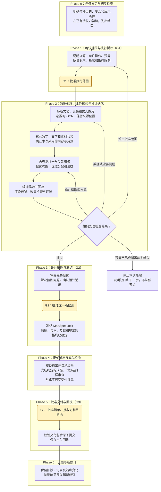
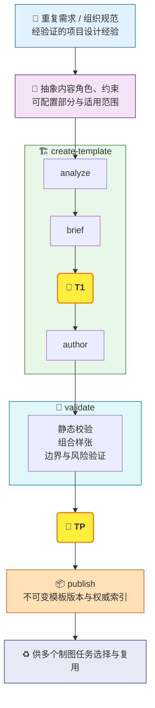
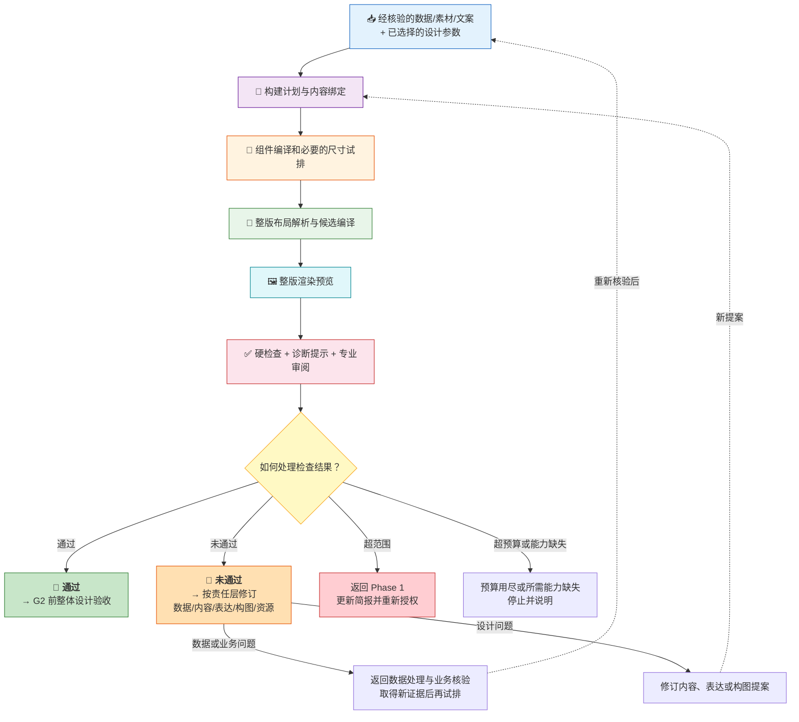

# 海报地图制图流程说明

> 统一主流程，复合内容协同设计，整版验收与可靠交付

更新日期：2026-11-12（Asia/Shanghai）

状态：**目标流程设计与当前实现对照。目标流程不等于已实现能力，不作为运行时机器协议。**

**与其他说明的关系**：[总体流程](制图智能体总体流程.md)统一阶段名称、术语、审批、修订和实施计划；本文重点说明文档与图片处理、复合内容和版式。后续共同规则变更应先同步总体文档，再检查三份任务说明；当前执行始终以 Skill、协议和能力策略为准。

---

## 关于这份文档

本文替换原有“先创建并发布海报模板，再接入真实数据”的串行说明，与 [标准专题图制图流程说明](标准专题图制图流程说明.md) 采用相同的任务、审批、迭代、冻结、验收和交付逻辑。海报的内容策划、自由构图、异构素材和印刷验收作为主流程内的能力扩展，不另建一套生产控制体系。

**一句话总结**：海报地图不是“更自由但更少验证的地图”，而是在同一可信主流程中，拥有更丰富内容和更大受控设计空间的地图制品。文档与图片素材的解析、识别和提取属于数据处理；哪些内容进入海报、如何解释与排版，属于后续内容策划与设计。

### 怎么读这份文档

- 除“当前能力与接入边界”及明确标注的实现说明外，本文描述的是**目标流程**。阶段名称、需求卡、关系图和检查项目不代表现有 CLI、Schema 或检查器已经支持。
- 当前执行仍以 `skills/carto-agent/` 内工作流、Schema、策略、注册表和代码为准。本文不能作为运行时机器协议、数据授权或审批回执。
- 本文不新增顶层业务路由、海报专用锁或审批编号，不放宽 T1 / TP / G1 / G2 / G3；所有扩展必须同步完成协议、实现、合法/非法样例、自动测试和能力准入。
- 当前仅准入 `general_thematic_mapping` 的有限分类栅格链，尚未准入完整海报能力。不能通过修改模板声明、扩展名或输出参数，把当前 A4 图件冒充已实现的海报流程。
- 本文说明目标方法，不会自动改变代码或策略，也不代表真实海报任务已经验收。

---

## 一、统一的是什么，海报特殊在哪里

### 1.1 专题图与海报不是互斥类别

应区分业务用途、内容组织和输出媒介。一张经济发展海报可以同时是一件专题地图制品；“海报”不必成为新的业务场景分类。

| 维度 | 要回答的问题 | 示例 |
|---|---|---|
| 业务用途与主题 | 表达什么，支持什么判断？ | 土地覆被、经济发展、风险分布 |
| 内容组织与表达 | 用哪些内容共同解释？ | 单地图、多地图、地图与图表/文字/图片组合 |
| 输出与使用媒介 | 在什么条件下阅读和使用？ | 报告插图、展板、灯箱、屏幕展示、印刷图件 |

当前 A4、分类栅格、有限网格是实现范围，不是“标准专题图”的定义。海报也不天然要求自由布局、固定尺寸、固定主图面积或固定数量的辅助图表。

### 1.2 共用主流程，扩展阶段内部的设计方法

| 层面 | 统一要求 | 海报需要扩展的内容 |
|---|---|---|
| 任务与授权 | 用途、受众、来源、范围、允许操作、验收目标 | 阅读层次、展示条件、素材使用和印刷需求 |
| 数据与资源 | 来源与版本可核验，权限和处理证据闭合 | 文字、关键数字、图表、照片、图标、字体等资源 |
| 设计迭代 | 提案、编译、预览、评议、修订 | 内容编辑、关系组织、多候选构图和整版试排 |
| 布局约束 | 显式声明，确定性解析，违反约束时诊断 | 不等大区域、层级、受控叠置和 inset 关系 |
| 验收与审批 | G2 前设计审图，G3 前成品审查 | 图文一致性、跨组件语义与媒介适用性 |
| 冻结与生产 | 内容和依赖齐全的候选、唯一锁、固定依赖和输出合同 | 冻结整张海报，而不只是主地图 |
| 修订与交付 | 新证据、明确失效范围、精确授权和可恢复交付 | 地图、文字、图表、图片分别识别变更影响 |

**不做两件事**：不把海报强行压成“主图加几个边注框”，也不为海报复制一套状态机、审批、锁和交付机制。

---

## 二、总览：制图主流程 + 独立模板生命周期

### 2.1 海报地图主流程（目标设计）

Phase 编号与标准专题图说明一致，是职责阶段，不是新增 CLI 命令。



**读图说明**：这是目标流程，不是当前 CLI 状态图。每次处理或修订前都要检查权限和剩余预算；有些核验应边处理边做，不能等全部工具运行结束才发现关键事实错误。数据问题回到数据处理，设计问题回到设计；超范围先修改简报并重新授权，预算用尽则停止。审图通过后才申请 G2，G3 通过后才实际交付。

已有成熟方案可以一轮通过；复杂任务才展开多候选和多轮试排。共用主流程不等于每次必须执行同样多的内部步骤。

### 2.2 模板资产生命周期（按需、独立）



- 有兼容已发布模板：直接复用，不在每次制图时重复 T1/TP；各地图运行仍须自己的 G1/G2/G3。
- 无合适模板：目标上允许项目内完整设计进入同一生成与验收链，不必先公共发布；**当前这种路径尚未实现**，不能把暂存模板包用于正式入口。
- 确需可复用新模板或升级：另起模板研发运行，完成验证与 T1/TP，再将精确发布引用交给地图任务。
- “模板不打包本次业务数据”不等于“项目设计不能参考已获准的实际数据和素材”。先完成项目设计、再提炼通用模板，同样是合理路径。
- 组合已准入能力属于设计；开发新算法或执行代码属于独立开发与准入，不在制图运行中动态执行模型生成的代码。

---

## 三、主流程各阶段的职责与交接

### Phase 0：任务界定与初步检查

**目的**：先确定这张海报需要帮助读者理解什么，而不是先决定分几栏或放几张图。

应明确：

1. 主题、受众、阅读任务，以及哪些结论需要证据支持；不预设必须得到某种有利结论。
2. 展示环境、预期阅读距离、页面尺寸范围、屏幕或印刷目标。尺寸和字号须依据实际任务确定，不把示例数值当作通用规则。
3. 必需、期望和可选内容；哪些信息首先可见，哪些留给进一步阅读。
4. 数据、文字、图像、图标、字体及品牌资源的已知来源与可用性。
5. 指标口径、时间、边界版本、素材真实性、来源许可和能力方面的待解决问题。

**交接**：任务理解、初步内容清单、来源摘要、画像及待解决问题。优先复用 `MapIntent`、请求和 `MapBrief` 的设计，不为每个小步骤创建新顶层协议。

**权限边界**：有限探索仍受已有授权、允许根、身份、工具和敏感信息限制。不能因处于“画像阶段”就任意读文件、联网下载或上传数据；意图解析和用户回答问题不等于 G1。

### Phase 1：确认范围与执行授权（G1）

**共用边界**：G1 批准执行范围，不保证尚未核验的事实正确。G1 前只能在已有授权内做必要初读和检查；正式处理及外部调用必须具有覆盖该动作的有效授权。技术检查可以由程序完成，涉及含义、取舍或歧义的决定由有权人员确认；不要求每个数据项都重新人工签字。

地图简报应固定用途、必需内容、可访问数据与素材、允许操作、资源预算、质量要求和交付目标，并区分：

- **不可变要求**：业务含义、来源边界、必保内容、禁止暴露的信息、输出底线等。
- **允许设计事项**：哪些表达、图表形式、构图和视觉参数可以在约束内提出方案。
- **未解决问题**：影响后续某项决定的问题必须在该决定执行前关闭；不能靠视觉设计掩盖。

**门禁**：G1 批准特定地图简报与执行范围，不另设一个含义模糊的“海报数据使用审批”。素材获取、图像处理或新增来源等操作必须在明确授权内。

**当前限制**：现有 Brief 和运行请求仍按既有合同绑定，尚未支持任意设计开放项。上述划分不能用于绕过当前输入指纹检查或自动继承旧审批。

### Phase 2：数据处理、业务核验与设计迭代

这是海报的核心设计阶段。第四节展开其方法，第五节规定跨组件关系。

- 先在统一数据处理阶段解析获准文档、表格和图片，提取带来源定位的事实候选与素材引用，再验收供设计使用；不能把识别结果直接当作已核实事实。
- 内容策划、表达选择和构图允许互相反馈，而不是模板发布后只调整少量图例和标签。
- 地图与辅助内容均须证明其必要性和依据；不能为了版面丰满增加无关图表，也不能因为空间不足静默删除必保信息。
- 每轮记录提案、依据、具体参数、候选、预览、评议与修订原因。由编译器生成闭合执行描述，不由 LLM 直接提交任意渲染代码。
- 语义问题返回准备/规划层，图面问题返回构图层，能力不足返回能力诊断，超出授权范围返回 G1 或相应责任方。

**进入下一阶段的条件**：选定候选不含占位资源、未经确认的事实或尚未确定的执行参数；阻断问题解决，必需检查通过，专业审阅可追溯。

### Phase 3：设计审图与冻结（G2）

G2 审阅的是**整张海报候选及其预览与证据**，不只是一张主地图 PNG。

检查四个问题：

1. 地图的地理、指标与表达语义是否正确？
2. 地图、图表、数字、文案和图片之间是否一致？
3. 读者能否按任务要求理解重点、关系与限制？
4. 所有内容、资源、布局参数和输出规格是否已确定，且都有固定来源与版本？

设计审图通过并取得有效 G2 后，才冻结 `MapSpecLock` 的完整制品执行输入。地图、图表、文字、裁切、层级、字体、颜色规则、依赖和目标输出均应进入绑定链；不能主图已冻结而旁边的数字仍可替换。

**目标扩展边界**：沿用唯一锁机制并按需演进其合同，不新建并行 `PosterLock`。当前锁及组件合同尚不支持本文全部海报内容，不能直接填入未知字段。

### Phase 4：正式输出与成品验收

**目标顺序**：按锁输出 → 自动终检 → 完成简报要求的成品审查（以及适用的时效复核、印刷打样）→ 形成包含所需审查依据的不可变交付清单 → 在 Phase 5 申请 G3。不是所有任务都需要打样或额外专家会签，是否需要应在简报中明确；必需审查不能在事后省略。

海报要检查整版的地图、图表、文字、图片和阅读关系，也要按约定检查颜色、图像清晰度和打印效果。组件各自通过不代表整版通过；没有要求的实物打样不应额外强加给用户。

**当前实现**：`check` 自动检查通过后即冻结 `DeliveryManifest`，人工可以在其后、G3 前审阅对应的实际成品。把审查记录强制纳入清单，是后续协议和状态机改造；不能给已冻结清单补字段后沿用旧摘要或旧 G3。

### Phase 5：批准交付与回执（G3）

G3 批准特定成果文件集合、接收方、目的地、许可与限制，交付服务重验后执行可恢复的原子提交并写回执。审图意见、素材获取许可、IDE 命令许可都不能代替 G3。

目标海报包包含任务要求的正式文件、说明、清单和校验信息；屏幕版、印刷版或其他格式必须逐项列明，不自动增加可编辑工程、原始数据或素材文件。

当前白名单仍是 `map.pdf`、`map.png`、`README.md`、`delivery-manifest.yaml`、`checksums.sha256`。扩展目标或文件类型须先更新对应合同与验证，不能依据本文更改交付目录。

### Phase 6：反馈与新修订

交付后的反馈关注真实阅读、展示和复用效果，不承担首次专业验收责任。如果交付对象本来就是审阅草稿，应在任务和成果状态中明确，不冒充正式验收通过的制品。

修改时保留旧锁、旧成果和旧证据，按第九节创建新修订。通用经验可进入模板提炼；本次业务数据、照片、敏感信息与偶然布局不能直接变成公共模板内容。

---

## 四、海报协同设计的方法：保留原方法，调整发生位置

内容盘点、关系组织、空间约束、候选构图、区域分配与试排都在 Phase 2 为本次任务服务。模板研发只提炼其中值得复用的规则，不要求每张海报先发布一个模板。

### 4.1 画像与事实核验：区分测量、声明、估计和未知

海报画像应覆盖数据与内容，而不仅是 GIS 字段：

| 来源状态 | 示例 | 使用边界 |
|---|---|---|
| 已测量 | 实际文本长度、图像像素、要素数量、投影后范围、观测值 | 绑定来源、方法和版本，可供正式决策核验 |
| 用户声明 | 指标口径、素材用途、要求保留的内容 | 记录声明来源；需要外部依据的事实另行核验 |
| 估计 | 候选素材尚未取得时的长宽比、预估文案长度 | 仅支持早期草图；标明依据与不确定性，不能伪装成测量结果 |
| 未知 | 类别含义、缺失图片来源、未明确的时间口径 | 影响某项决定时阻断该决定，不编造补齐 |

- DataProfile 在本文中是特征与证据摘要的概念，不是已经实现的通用海报 Schema。
- 画像可以包含获准的统计值；“画像不是完整数据”不等于“画像不能出现任何数值”。敏感范围、类别行和素材正文不能进入普通日志。
- 空间单元数量、观测数量、类别数量和分级级数分别记录，不能把“若干地市”直接当作同样数量的数值等级。
- 几何比例依据选定投影、范围和地图行为计算，不能直接用经纬度跨度比确定页面宽高比，也不能通过拉伸地理图形填满框。
- 实际内容应满足设计验证的适用范围，不要求与早期估计逐字相等。超出容量或改变语义时，重新核验并触发修订。

#### 4.1.1 文档与图片解析、提取属于统一数据处理

海报输入不只包含现成 GIS 数据，也可能包含报告、扫描件、表格、照片、示意图和参考版式。它们共用数据处理入口，不另建一条“素材制图”主流程。下列内容为目标能力，不表示当前已准入所有格式或识别工具。

```text
获准输入及原始快照
  → 格式识别与安全解析
  → 文本 / 表格 / 嵌入图片 / 图像元数据提取；必要时 OCR 或视觉辅助识别
  → 来源定位、结构归一、歧义与错误检查
  → 事实和素材验收
  → 数据证据与素材引用交给内容策划、表达和构图
```

| 输入或处理 | 数据处理负责 | 不能直接推导的结论 |
|---|---|---|
| DOCX、可解析 PDF 等文档 | 保留段落、标题、表格、页码/对象等来源位置，提取正文、表格与嵌入素材及其关系 | 文档中的每句话都正确，或都应成为海报文案 |
| 扫描文档、截图 | 在已准入工具下识别文字/表格，记录页与区域、识别方法、歧义及核验结果 | OCR 识别成功即事实已确认；不得默默补小数点、单位、年份或合并单元格语义 |
| 照片、图标与其他图片 | 提取文件、尺寸、颜色/透明度及可用元数据，保留原图和派生关系，核验来源与用途 | 文件名、视觉识别或元数据自动证明拍摄地点、日期、授权或业务含义 |
| 图片中的地图、图表 | 区分“直接作为图片使用”与“识别其中信息”；有明确授权和能力时另做核验 | 按像素位置直接生成地理坐标；把图表估读值冒充原始统计数据 |
| 参考海报或版式图 | 提取被允许参考的结构和视觉特征，并标明是参考材料 | 把示例图中的数字、地点、品牌或照片当成本次事实和获准资产 |

**数据处理与设计的界面**：

- 解析器负责结构提取；模型可在受控上下文内辅助理解和提出事实候选；程序检查格式、引用与关系，必要时由有权人员核实语义。不能因为包含模型参与，就把提取活动移到不受数据权限约束的设计阶段。
- 每项事实候选应能回到原文件及段落、表格单元、页或图像区域；每个提取素材应绑定原文件摘要、对象位置、提取/转换过程和自身摘要。重排或修改原文后，不得继续沿用失效的来源定位。
- 原始输入、提取结果、人工纠正和设计用派生素材分别留痕；纠正 OCR 或表格解析错误不覆盖原文。识别置信度、证据充分性和业务确认是不同状态。
- 已验收数据回答“材料中是什么、可以采用什么”；内容策划回答“为了这次阅读任务选什么、怎样组织”；标题改写、摘要和结论文案不能改变已确认事实。
- G1 前只做已有授权内的必要本地初读和画像；正式解析、OCR、批量提取、联网识别或上传素材必须处于相应执行授权内。不得以文件已上传为由默认允许向第三方发送。
- 文档、图片中的提示词、脚本、宏、外部链接和嵌入对象均视为不可信输入；不作为宿主命令，不触发未批准代码或下载。正文、业务表格与敏感图像不进入普通日志。
- 交接可由既有数据包、证据与资产引用按需演进承载；不把完整原文件、未解决识别问题或用户隐私复制进模板包。设计需要重新提取或新增来源时返回数据处理与授权边界。

**验收条件**：来源可追溯、提取完整性与关键值已核验、未决项明确、敏感与使用限制可执行，设计使用的是已采用版本。依赖未核实提取结果的模块不能进入冻结候选；不能把“解析成功”当作“数据验收通过”。

### 4.2 内容需求卡：先说明内容为什么存在

每个内容模块建立需求卡，至少覆盖以下问题。下表是设计说明，不是可直接提交的协议字段。

| 需求 | 示例：一幅承担分布解释任务的主地图 |
|---|---|
| 内容身份与角色 | 主地图，与特定数据、图例和必要说明关联 |
| 阅读任务 | 让读者识别空间分布及重要差异，而非预设某个结论 |
| 必保内容 | 获准范围内应展示的地区、必需标签、缺失说明和来源 |
| 事实与语义依据 | 数据版本、时点、指标、单位、边界与类别解释 |
| 容量依据 | 实际范围、图例项、地名长度、密集标注区域；估计与实测分开 |
| 空间与视觉约束 | 不变形、可读字号、与关联说明的邻近关系；尺寸由任务与测量确定 |
| 可调整事项 | 获准的图框尺寸、标注布局、相容视觉参数与候选构图 |
| 不可调整事项 | 真实地理坐标、指标含义、来源、必保标签和未经批准的类别归并 |
| 验收与替代策略 | 如何判断可读；放不下时返回谁决策，是否允许改变整体布局 |

其他模块也要说明其任务：图表解释非空间比较或趋势，数字突出有依据的指标，正文解释方法与限制，照片说明场景，图标引导阅读或表达类别。没有明确任务的模块不因“版面有空”就自动加入。

### 4.3 关系组织：内容关系不等于几何邻近

建立主题分组、阅读关系、数据关系和依赖关系：

- 哪些模块共同回答一个问题，哪些属于补充信息？
- 哪张图例属于哪个视图，哪段文字解释哪组数据？
- 相同名称是否指相同区域和时点，相同颜色是否承载相同含义？
- 哪些内容需要邻近，哪些允许独立阅读，哪些必须一起显示或一起修订？

可使用“核心总览组、结构比较组、时间趋势组”等名称；不要把分组命名为 G1/G2/G3，以免与审批门禁混淆。

阅读顺序、主次关系和分组由人或 LLM 明确；程序验证绑定与已声明约束。主地图是否必须占最大连续区域，应依据任务而非海报身份一律硬编码。

### 4.4 空间建模：自由布局不是没有结构

分别描述容器布局角色、内容类型、数据/资源引用、渲染需求和检查要求。不能把图表、正文、照片和图标统一塞进边注类型，导致系统只会检查外框，无法核验内部内容。

| 约束类别 | 应明确的内容 |
|---|---|
| 画布与媒介 | 成品尺寸、单位、阅读条件、裁切/出血及安全区要求 |
| 容器与父子关系 | 内容属于哪个区域，inset 关联哪个父视图，是否独立范围和比例尺 |
| 尺寸与容量 | 最小可读尺寸、允许范围、固定或可伸缩方向、真实内容度量依据 |
| 地理与页面坐标 | 地图投影与空间事实不作为排版自由度；页面位置由布局解析 |
| 叠置与遮挡 | 允许的组合、层级、透明度、裁切、保护区和禁止遮挡的内容 |
| 对齐与邻近 | 必需关系与参考偏好分开，不把所有偏好都提升为硬规则 |
| 溢出与取舍 | 哪些只能拒绝，哪些可在批准范围内调整；不得静默删减或缩字 |

背景、装饰或 inset 可在**将来获准的明确叠置规则**下重叠；这不是取消碰撞检查。正文、图例和必保信息仍须有遮挡保护。出血允许背景越出裁切边，也不意味着正文可以任意越出安全区。

**与现行原则的关系**：当前 [设计原则](design-principles.md) 和已准入布局仍按各自的不重叠与能力约束验证。受控叠置须先澄清并同步修订原则的适用层级、Schema、解析器、检查器和测试；本文不直接授权例外。

### 4.5 候选构图：按需要比较，不固定候选数量

存在重要构图取舍时，可提出少量低保真候选，例如：

| 候选方向 | 需要比较的问题 |
|---|---|
| 主地图与辅助内容分区 | 主地图是否获得足够空间，辅助内容是否过于拥挤？ |
| 主地图居中、相关内容环绕 | 关系是否清楚，阅读路径是否混乱，是否产生无依据的视觉关联？ |
| 按主题或阅读层次分区 | 信息顺序是否有效，多个部分能否独立理解？ |

此时比较主题清晰度、关系组织、容量风险、阅读成本和实现可行性，不用合成数据占位图证明真实统计结论。成熟模板可只形成一个候选；复杂任务也不应无限增生方案。

候选选择及理由被记录，但方向性确认不自动等于 T1、G1 或 G2。审批仍以对应的正式对象为准。

### 4.6 区域分配与实际度量

对选定方向声明相对位置、尺寸范围、对齐、间距、层级和容量要求，再由程序执行字体度量、地理视图拟合及确定性布局解析。

- 文本度量必须使用候选绑定的实际字体与文字；估计长度只用于前期。
- 图片按实际主体和裁切许可安排，不能只按占位框长宽比推断可用性。
- 地图图框适配应尊重投影、范围与比例约束；显示哪些区域不能由裁切美化暗中改变。
- 约束无解时返回内容或构图层：换候选、调整获准参数或请求改变内容/媒介要求，不能自动删掉必保模块。
- 改变图表类型、视觉变量或分类策略可能改变解释含义，应返回相应设计责任层，不当作普通几何修复。

当前程序仍只做已准入的机械推导，不自行优化设计。自动搜索与求解如涉及创意选择，须先按设计原则完成职责评审，并固定目标、约束、算法与结果证据。

### 4.7 组件试排、整版预览与有界修订



- 模板验证可以使用合成 Fixture；项目候选必须用本次绑定的实际内容完成验收。组件样张和占位图不得替代整版证据。
- 新候选、新预览分别有独立摘要；替换任何影响执行的内容后，不能拿旧图或旧评议批准新候选。
- 设置修订次数、时间和资源预算；超限返回具体诊断与待决项，不“直到通过”为止无限循环。
- 当前状态机尚未支持上述完整自动循环。`retry` 是受限故障恢复，不是修改请求或回退步骤的设计入口。

---

## 五、复合内容与跨组件一致性

### 5.1 各内容类型的证据与检查责任

| 内容类型 | 必须绑定的依据 | 主要核验内容 |
|---|---|---|
| 地图 | 数据、时点、指标、边界、CRS、范围、表达规则 | 地理与指标含义、分类/符号、标签、图例及缺失解释 |
| 统计图与表格 | 数据引用、筛选/聚合过程、单位、轴或列语义 | 值与标签、排序、比例、单位、类别和缺失处理 |
| 关键数字与事实性文案 | 对应统计结果或来源；必要的计算、舍入与范围说明 | 文字结论和数字是否能追溯，是否夸大或改变事实 |
| 照片与事实性图片 | 来源、用途、拍摄或表达对象、必要时间信息、处理记录 | 与主题的真实关系，裁切和处理是否改变含义 |
| 图标与示意图 | 来源、用途、语义角色；若表达事实则另绑定证据 | 是否被误读为真实观测，是否与图例、正文一致 |
| 装饰内容 | 来源、使用权限、非事实性角色 | 不伪装为数据，不遮挡关键信息，不制造错误关系 |
| 字体与品牌资源 | 精确文件/版本、使用与嵌入条件 | 字形、替换、授权限制与输出适用性 |

图片和图标可以是装饰，但不能因“装饰”标签豁免来源与安全检查。合成或生成素材如果未来被准入，必须明确性质，不能冒充真实现场照片或观测数据；相关工具调用和外传仍须单独满足授权范围。

数据与素材中的文本、说明或嵌入内容不是执行指令。解析、下载、外部引用和主动内容处理必须经过受信能力与权限校验，不能让模型或素材指定任意执行代码。

### 5.2 跨组件关系必须显式验证

1. **时点与口径**：不同年度、区域或口径可以并列，但必须清楚标注，不能被解释成同一组数据。
2. **区域与聚合**：地图覆盖范围、统计图筛选范围和关键数字的地域口径应对应；合计关系须有明确聚合规则与必要容差，不能一律假定可简单求和。
3. **视觉含义**：同一类别跨组件的颜色、名称和顺序应符合声明的映射；有意采用不同编码时须避免误读。
4. **比较关系**：是否统一断点、单位、比例基准、时间范围和地图尺度由任务决定；共享图例或相邻排版不自动证明可比性。
5. **文字与数据**：数据发生修订后，关联的数字、图表、图例、标题和结论文案都进入影响分析，不能只更新主图。
6. **图像与说明**：图片说明与其对象、时间和裁切结果一致；事实性图片不能被无关的美观素材静默替换。
7. **阅读关系**：模块间的邻近、连线、指向或 inset 定位不得暗示未经证据支持的地理或因果关系。

事实、业务语义、表达选择和版式安排分别有责任方。不能为了故事效果挑选数据或分类，也不能把对设计方向的认可当作对数据真实性的证明。

---

## 六、整版冻结、渲染与输出合同

### 6.1 冻结整个制品，而不是只冻结主图

目标候选和锁应通过精确引用闭合以下内容，具体字段设计仍需协议评审：

- 数据与资源快照、语义绑定和处理证据；
- 地图、图表、数字、正文、图片、图标和来源说明；
- 组件关系、实际裁切、图层顺序、字体、颜色、布局与必要可复现算法参数；
- 所有正式目标的尺寸、媒介、颜色处理和质量要求；
- 组件渲染器、整版合成器及依赖环境；
- 所选候选、整版预览、验证结果和对应审图依据。

采用既有 `MapPlan → 候选 / RenderScene → MapSpecLock → 输出证据 → DeliveryManifest` 的概念链按需演进，不创建第二份并行计划或海报锁；也不向现有 Schema 直接添加未经定义的字段。

### 6.2 可以分别渲染，必须整版验收

目标上允许受信组件分别生成地图、图表和图像处理结果，再由整版合成器组合。每个组件的输入、版本、输出和最终合成关系都必须闭合，最终成果回执绑定完整海报。

- 组件检查通过不代表整版通过；整版可打开也不代表组件的数值和含义正确。
- 渲染阶段不得联网补图、替换字体、重选断点、改写文案或重新生成设计。
- 外部资源失效时使用已获准冻结的快照；没有合法快照则失败，不临时寻找替代品。
- 当前一页一个已准入静态后端不代表已实现异构组件渲染。多组件协作必须先补齐能力匹配、资源闭合和合成证据。

### 6.3 印刷与屏幕输出分别定义，不能只写“CMYK + 300dpi”

| 输出事项 | 应明确的要求 |
|---|---|
| 成品几何 | 页面尺寸、方向、裁切边、出血、内容安全区及允许误差 |
| 图像质量 | 实际放置尺寸和裁切后的有效像素；不能用文件元数据中的 DPI 代替检查 |
| 字体 | 绑定字体、字形覆盖、嵌入条件、是否允许转换及其后果 |
| 颜色 | 源颜色定义、转换方式、适用 ICC / 输出意图、透明度及印刷端要求 |
| 文件规范 | 目标端要求的 PDF 规范和版本，具体预检规则；不默认所有任务相同 |
| 屏幕目标 | 像素尺寸、颜色处理、阅读条件及其与印刷版的对应关系 |
| 交付前打样 | 是否需要局部原尺寸样张、色样或实物打样，由用途和验收合同确定 |

“PDF 的分辨率”不应被当作覆盖所有矢量、文字和栅格内容的单一属性。组件和效果按其实际输出方式验证，不能整体栅格化后仍宣称保留了未实现的矢量或可编辑性质。

屏幕预览与印刷成品可使用不同、但已经冻结的输出配置，不要求两者像素完全相同；应核验共同内容、地理与统计语义、布局意图，以及各自规格下的结果。任何允许差异或容差必须预先声明，不能在终检失败后临时放宽。

当前不支持本文完整的 CMYK、自由尺寸及印刷交付能力；ICC、输出标准与打样等要求须在相关能力实际建设时验证，不由文档声明自动获得。

---

## 七、模板研发与验证：独立、可复用、不绑定本次事实

### 7.1 什么值得成为模板

值得抽象的是内容角色、关系、布局约束、品牌/表达配置、适用范围与质量要求，而不是本次已经摆好的所有对象。

可重复使用的固定布局本身并非错误；问题在于是否明确其适用范围，以及是否把一次性设计强制包装为所有任务的前置模板。参数化模板应说明哪些参数可调、哪些内容容量已验证、哪些变化必须升级版本。

项目内设计也必须验证。无模板路径不等于免审、免锁或允许运行任意脚本；当前正式入口仍要求已发布模板，海报模板能力尚未准入。

### 7.2 T1/TP 与地图审批分开

| 模板步骤 | 目标职责 |
|---|---|
| analyze | 识别重复需求、内容角色、可复用约束与能力缺口 |
| brief / T1 | 确认模板用途、适用范围、参数、数据使用计划和验收要求 |
| author | 形成闭合草稿、依赖和代表性验证材料；不携带本次原始业务数据 |
| validate | 静态验证、组合覆盖、边界样张、整版渲染及专业样张评议 |
| publish / TP | 核对精确包及完整证据，发布不可变版本与索引 |

当前 CLI 的上述模板步骤只对已准入能力有效；不能将这张职责表当作海报发布已可执行。模板审批不替代任何地图运行的 G1/G2/G3。

### 7.3 模板样张与项目验收分开

| 验证层 | 样张或检查重点 | 不能替代什么 |
|---|---|---|
| 内容组件 | 字形、图表语义、图片处理、图例、组件输出 | 不能证明整版关系正确 |
| 组合与布局 | 容器关系、允许叠置、inset、阅读顺序、复合页面 | 不能证明本次实际数据适用 |
| 容量与边界 | 长标题、多语言、密集标签、较多类别、极端范围、不同图片比例 | 不能作为实际任务已验收的证明 |
| 跨组件语义 | 时点、口径、合计、颜色含义、图文关联 | 不能只靠截图相似性检查 |
| 输出与资源 | 字体、图像质量、颜色处理、最终目标、缺失或篡改资源 | 不能代替必要的人工和实物审查 |
| 实际任务 | 本次数据、文案、素材、用途和阅读条件下的整版表现 | 不能由合成 Fixture 代替 |

当前标准模板的六种网格样张只证明对应声明范围，不能用来证明海报自由构图能力。新模板验证覆盖应由其声明和风险导出，不固定为“六种”或“每个框测一次就够”。

---

## 八、审批、审图与角色分工

### 8.1 五个门禁保持一致，海报不另造一套

| 门禁 | action / object_type | 批准对象及海报关注点 |
|---|---|---|
| T1 | `approve-template-brief` / `template-brief` | 模板简报、内容角色、适用范围与验证要求 |
| TP | `approve-template-publish` / `template-package` | 精确模板包及代表性样张、适用限制 |
| G1 | `approve-map-brief` / `map-brief` | 本次任务、数据与素材访问、允许操作、预算、输出和不可变要求 |
| G2 | `approve-freeze` / `resolved-map` | 整张海报候选、整版预览及对应证据，不只主图 |
| G3 | `approve-delivery` / `delivery-manifest` | 精确成品集合、接收方、目的地、许可与限制 |

海报关注点中尚未被当前合同承载的内容，须先演进协议再强制执行；不能据表格伪造已有字段或审批能力。G2 摘要应来自正式预览生成的精确上下文，不能只计算一张图片的摘要代替；G3 必须绑定完整清单。

审批继续核验身份、动作、对象摘要、作用域、环境、策略、时效和 nonce。不同 gate、对象、运行和作用域的回执不能互用；一次性回执不能被重复消费来支撑迭代。

### 8.2 检查、评议、批准分别负责什么

| 类型 | 示例 | 处理方式 |
|---|---|---|
| 硬检查 | 源或值不一致、缺字、溢出、非法遮挡、缺资源、错误绑定 | 按明确规则拒绝，返回所属责任层；不能让模型豁免 |
| 诊断提示 | 内容密度、留白分布、视觉重量估计、阅读路径风险 | 提供证据和提示，不把模型分数或单一阈值当作普遍审美真理 |
| 专业审阅 | 主题是否清楚、表达是否适用、图文是否协调、重要信息是否易读 | 审阅精确候选，记录理由、问题、处置与接受范围 |
| 审批 | 是否允许执行、冻结或交付对应对象 | 由有权身份签发，程序验证精确绑定，不由模型自批 |

结构化审图记录及其强制绑定仍待实现。目标上，G2 前完成设计审图，G3 前完成必要成品审查；不能只增加一个可随意填写的“审图通过”布尔值，也不能把自评作为独立验收。

### 8.3 职责不是智能体进程数量

- **主智能体 / 规划职责**：理解需求、组织证据、提出内容和表达方案、解释取舍。
- **冻结前图面实现职责**：在约束内完成关系组织、构图提案、区域参数与修订。
- **确定性工具 / 编译器**：获准的数据与素材处理、测量、绑定、解析、编译和检查。
- **专业审图与审批责任方**：评价事实和设计适用性，对具体对象作出授权。
- **冻结后渲染与交付**：执行固定输入，不再设计或重新获取资源。

基线仍可由一个主智能体分阶段承担规划和图面职责。无需为每张需求卡、每个图表或每轮试排创建新智能体；程序与模型均不能拥有未授予的权限。

---

## 九、修订影响与失败恢复（目标机制）

任务范围、设计修订版（revision）、候选、渲染尝试（attempt） 和交付事务是不同概念。新设计不能通过修改原请求、覆盖文件或回退状态伪装为同一次执行。

| 变化 | 返回责任层 | 需要重验的范围 |
|---|---|---|
| 调整获准的间距或普通标签位置 | 图面实现 | 新候选、整版预览和检查；未变且授权有效的数据证据可继续引用；是否重走 G1 仍按实际批准对象判断 |
| 修改事实性文案、关键数字或标题结论 | 内容/规划 | 来源和语义，所有关联地图/图表/说明，整版候选及审图 |
| 更新数据、单位、时点或聚合规则 | 数据/语义 | 新证据及所有依赖内容；实际批准对象变化时重获 G1 等相应审批 |
| 改变图表类型、分类或视觉映射 | 表达规划 | 方法适用性、比较关系、图例与关联文案，重新编译和评议 |
| 替换或裁切照片、图标 | 素材/内容/图面 | 来源与许可、事实性角色、裁切语义、图像质量和关联说明 |
| 改变纸张、颜色处理或印刷条件 | 输出/规划 | 全版尺寸、文字与图像质量、输出匹配、打样要求；判断是否影响 G1 |
| 冻结后改变任何影响执行的内容或资源 | 对应责任层 | 新候选、新预览、新 G2、新锁；重新生产、终检与 G3，旧对象保留 |
| 同锁、同输入和环境下的可恢复故障 | 执行/渲染 | 受限新 attempt 与恢复证据，不重新设计或重放审批 |
| 改变成果清单、接收方或目的地 | 交付责任方 | 新批准对象和 G3；若上游范围也改变，同步更新相关授权 |
| 提交结果未知 | 交付服务 | 查询幂等事务并核验已有成果，不盲目覆盖或重复交付 |

上述是目标失效规则，不表示当前已支持局部重算或任意步骤回退。现有 `JOB_INPUT_DRIFT`、单写锁、revision/CAS、回执和恢复检查必须保留；尚不支持的修订应保存旧证据、创建新运行并重获所需审批。

---

## 十、当前能力与接入边界

### 10.1 现有底座与海报目标的差距

| 能力 | 当前状态 | 海报接入需要补齐 |
|---|---|---|
| 模板与地图生命周期 | 已有独立 create-template / generate-map 路由 | 保持分离；海报模板、项目内设计等分别完成准入 |
| 数据准备 | 分类栅格画像与澄清已实现；G1 后重验并组装 bundle | 文档解析、表格/嵌入图片提取、必要 OCR、多类型数据/素材画像、事实/语义/表达分离和统一证据 |
| 内容与布局 | 已准入有限网格与分类地图内容 | 类型化复合内容、关系、自由构图、受控叠置及其检查器 |
| 设计循环 | 当前主要是固定请求的确定性构建与单向编排 | 提案接口、设计修订版（revision）、有限预算、候选评议与显式修订转移 |
| 冻结与渲染 | 已有 MapSpecLock 与受信静态后端链 | 整个复合制品闭合、多组件合成、适用输出与环境证据 |
| 质量与审查 | 已有自动预检/终检、G2/G3，人工可在门禁前审阅 | 跨组件语义、结构化专业审图、海报风险样张与印刷验收 |
| 交付与恢复 | 已有精确清单、白名单、原子交付与回执 | 扩展输出合同；为新增修订和故障类型提供明确、可验证的恢复路径 |

当前生成 CLI 仍是：


完整海报尚不能通过这条入口执行。当前注册能力仅支持用户提供的已分类栅格、有限网格、A4 横版 300dpi PDF+PNG，`production_enabled: false`。当前不是“把目标图里几个阶段合并到 compile 就已经支持海报”。

### 10.2 不通过文档扩张能力

- 不新增 `generate-poster-map` 顶层路由、海报专用审批、并行锁或第二套运行实现。
- 不把图表、图片、inset、自由布局、CMYK、任意尺寸等写入当前请求来试图绕过 Schema 和场景策略。
- 不把矢量候选代码、内部组件或表达目录存在解释为正式业务准入。
- 不把组件截图、模板合成样张、内部页面报告或测试审批当作用户海报成果与真实授权。
- 不把“自由排版”解释为程序可以自行改变设计；受控叠置与优化须先按设计原则完成评审。
- 代码实现根保持 `skills/carto-agent/`，不在历史占位目录、仓库根或宿主专用目录新增并行系统。

### 10.3 建议接入顺序与完成判据

实施阶段统一采用[总体流程](制图智能体总体流程.md)第十三节的 A0–A5。这里列出本任务的重点，不另设一套阶段编号；这些阶段不等于 Phase 0–6，也不等于审批门禁。

| 阶段 | 海报地图的重点 | 完成判据 |
|---|---|---|
| A0 | 说明内容类型、来源与版式边界 | 不把目标内容写成已准入能力 |
| A1 | 共用设计修订、审图和恢复机制 | 旧候选证据不能批准新版本 |
| A2 | 文档、表格、嵌入图片和 OCR 提取与来源核验 | 识别错误、陈旧来源和越权外传能被阻止 |
| A3 | 在有限布局中接入复合内容及对应业务检查 | 地图、数字、图表和文字能够一致地表达事实 |
| A4 | 再扩自由构图、受控叠置、整版合成和媒介输出 | 实际内容下可读、可复现，符合输出要求 |
| A5 | 完成真实海报和约定媒介验收 | 不用组件截图或合成样张代替实际任务验收 |

新增协议须同步合法/非法样例和自动测试，未知字段默认拒绝。版本升级后重新形成所需候选、锁和审批，不自动迁移旧锁或新增旧格式兼容旁路。

---

## 十一、完成标准与相关文档

一张海报任务完成，至少要分别确认：

1. **任务与事实**：来源、口径、时点、范围和素材性质清楚，没有编造或被视觉效果掩盖的关键缺口。
2. **整体设计**：地图、辅助内容和阅读关系有效，必保信息完整，必要专业审图完成。
3. **输出与媒介**：实际成品符合冻结规格，必要印前检查和实物验收完成，不将屏幕可见等同于印刷合格。
4. **证据与授权**：候选、预览、锁、输出、审查和交付对象准确对应，G1/G2/G3 合法有效。
5. **交付与能力验收**：精确成果到达正确目的地并有回执；合成回归、真实任务验收与生产准入分别记录。

| 文档 | 与本文的关系 |
|---|---|
| [制图智能体总体流程](制图智能体总体流程.md) | 统一阶段、术语、审批、修订和 A0–A5 实施顺序 |
| [标准专题图制图流程说明](标准专题图制图流程说明.md) | 同一主流程与当前执行对照；海报扩展内容与设计方法，不复制控制体系 |
| [设计原则](design-principles.md) | 当前职责边界依据；叠置和优化等扩展须先同步评审，不以本文覆盖 |
| [总体架构](carto-agent-architecture.md) | 规划、冻结前图面实现、锁后渲染、证据与分层修订的架构依据 |
| [地图生成 TRD](carto-generate-map-TRD.md) | 统一生成、候选、冻结和交付的目标与合同依据 |
| [模板创建 TRD](carto-create-template-TRD.md) | 独立模板研发、合同闭合、验证及发布依据 |
| [审批门禁手册](carto-gate-approval-manual.md) | 现有门禁对象、摘要来源、签发和验证的操作依据 |
| [Carto Agent Skill](../skills/carto-agent/SKILL.md) / [路由](../skills/carto-agent/workflows/routing.md) | 唯一运行入口及当前准入边界 |
| [生成工作流](../skills/carto-agent/workflows/generate-map.md) / [模板工作流](../skills/carto-agent/workflows/create-template.md) | 当前可执行步骤与状态约束 |
| [分类栅格工作流](../skills/carto-agent/workflows/raster-classification.md) | 已实现的数据准备与显示合同，不等于通用海报画像 |

**总结**：一个主流程统一任务、证据、修订、审批和交付；多种设计策略处理不同内容、布局和媒介。海报的自由发生在冻结前的受控设计空间，可靠性来自对整张制品而不是仅主地图的共同验收。
