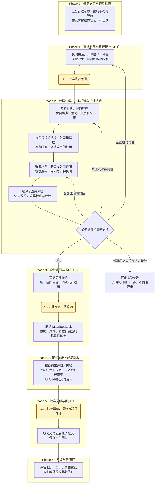
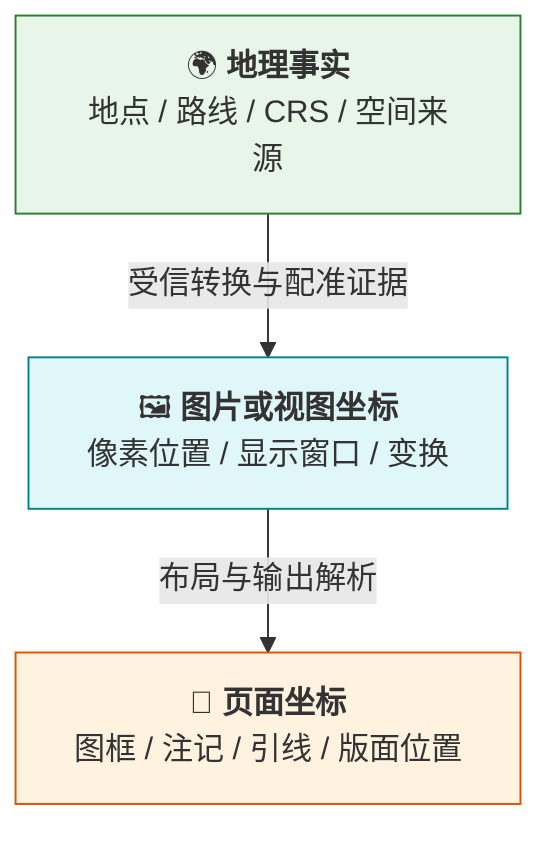

# 领导调研用图制图流程说明

> 共用制图主流程，保留出行业务核验，不把静态地图冒充导航

更新日期：2026-11-12（Asia/Shanghai）

状态：**目标流程设计与当前实现对照。目标流程不等于已实现能力，不作为运行时机器协议。**

**与其他说明的关系**：[总体流程](制图智能体总体流程.md)统一阶段名称、术语、审批、修订和实施计划；本文重点说明行程、地点、入口、路线和时效。后续共同规则变更应先同步总体文档，再检查三份任务说明；当前执行始终以 Skill、协议和能力策略为准。

## 关于这份文档

本文说明如何为行程说明和获准的出行参考制作地图，复用统一的任务、权限、数据处理、设计迭代、冻结、验收和交付机制，同时保留行程、地点、入口、路线、时间与敏感披露的专用规则。

参考来源为另一工作区 `carto-master-merge/doc/领导调研用图制图流程说明.md`。该文档描述的 `leadership-visit` 1.0.0 / 1.1.0 / 1.2.0 为 draft 工程预览，并排除导航与正式交付。本文吸收其事实建模和证据方法，**不复制旧请求格式、目录规则、CLI 参数、模板或准入状态**，也不宣称那些能力已合入当前项目。

本文不是运行协议，不新增顶层路由、第二套锁或审批编号。当前实现以 `skills/carto-agent/` 为准，未知能力继续拒绝。业务域在本文指用户任务族，不新增 `business_domain` 协议层级。

---

## 一、场景定位与产品边界

领导调研属于出行与行程业务任务；海报属于内容组织和制品形式。一次调研可以输出总览图、分段图、入口详图、路线卡或汇报海报，因此不能把三者做成互斥、彼此复制底座的系统。

### 1.1 先明确做哪类产品

| 产品 | 主要用途 | 最低责任边界 |
|---|---|---|
| 行程示意图 | 说明地点、活动、顺序和大致关系 | 允许已批准的示意表达；不能暗示连线就是可行驶道路 |
| 出行路线参考图 | 提供已核验地点、入口、采用路线及相关条件 | 需要地点身份、道路与入口连接、路线模式、时间条件和用途适用性验收 |
| 实时导航 | 持续定位、偏航处理、路线更新与导航提示 | 独立会话与服务能力；不以静态图件生产链代替 |

前两类进入制图主流程；实时导航仅可通过单独准入、授权的接口接入。不能因为地图出现路网折线、箭头或预计车程，就把成果标为导航产品。

### 1.2 保留的专用设计

- 地点、停留、活动和路段分开建模，事实逐项保留来源。
- 同地连续停留与实际移动区分，不能虚构零距离行车段。
- 全程顺序、稳定 ID 和图面编号分离。
- 原文预计、工具估算、人工采用决定分离，不能拼接来源或把估算当实测。
- 原始工具结果与制图派生文件分离；地理坐标、图片像素和页面位置分离。
- 地理编码成功不等于地点正确，坐标转换成功不等于独立精度验收。

---

## 二、目标主流程

Phase 编号与标准专题图、海报说明一致，表示职责而非新增 CLI。

**读图说明**：这是目标流程，不是当前 CLI 状态图。每次处理或修订前都要检查权限和剩余预算；有些核验应边处理边做，不能等全部工具运行结束才发现关键事实错误。数据问题回到数据处理，设计问题回到设计；超范围先修改简报并重新授权，预算用尽则停止。审图通过后才申请 G2，G3 通过后才实际交付。

模板复用和模板研发独立于主流程。已有模板不必每次重建；需要可复用新规则时另走 T1/TP。当前没有兼容能力时应明确停止，不用模板参数规避准入。

---

## 三、各阶段职责、输入与交接

### Phase 0：任务界定与初步检查

输入可以是文档、表格、图片、扫描件、用户说明、已有点线数据或底图。文档解析、必要 OCR、表格与嵌入素材提取属于统一数据处理，不是出行场景独有的第二条解析管线。

初步确认：

1. 使用者、使用方式、受众及披露范围，尤其区分汇报展示与实际出行参考。
2. 原文行程、地点、活动、顺序和时间是否充分，哪些只是估计或尚未确认。
3. 是否允许求路，是否要求保持既定停靠顺序，采用什么交通方式和约束。
4. 数据与服务是否可用，是否允许将查询内容发送给指定第三方。
5. 底图、坐标和配准证据是否充分，是否需要独立精度核验。

**交接**：任务理解、来源引用、提取候选、初步行程、待解决问题和权限草案。原文片段留在受控项目证据中；普通日志仅记录状态和引用，不输出完整行程、地址和坐标。

G1 前只做已有授权内的必要初读和探索。不能因为附件已交给 Agent，就默认允许上传到 OCR、地理编码或路径服务。

### Phase 1：确认范围与执行授权（G1）

**共用边界**：G1 批准执行范围，不保证尚未核验的事实正确。G1 前只能在已有授权内做必要初读和检查；正式处理及外部调用必须具有覆盖该动作的有效授权。技术检查可以由程序完成，涉及含义、取舍或歧义的决定由有权人员确认；不要求每个数据项都重新人工签字。

G1 批准用途、来源、服务、可外传字段、允许操作、预算、质量要求和输出目标。哪些地点、时间或路线仍待核验应显式列出，不能用猜测补齐简报。

**与原调研流程的对齐**：原文把 G1 放在求路之后，同时另设外部访问授权。目标将执行范围确认前移，但保留后续“完整行程与路线采用确认”。不能因移动 G1 而丢掉业务责任，也不能将尚未完成的事实核验说成 G1 已保证其正确。

外部访问授权、业务采用确认、设计审图和 G2/G3 各有对象。可以按统一证据模型协调，不默认增加每一步签字，也不通过合并界面省略实际责任。

### Phase 2：数据处理、业务核验与设计迭代

数据处理完成结构化、地理与时间核验，制图设计消费已验收或明确标识状态的事实。两者可以迭代，但设计不得自行改变行程。

**业务交接**：已采用行程、地点/入口、路线、来源与时效条件、警告及处理决定。

**制图交接**：地图清单、图面内容、表达和布局提案，以及候选、预览与评议记录。

来源不足、定位歧义或行程冲突应返回有权确认者；程序计算不能代替业务选择。需要改变出发时间、停靠顺序或任务范围时，不由 MapComposer 自行处理。

### Phase 3：设计审图与冻结（G2）

G2 前同时核对：

- 地点及入口是否对应已采用对象；路线段和停靠关系是否正确。
- 地图内容与采用行程一致，未把显示编号写回行程顺序。
- 路线模式、预计值来源、时间条件、缺口与限制可见且不误导。
- 图例、编号、方向、引线、注记和分段图关联清楚；显示偏移不冒充真实路线。
- 受众可以看到的信息符合批准范围，图面未泄露不允许披露的内容。
- 候选与所有依赖齐全且版本固定，专业意见所指对象与冻结对象完全一致。

冻结采用统一 `MapSpecLock`；不再求路、不再地理编码、不再修改行程或布局。专业业务确认和审图记录的强制绑定需要后续协议建设，不能用任意可填写的“已确认”布尔值替代。

### Phase 4：正式输出与成品验收

**目标顺序**：按锁输出 → 自动终检 → 完成简报要求的成品审查（以及适用的时效复核、印刷打样）→ 形成包含所需审查依据的不可变交付清单 → 在 Phase 5 申请 G3。不是所有任务都需要打样或额外专家会签，是否需要应在简报中明确；必需审查不能在事后省略。

出行参考还需按声明条件复核行程版本、路线获取时间和使用条件。必要外部查询仍须授权；发现已采用行程或道路条件变化，保留旧锁并发起新修订，不能在终检中静默重新求路。

**当前实现**：`check` 自动检查通过后即冻结 `DeliveryManifest`，人工可以在其后、G3 前审阅对应的实际成品。把审查记录强制纳入清单，是后续协议和状态机改造；不能给已冻结清单补字段后沿用旧摘要或旧 G3。

### Phase 5：批准交付与回执（G3）

G3 批准精确文件、接收方、目的地、许可与限制。区分内部核对、出行参考、汇报展示和对外版本；每种版本的可见内容、文件身份和交付对象都应明确。

不携带原始行程文件，不等于成品没有泄露行程。检查范围同时覆盖图面、文字、元数据和附件。当前禁止披露的内容不能以“内部使用”自动豁免，扩展必须先经政策与授权确认。

### Phase 6：反馈与新修订

发生行程、地点、入口、路线条件、输出用途或受众变化时，记录新版本、影响范围、替代关系与所需批准。保留原版追溯信息，对已有成果说明是否已被替代；不能保证通过删除本地文件就撤回所有已分发副本。

导航中的实时定位、偏航重算或动态调度由独立会话负责，不让每次位置更新都触发一次静态图件 G2/G3 流程。

---

## 四、行程语义与事实采用

### 4.1 领域对象不能压成“点 + 序号”

| 对象 | 责任 | 关键约束 |
|---|---|---|
| 地点 | 稳定的机构、场所或目标身份 | 名称、查询词和地点 ID 分开；同名不自动同地 |
| 入口 / 到达对象 | 本次应抵达的门、接待点或合法网络连接 | 不默认使用机构中心点代替入口 |
| 停留 | 一次到访或停留片段 | 同一地点可重复到访，不能按名称去重丢失时序 |
| 活动 | 调研、会议、休息、中转等事实 | 保留原文关系；位于终点不意味着可隐藏重要活动 |
| 路段 | 相邻停留之间的移动或连续停留关系 | 区分 stay 与 travel，禁止虚构移动段 |
| 来源 | 文档、用户确认、工具结果等依据 | 原文件、提取位置、处理和确认版本可追溯 |

上述是领域职责，不表示本次新建了 Schema。应在现有事实、准备报告和数据包体系内评审适当承载方式。

### 4.2 提取、纠正、估算、采用分别留痕

- 原文没有的地址、年份、活动时间或车程，不由模型依据常识补写。
- 相对日期需要结合材料上下文、时区和明确确认解释；时间相关求路缺少必要日期时，应阻断该计算或明确使用不含该条件的获准模式。
- OCR、表格解析或实体抽取的纠正生成新证据，不覆盖原材料。
- 原文预计值和工具估算保留各自来源与计算条件；使用哪一组是明确采用决定，不拆拼成一组看似一致的指标。
- 业务采用确认须指向本次精确行程、地点与路线证据；工具成功、用户沉默或初始“做完给我”不构成确认。
- 采用确认不是实时通行保证；尚未核验的关键条件应保持未决，不能因通过格式校验就进入正式出行参考。

### 4.3 既定行程求路与行程优化分开

默认保持已确认停靠顺序，逐段求路。若用户明确要求优化，应另行确定可重排范围、时间窗口、停留时长、交通方式、目标函数和批准责任。

程序可以产生优化候选，模型可以解释取舍，但不能自动将其覆盖为原行程。路线最短、耗时最少、换路最少等是不同的目标，不能混用“最佳路线”替代明确选择。

---

## 五、地点、道路与时间的适用性验收

### 5.1 地理编码成功不等于到达对象正确

应核对查询结果的对象身份、分支、地址、实际入口、坐标与网络连接。机构代表位置、建筑位置、入口和道路连接点分别承担不同责任。

检索半径是查找候选的参数，不应直接成为到达验收阈值。不能仅凭路线端点落在某个距离范围内，就证明“到达了正确的门”；必要时核对断连缺口、抵达侧、方向和通行限制。阈值和证据要求应随用途与能力声明确定，不在文档中虚设一个通用安全距离。

原文名称和稳定 ID 不因检索关键词变化而改写。歧义不能通过挑选第一条结果关闭；缺证据时返回确认或停止相应产品。

### 5.2 路线服务失败时，不能改变任务含义

| 情况 | 处理原则 |
|---|---|
| 等价服务替换，约束和质量要求仍满足 | 在批准的服务策略内执行并保留来源与验证 |
| 不同引擎采用不同路网、偏好或时间条件 | 显式核对适用性，不能仅拼接结果后宣称一致 |
| 离线/在线服务都不能给出可靠道路路线 | 要求道路参考时停止，不自动降为示意并宣称完成 |
| 任务原本允许示意模式 | 可采用被明确批准的示意表达，并逐段清楚标识 |
| 用户提供几何 | 核验来源和采用范围；用户提供不自动证明道路合法可达 |

从实际道路路线变成两点之间的直线示意，是业务含义变化，不只是画质下降。不同模式混合时，每段模式、指标来源与限制要可见，不能只在角落加一句总免责声明。

### 5.3 时间冲突只诊断，不擅自改行程

核对出发、到达、活动时长、等待时间、时间窗口和求路估算条件。若预计移动时间与计划间隔冲突，返回证据与问题，由业务责任人决定修改安排、采用其他路线或改变产品范围。

不得把缺失值填零，不得静默提前出发或压缩活动时长。跨日、跨时区、多交通方式等必须有明确协议与能力，不因数据结构可以填入就视为已支持。

### 5.4 四种时间分别管理

| 时间 | 含义 |
|---|---|
| 审批票据有效期 | 何时可以合法消费该授权 |
| 数据与工具结果获取时间 | 证据描述的获取时点及相关条件 |
| 计划出发或活动时间 | 行程意图与时间相关计算依据 |
| 成果适用条件 / 复核策略 | 何时需要检查变化、生成替代版本或停止继续使用 |

数据时效策略应有来源和业务依据；不以票据有效期推定道路事实有效期，也不凭模型设定固定通用 TTL。供应商未提供数据版本时如实记录可得信息和限制，不编造版本证明。

---

## 六、制图设计与精度边界

### 6.1 保留受控设计空间

可按任务选择总览图、分段图、入口详图、行程表或图文复合海报。显示哪些信息由用途和披露约束决定，不把一种模板的默认行为推广为所有调研任务的规则。

- 全程顺序与显示编号分别记录；分时段重新编号须能清楚区分不同组。
- 出发、中转、终点等角色不应遮蔽用户必须看到的活动内容。
- 图例、路线颜色、箭头、信息框和时间说明应一致；不适用专题分类图例检查时，采用出行场景自己的语义检查，不是全面跳过图例验收。
- 注记移位不改变真实地点；路线显示偏移不用于距离计算、求路或导航交换。
- 地图放不下时返回设计或任务范围决策，不擅自删点、合并不同入口或隐藏必需段。

### 6.2 三类坐标与证据分离

原始工具证据、派生点线文件和显示几何分别保存，不能反向把派生文件当原始证明。转换成功不表示配准或独立地理精度已验收；像素坐标不能伪装为经纬度。

“保持原图不变”保护来源证据，但不应成为所有产品绝不允许缩放的原则。输出变换如被能力和合同允许，应绑定过程并检验地理关系、清晰度与用途适用性；不为凑纸张而修改源坐标或配准参数。

叠置、自动避让和布局优化仍受当前 [设计原则](design-principles.md) 约束。引用其他工作区的求解器不代表当前已允许程序自主选择设计，须先明确目标、规则、职责及验证范围。

---

## 七、敏感信息、审图与修订

### 7.1 隐私和权限贯穿输入到图面

- 对材料、地点查询、路线查询、模型上下文、工具日志、图片、元数据、成果和存档统一分类管理。
- 对第三方服务明确可以发送的字段、对象、用途和范围；将查询拆成多个请求不自动构成安全保证。
- 普通日志只记录状态和引用，不写完整行程、地址、坐标、活动安排或密钥。
- 不因最终包没有原始 DOCX，就认为路线图不会泄露敏感安排；输出中的位置、顺序、时间、标签和缩略图同样需检查。
- 不同受众版本独立绑定成果、接收方和披露规则。当前禁止披露的内容继续拒绝，不自动开放。

### 7.2 审图分工

| 检查层 | 关注点 |
|---|---|
| 材料与业务 | 提取是否忠实、停靠/活动关系、采用决定、顺序和时间 |
| 地理与路线 | 身份与入口、坐标/配准、连续性、道路模式、来源和适用条件 |
| 图面与内容 | 编号、图例、方向、缺失说明、可读性、跨图和图表一致性 |
| 成品与交付 | 实际文件、时效、用途、敏感披露、接收对象和完整性 |

数据采用、设计审图和审批是不同责任；不要求每个小动作都有新 gate，但关键决定必须能回到相应身份和精确对象。

### 7.3 修订影响

| 变化 | 返回层与处理 |
|---|---|
| 调整普通标注位置 | 新设计修订版和新预览；未变且授权有效的数据证据可继续引用；是否重走 G1 仍按实际批准对象判断 |
| 地点、入口、顺序、活动或时间改变 | 回业务处理，重建受影响地理/路线/时间证据并重新采用；批准范围变化须重新 G1 |
| 更换路线服务或计算条件 | 核验等价性与授权，重验结果；不直接沿用旧路线确认 |
| 工具数据过时或条件变化 | 按复核策略生成新证据和候选，旧锁不变 |
| 冻结后修改任何执行内容 | 新候选、新 G2、新锁、正式输出、终检和 G3 |
| 同锁可恢复执行故障 | 有界新 attempt 与恢复证据，不重放审批或重做设计 |
| 接收方、目的地或披露范围变化 | 更新相应批准对象；必要时新内容版本和上游审批，重新 G3 |

当前不支持的转移不能通过编辑状态文件实现；保留 `JOB_INPUT_DRIFT`、单写锁、revision/CAS、不可变回执及恢复校验。需要新运行时按现有协议重新准备与审批，不复制旧票据。

---

## 八、接入当前项目的原则与顺序

### 8.1 当前不是已完成的三场景系统

当前项目执行能力仍仅准入 `general_thematic_mapping` 的受限分类栅格链；意图目录含某个场景名称，不等于其执行能力已准入。另一工作区的旧 `scene_hint`、审批命令和模板路径不应作为兼容旁路搬入。

目标接入唯一根目录 `skills/carto-agent/`，复用 `generate-map` 与模板生命周期；不新建 `generate-leadership-map`、第二套审批或领导调研专用锁类型。不同运行各有自己的锁，不共用审批。

### 8.2 接入顺序

实施阶段统一采用[总体流程](制图智能体总体流程.md)第十三节的 A0–A5。这里列出本任务的重点，不另设一套阶段编号；这些阶段不等于 Phase 0–6，也不等于审批门禁。

| 阶段 | 领导调研用图的重点 |
|---|---|
| A0 | 分清行程示意、出行参考与导航边界，核对其他工作区的参考能力 |
| A1 | 共用设计修订、数据采用记录、审图与合法恢复路径 |
| A2 | 复用材料解析和来源定位，建立保留原文的行程提取结果 |
| A3 | 接入地点、入口、固定顺序求路、时间与敏感披露检查 |
| A4 | 按任务扩展总览、分段、入口详图及复合海报，不改变业务事实 |
| A5 | 分别验收示意和出行参考的真实任务；导航仍在独立会话边界之外 |

新增协议须同步合法/非法样例和自动测试，未知字段默认拒绝。不能通过修改生产标志、取消限制声明或复制旧接口完成升级。

### 8.3 建议必须覆盖的反例

同名异址、入口不符、同地多活动被合并后丢失信息、停靠被重排、单元/显示编号混淆、原文与工具估算拼接、道路求路失败被直线冒充、过时结果继续交付、配准漂移、旧审查批准新候选、图面泄露敏感安排、旧票据重放。

---

## 九、相关文档与完成标准

| 文档 | 关系 |
|---|---|
| [制图智能体总体流程](制图智能体总体流程.md) | 统一阶段、术语、审批、修订和 A0–A5 实施顺序 |
| [标准专题图制图流程说明](标准专题图制图流程说明.md) | 共用主流程、现有执行链与调整方向 |
| [海报地图流程说明](海报地图流程说明.md) | 可组合的内容组织与表现形式；共享文档/图片解析与素材处理 |
| [设计原则](design-principles.md) | 事实、创意选择、形式验证和机械推导的职责依据 |
| [总体架构](carto-agent-architecture.md) / [地图生成 TRD](carto-generate-map-TRD.md) | 通用组件、证据、候选与锁机制 |
| [审批门禁手册](carto-gate-approval-manual.md) | 当前审批操作依据；不照抄其他工作区命令 |
| [Carto Agent Skill](../skills/carto-agent/SKILL.md) / [路由](../skills/carto-agent/workflows/routing.md) | 当前真实准入与唯一运行入口 |

完成不只是“图件导出了”，而是：材料与事实已核验、路线满足声明用途、设计与披露范围正确、时效条件已检查、必要批准有效、精确成果已交付且可追溯。未准入的出行参考和导航能力继续明确拒绝。
